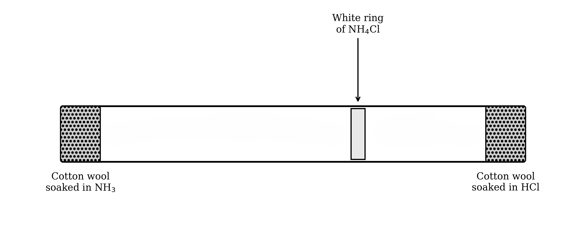

# Solids, Liquids & Gases

Course: cie-igcse-science-co-ordinated-sciences-double-award-23-chemistry · Section: 1. States of Matter

Source: https://www.savemyexams.com/igcse/science/cie/co-ordinated-sciences-double-award/23/chemistry/flashcards/states-of-matter/solids-liquids-and-gases/

## Card 1 — true_or_false (`fl_zNhgCTDcvC4tN6qq`)

**FRONT**

**True or False?**

In a solid, particles vibrate about fixed positions.

**BACK**

**True.**

Particles in a solid are held in a regular, close-packed arrangement and can only vibrate about fixed positions rather than moving freely.

Spec links: `spcpt_WHgJskhP8PJbgDbt`

## Card 2 — fill_in_the_blanks (`fl_PcVNhgdkKnQpJy7w`)

**FRONT**

In a solid, particles are in a **..........**  arrangement and are held **..........**  together, giving solids a fixed shape and volume.

**BACK**

In a solid, particles are in a **regular** arrangement and are held **close** together, giving solids a fixed shape and volume.

*Blanks: 2 — answers: ['regular', 'close']*

Spec links: `spcpt_WHgJskhP8PJbgDbt`

## Card 3 — question_and_answer (`fl_Pxq9JGFswbDpp4G8`)

**FRONT**

Why can gases be compressed but solids cannot?

**(Extended Tier Only)**

**BACK**

In gases, particles are far apart with large empty spaces between them, so they can be pushed closer together.

In solids, particles are already close together with no room to compress further.

Spec links: `spcpt_WHgJskhP8PJbgDbt`

## Card 4 — keyword_definition (`fl_qFjgnFRYCNjtNhNz`)

**FRONT**

What does kinetic theory state?

**BACK**

Kinetic theory states that all matter is made of particles in constant motion, and that the properties of each state of matter depend on the arrangement and movement of those particles.

Spec links: `spcpt_WHgJskhP8PJbgDbt`

## Card 5 — true_or_false (`fl_75Tgfqt2nVGDq8f8`)

**FRONT**

**True or False?**

Both solids and liquids have particles that are close together.

**BACK**

**True.**

In both solids and liquids, particles are close together. In gases, particles are far apart with large amounts of space between them.

Spec links: `spcpt_WHgJskhP8PJbgDbt`

## Card 6 — question_and_answer (`fl_BZNJKwXVz2v4Vmwg`)

**FRONT**

What is the arrangement and motion of particles in a gas?

**BACK**

Gas particles are in a random arrangement, far apart, and move rapidly in all directions. They exert pressure on their container by colliding with the walls.

Spec links: `spcpt_WHgJskhP8PJbgDbt`

## Card 7 — fill_in_the_blanks (`fl_b7dQfzVvt9msjGNf`)

**FRONT**

In a liquid, particles are **..........**  arranged and can **..........**  past one another, so liquids flow but have a fixed volume.

**BACK**

In a liquid, particles are **randomly** arranged and can **slide** past one another, so liquids flow but have a fixed volume.

*Blanks: 2 — answers: ['randomly', 'slide']*

Spec links: `spcpt_WHgJskhP8PJbgDbt`

## Card 8 — question_and_answer (`fl_VzgT6ZcbTNxkgDgZ`)

**FRONT**

Why do gases exert pressure on the walls of their container?

**(Extended Tier Only)**

**BACK**

Gas particles move rapidly and in all directions, colliding with the container walls. Each collision exerts a small force, and the combined effect of many collisions per second is experienced as pressure.

Spec links: `spcpt_WHgJskhP8PJbgDbt`

## Card 9 — true_or_false (`fl_x53nYM53RPg8zrcn`)

**FRONT**

**True or False?**

Gas particles move faster on average than solid particles.

**BACK**

**True.**

Gas particles have greater kinetic energy than solid or liquid particles, so they move much faster on average.

Spec links: `spcpt_WHgJskhP8PJbgDbt`

## Card 10 — fill_in_the_blanks (`fl_VWNrhh2XQq8wsX5Y`)

**FRONT**

Gas particles are in a **..........**  arrangement, moving **..........**  in all directions with **..........**  spaces between them.

**BACK**

Gas particles are in a **random** arrangement, moving **rapidly** in all directions with **large** spaces between them.

*Blanks: 3 — answers: ['random', 'rapidly', 'large']*

Spec links: `spcpt_WHgJskhP8PJbgDbt`

## Card 11 — keyword_definition (`fl_JdfXT4QFcMYZSGCd`)

**FRONT**

Define the term **pressure** as it applies to a gas in a container.

**(Extended Tier Only)**

**BACK**

Pressure is the force exerted per unit area on the walls of a container, caused by gas particles colliding with those walls.

Spec links: `spcpt_WHgJskhP8PJbgDbt`

## Card 12 — question_and_answer (`fl_mzZXmw5cgpPZqkgK`)

**FRONT**

How does the particle model explain why solids have a higher density than gases?

**(Extended Tier Only)**

**BACK**

Solid particles are packed close together in a regular arrangement with little empty space, so a given volume contains many particles. Gas particles are far apart, so the same volume contains far fewer particles, giving gases a much lower density.

Spec links: `spcpt_WHgJskhP8PJbgDbt`

## Card 13 — true_or_false (`fl_b6zFx4CD9wj7vKgf`)

**FRONT**

**True or False?**

Boiling and evaporation both only occur at the boiling point of a liquid.

**BACK**

**False.**

Boiling occurs at a fixed boiling point and produces bubbles throughout the liquid.

Evaporation can occur at any temperature below the boiling point and takes place only at the surface.

Spec links: `spcpt_GqbwFhsFbbKWPR4C` `spcpt_92kPkXwDqDR9JPB7`

## Card 14 — fill_in_the_blanks (`fl_XwF2hjG3P25BZMtM`)

**FRONT**

During evaporation, only the most **..........**  particles at the surface of a liquid have enough energy to **..........**  the liquid.

**BACK**

During evaporation, only the most **energetic** particles at the surface of a liquid have enough energy to **escape** the liquid.

*Blanks: 2 — answers: ['energetic', 'escape']*

Spec links: `spcpt_GqbwFhsFbbKWPR4C` `spcpt_92kPkXwDqDR9JPB7`

## Card 15 — question_and_answer (`fl_2Kh9B6bVR5KBxRkQ`)

**FRONT**

Why does evaporation cause the temperature of a liquid to fall?

**BACK**

During evaporation, the most energetic particles escape from the surface of the liquid. This reduces the **average kinetic energy** of the remaining particles, so the temperature of the liquid falls.

Spec links: `spcpt_GqbwFhsFbbKWPR4C` `spcpt_92kPkXwDqDR9JPB7`

## Card 16 — true_or_false (`fl_P3279KQ5QD3b6T3R`)

**FRONT**

**True or False?**

Melting and freezing occur at the same temperature for a given substance.

**BACK**

**True.**

Melting and freezing are reverse processes and occur at the same temperature, known as the melting point.

Spec links: `spcpt_GqbwFhsFbbKWPR4C` `spcpt_92kPkXwDqDR9JPB7`

## Card 17 — keyword_definition (`fl_3DSWb59jqRzFSXzB`)

**FRONT**

What is the difference between boiling and evaporation?

**BACK**

Boiling occurs at a fixed **boiling point** throughout the bulk of the liquid, forming bubbles.

Evaporation occurs at any temperature at the **surface** of the liquid only, as the most energetic particles escape.

Spec links: `spcpt_GqbwFhsFbbKWPR4C` `spcpt_92kPkXwDqDR9JPB7`

## Card 18 — fill_in_the_blanks (`fl_vpqcMpCzVTSmScFX`)

**FRONT**

On a heating curve, the temperature remains **..........**  during a state change because energy is used to **..........**  the forces between particles rather than increase temperature.

**BACK**

On a heating curve, the temperature remains **constant** during a state change because energy is used to **overcome** the forces between particles rather than increase temperature.

*Blanks: 2 — answers: ['constant', 'overcome']*

Spec links: `spcpt_GqbwFhsFbbKWPR4C` `spcpt_92kPkXwDqDR9JPB7`

## Card 19 — question_and_answer (`fl_55xg6RdTyvXvjQsT`)

**FRONT**

Why does the temperature not rise during melting, even though energy is being supplied?

**BACK**

During melting, all the energy supplied is used to **break the forces** holding particles in fixed positions. No energy goes into increasing the kinetic energy of particles, so the temperature remains **constant** until all the solid has melted.

Spec links: `spcpt_GqbwFhsFbbKWPR4C` `spcpt_92kPkXwDqDR9JPB7`

## Card 20 — keyword_definition (`fl_qSv2SgXpTD6N5NtV`)

**FRONT**

What happens to the volume of a gas when its temperature increases at constant pressure?

**BACK**

The volume of a gas **increases** when its temperature increases at constant pressure. The particles gain **kinetic energy**, move faster, and spread further apart, occupying a greater volume.

Spec links: `spcpt_vtQ4pz5y7XcWdd4h` `spcpt_hxYSxyTtV3ZcxWwj`

## Card 21 — true_or_false (`fl_DvSWjDSKxmmCddxW`)

**FRONT**

**True or False?**

When a gas is compressed at constant temperature, the pressure increases because the particles move faster.

**BACK**

**False.**

At constant temperature, particle speed stays the same. Pressure increases because the same particles collide with the container walls more frequently in the smaller volume.

Spec links: `spcpt_vtQ4pz5y7XcWdd4h` `spcpt_hxYSxyTtV3ZcxWwj`

## Card 22 — question_and_answer (`fl_s5whK2Rzd9NBfqTh`)

**FRONT**

Why does the pressure of a gas increase when its temperature rises at constant volume?

**BACK**

When temperature rises, particles move faster and have greater kinetic energy. They collide with the container walls **more frequently** and with **greater force**, so the pressure increases.

Spec links: `spcpt_vtQ4pz5y7XcWdd4h` `spcpt_hxYSxyTtV3ZcxWwj`

## Card 23 — fill_in_the_blanks (`fl_RjByJbKpp25QNRZv`)

**FRONT**

When the volume of a gas decreases at constant temperature, particles collide with the walls more **..........**,  causing the pressure to **..........** .

**BACK**

When the volume of a gas decreases at constant temperature, particles collide with the walls more **frequently**, causing the pressure to **increase**.

*Blanks: 2 — answers: ['frequently', 'increase']*

Spec links: `spcpt_vtQ4pz5y7XcWdd4h` `spcpt_hxYSxyTtV3ZcxWwj`

## Card 24 — true_or_false (`fl_ztCfgMrzvNsrmQRN`)

**FRONT**

**True or False?**

Gas particles spread out (move further apart) when a gas is heated at constant pressure.

**BACK**

**True.**

When a gas is heated at constant pressure, particles gain kinetic energy and move faster, spreading further apart from each other. The volume of the gas increases as a result.

Spec links: `spcpt_vtQ4pz5y7XcWdd4h` `spcpt_hxYSxyTtV3ZcxWwj`

## Card 25 — question_and_answer (`fl_39cm946WgFSKXXnr`)

**FRONT**

Why is it incorrect to say that gas particles expand when a gas is heated?

**BACK**

Gas particles **do not change in size** when heated. They gain kinetic energy and move faster, spreading further apart from each other. It is the gas as a whole that occupies a greater volume, not the individual particles.

Spec links: `spcpt_vtQ4pz5y7XcWdd4h` `spcpt_hxYSxyTtV3ZcxWwj`

## Card 26 — keyword_definition (`fl_DnvgM82Q5ZdtTFxp`)

**FRONT**

What is diffusion?

**BACK**

Diffusion is the net movement of particles from a region of **higher concentration** to a region of **lower concentration**. It occurs due to the random motion of particles and requires no energy input.

Spec links: `spcpt_S7cqwb4cyGpmZ8R2` `spcpt_KwXxwQyHDPRx2xd6`

## Card 27 — true_or_false (`fl_BbbQ5PkhhYDVvV2t`)

**FRONT**

**True or False?**

Diffusion occurs because particles are pushed from high to low concentration.

**BACK**

**False.**

Diffusion is not driven by a pushing force. It occurs because particles are in constant random motion, and over time this motion results in a net movement from higher to lower concentration.

Spec links: `spcpt_S7cqwb4cyGpmZ8R2` `spcpt_KwXxwQyHDPRx2xd6`

## Card 28 — fill_in_the_blanks (`fl_dF9MkcvJ27g9nX4D`)

**FRONT**

A gas with a lower **..........**  diffuses more **..........**  because its particles are lighter and move at greater average speeds.

**BACK**

A gas with a lower ***M*****r** diffuses more **quickly** because its particles are lighter and move at greater average speeds.

*Blanks: 2 — answers: ['*M*r', 'quickly']*

Spec links: `spcpt_S7cqwb4cyGpmZ8R2` `spcpt_KwXxwQyHDPRx2xd6`

## Card 29 — question_and_answer (`fl_xzhWqRPSP4QvKCX8`)

**FRONT**

In the ammonia and hydrogen chloride experiment, why does the white ring of ammonium chloride form closer to the hydrogen chloride end?

**BACK**

NH3 has a **lower *****M*****r** (17) than HCl (36.5), so NH3 particles move faster and diffuse further along the tube. The two gases meet closer to the HCl end, where the white ring of ammonium chloride forms.

Spec links: `spcpt_S7cqwb4cyGpmZ8R2` `spcpt_KwXxwQyHDPRx2xd6`

## Card 30 — true_or_false (`fl_sXQrNYMjkvnFswhP`)

**FRONT**

**True or False?**

Diffusion occurs more quickly at higher temperatures.

**BACK**

**True.**

At higher temperatures, particles have more kinetic energy and move faster, travelling further in a given time and diffusing more quickly.

Spec links: `spcpt_S7cqwb4cyGpmZ8R2` `spcpt_KwXxwQyHDPRx2xd6`

## Card 31 — question_and_answer (`fl_xTBvtvcYZ4YxRJY5`)

**FRONT**

Why does diffusion occur without any energy input?

**BACK**

Diffusion occurs because particles are already in **constant random motion** due to their kinetic energy. No additional energy is needed — random particle movement naturally produces a net flow from regions of higher to lower concentration.

Spec links: `spcpt_S7cqwb4cyGpmZ8R2` `spcpt_KwXxwQyHDPRx2xd6`

## Card 32 — fill_in_the_blanks (`fl_YyMmPj5MZvXCRsWj`)

**FRONT**

In the ammonia and hydrogen chloride experiment, the white ring forms **..........**  to the HCl end because NH3 has a **..........**  *M*r and diffuses **..........** .

**BACK**

In the ammonia and hydrogen chloride experiment, the white ring forms **closer** to the HCl end because NH3 has a **lower** *M*r and diffuses **faster**.

*Blanks: 3 — answers: []*

Spec links: `spcpt_S7cqwb4cyGpmZ8R2` `spcpt_KwXxwQyHDPRx2xd6`

Flags: blank_answer_mismatch

