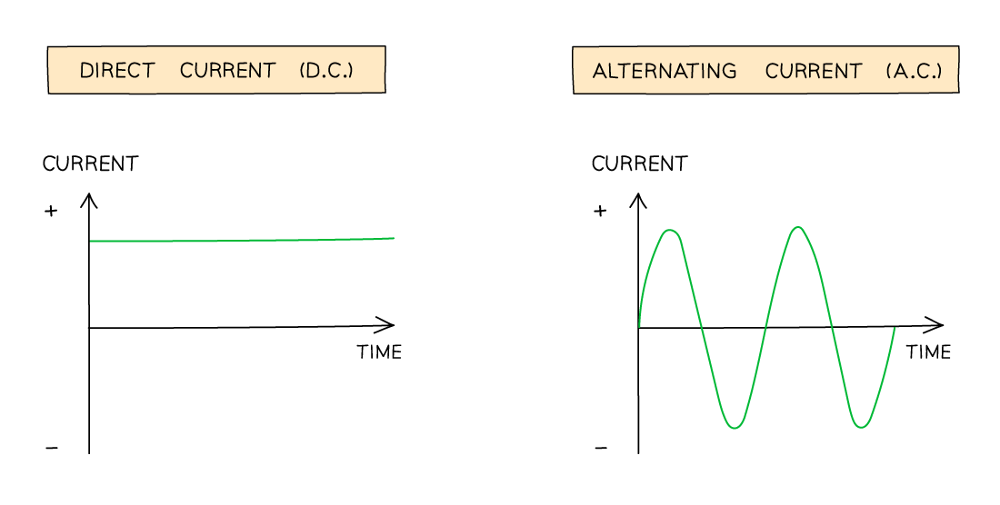

# Electrical Quantities

Course: cie-igcse-science-co-ordinated-sciences-double-award-23-physics · Section: 4. Electricity & Magnetism

Source: https://www.savemyexams.com/igcse/science/cie/co-ordinated-sciences-double-award/23/physics/flashcards/electricity-and-magnetism/electrical-quantities/

## Card 1 — question_and_answer (`fl_Sn9bpHcsC7dC9K7C`)

**FRONT**

How many **types** of electric charge are there?

**BACK**

There are **two** types of electric charge: **positive** and **negative**.

Spec links: `spcpt_p3Zjz7dmyvYv2qD7`

## Card 2 — question_and_answer (`fl_7wRRr8VsRWbXdDgH`)

**FRONT**

What are the **charges** of the particles inside an atom?

**BACK**

- **Electrons** are negatively charged
- **Protons** are positively charged
- **Neutrons** are neutral (no charge)

Spec links: `spcpt_p3Zjz7dmyvYv2qD7`

## Card 3 — question_and_answer (`fl_m9H78mcTMZcfhF8v`)

**FRONT**

Why is the overall charge of an atom **zero**?

**BACK**

An atom contains **equal numbers** of **protons** and **electrons**, so their equal and opposite charges **cancel out**.

Spec links: `spcpt_p3Zjz7dmyvYv2qD7`

## Card 4 — true_or_false (`fl_qnFSGtCwRkg8bbRp`)

**FRONT**

**True or False?**

Opposite charges attract.

**BACK**

**True.**

Opposite charges **attract** each other.

Spec links: `spcpt_p3Zjz7dmyvYv2qD7`

## Card 5 — question_and_answer (`fl_Vsx5dzSNrnDJsSSz`)

**FRONT**

What happens when two **like charges** are brought close together?

**BACK**

When two like charges are brought close together, they **repel** each other.

Spec links: `spcpt_p3Zjz7dmyvYv2qD7`

## Card 6 — question_and_answer (`fl_rSd2hqSYT8jBJmPf`)

**FRONT**

What **units** is electric charge measured in? **(Extended Tier Only)**

**BACK**

Electric charge is measured in **coulombs (C)**.

Spec links: `spcpt_p3Zjz7dmyvYv2qD7`

## Card 7 — question_and_answer (`fl_bnrnTHChcgRXPCD9`)

**FRONT**

What is the purpose of rubbing **insulating solids** with a cloth in electrostatic experiments?

**BACK**

Rubbing transfers **electrons** between the cloth and the insulator, leaving them with **opposite** net charges.

Spec links: `spcpt_KWMbShGTNdKCnY6T`

## Card 8 — question_and_answer (`fl_QS8g6WCymBvckp2D`)

**FRONT**

When charging by friction, why does one insulator become **positively charged**?

**BACK**

Only **electrons** can move. The insulator that **loses electrons** is left with a net **positive charge**, while the insulator that **gains electrons** becomes **negatively charged**.

Spec links: `spcpt_KWMbShGTNdKCnY6T`

## Card 9 — question_and_answer (`fl_Nv8KCd2MmRq8swJd`)

**FRONT**

Why does charge **remain** on an insulator after it has been charged by friction?

**BACK**

The charges **cannot immediately flow away**, because insulators do not conduct.

Spec links: `spcpt_KWMbShGTNdKCnY6T`

## Card 10 — question_and_answer (`fl_SYrRDccZcvBtkVDY`)

**FRONT**

Give **two** simple methods of showing that an object is electrically charged.

**BACK**

Any two from:

- using it to pick up small pieces of paper
- sticking a charged balloon to a wall by attraction
- using it to pull a stream of water towards it
- bringing it close to another charged rod

Spec links: `spcpt_ZknTzVcKXjZBnQWV`

## Card 11 — question_and_answer (`fl_JjYndqBqvZqzGSjc`)

**FRONT**

Describe an experiment to demonstrate electrostatic charging by friction.

**BACK**

- **Suspend** an insulating rod in a cradle using a length of thread so it can rotate freely
- **Rub** one end of the rod with a cloth to give it a charge
- Charge one end of a second insulating rod by rubbing it with a cloth
- Hold the charged end of the second rod close to the charged end of the first rod and observe whether it **attracts** or **repels**

Spec links: `spcpt_ZknTzVcKXjZBnQWV`

## Card 12 — question_and_answer (`fl_f5XbrzZVWwGV4Vjv`)

**FRONT**

How can you determine whether two charged rods have the **same charge**?

**BACK**

Observe their interaction when brought close together.

- If they **repel** each other, they have the **same** charge
- If they **attract** each other, they have **opposite** charges

Spec links: `spcpt_ZknTzVcKXjZBnQWV`

## Card 13 — question_and_answer (`fl_YykwKdrkCqv5PXvr`)

**FRONT**

Why can a **negatively charged** comb pick up small, uncharged pieces of paper?

**BACK**

The **positive charges** in the paper are attracted to the surface closest to the comb. Opposite charges attract, so the paper sticks to the comb due to **electrostatic attraction**.

Spec links: `spcpt_ZknTzVcKXjZBnQWV`

## Card 14 — keyword_definition (`fl_PdgZtXs3GPtwYzGj`)

**FRONT**

Define **electric field**. **(Extended Tier Only)**

**BACK**

An **electric field** is a region of space in which an electric charge experiences a **force**.

Spec links: `spcpt_bJTJrC5RYMCT2V3j`

## Card 15 — question_and_answer (`fl_6d2kpQxhcmwZK8h4`)

**FRONT**

How is the **direction** of an electric field at a point defined? **(Extended Tier Only)**

**BACK**

The direction of an electric field at a point is the direction of the **force** on a **positive charge** at that point.

Spec links: `spcpt_bJTJrC5RYMCT2V3j`

## Card 16 — true_or_false (`fl_nzhXf4T4RwwwTzCQ`)

**FRONT**

**True or False?**

Electric fields always point towards positive charges. **(Extended Tier Only)**

**BACK**

**False.**

The direction of an electric field is the direction of the force on a **positive charge**, so electric fields point **away from** positive charges and **towards** negative charges.

Spec links: `spcpt_bJTJrC5RYMCT2V3j`

## Card 17 — question_and_answer (`fl_pBrcyFhzyKwGXMBP`)

**FRONT**

What creates an **electric field**? **(Extended Tier Only)**

**BACK**

**Charged objects** create electric fields around themselves, similar to how magnets create magnetic fields.

Spec links: `spcpt_bJTJrC5RYMCT2V3j`

## Card 18 — question_and_answer (`fl_xgv49Fw6KByq6Y7Q`)

**FRONT**

Why is an electric field a **vector** quantity? **(Extended Tier Only)**

**BACK**

An electric field has both **magnitude** (strength) and **direction**.

Spec links: `spcpt_bJTJrC5RYMCT2V3j`

## Card 19 — keyword_definition (`fl_35tvpYHbTccTbHW3`)

**FRONT**

Define **conductor**.

**BACK**

A **conductor** is a material that allows **charge** (usually electrons) to flow through it easily.

Spec links: `spcpt_hvsRC3nF3SByzvTV`

## Card 20 — true_or_false (`fl_s82c52MPz6BvhD8T`)

**FRONT**

**True or False?**

Metals are generally good insulators.

**BACK**

**False.**

The best conductors tend to be **metals**.

Spec links: `spcpt_hvsRC3nF3SByzvTV`

## Card 21 — question_and_answer (`fl_SB8CNbFfYNCh2BcH`)

**FRONT**

Why do metals conduct electricity very well?

**BACK**

- Metals are made up of positively charged metal ions with their outermost electrons **delocalised**, meaning the electrons are **free to move**
- Current is the rate of flow of electrons, so the more easily electrons are able to flow, the **better** the conductor

Spec links: `spcpt_hvsRC3nF3SByzvTV`

## Card 22 — keyword_definition (`fl_9k64V83qS3DFWGFs`)

**FRONT**

Define **insulator**.

**BACK**

An **insulator** is a material that has **no free charges**, so it does **not** allow charge to flow through it very easily.

Spec links: `spcpt_hvsRC3nF3SByzvTV`

## Card 23 — true_or_false (`fl_DjjJmntK3DxvvZtj`)

**FRONT**

**True or False?**

Insulators allow no charge at all to pass through them.

**BACK**

**False.**

Some non-metals, such as **wood**, allow **some** charge to pass through them. Insulators can conduct a little in the form of **static** electricity.

Spec links: `spcpt_hvsRC3nF3SByzvTV`

## Card 24 — question_and_answer (`fl_QJSkT4cGzCZFrjqN`)

**FRONT**

Give **two** examples of electrical conductors and **two** examples of electrical insulators.

**BACK**

Conductors — any two from:

- silver
- copper
- aluminium
- steel

Insulators — any two from:

- rubber
- plastic
- glass
- wood

Spec links: `spcpt_hvsRC3nF3SByzvTV`

## Card 25 — keyword_definition (`fl_tt3dps436DVsbWcj`)

**FRONT**

Define **current**.

**BACK**

**Current** is the rate of flow of **electric charge**.

Spec links: `spcpt_FdD5bKwchtdPffZT`

## Card 26 — question_and_answer (`fl_BPnfXxZZ8vbZNMvW`)

**FRONT**

What is the purpose of an **ammeter**?

**BACK**

The purpose of an **ammeter** is to measure the **current** in a circuit.

Spec links: `spcpt_VDbHFSz39VBVTNx4`

## Card 27 — true_or_false (`fl_tcqdHVzQW6rhrKsz`)

**FRONT**

**True or False?**

Ammeters should be connected in parallel to measure current.

**BACK**

**False.**

Ammeters should be connected in **series** with the component being measured.

Spec links: `spcpt_VDbHFSz39VBVTNx4`

## Card 28 — question_and_answer (`fl_MmjtHmb2TmyJYsHK`)

**FRONT**

Which is more accurate, a digital or an analogue ammeter?

**BACK**

A **digital ammeter** is more accurate than an analogue ammeter because it gives a specific value, is capable of displaying more precise values and can measure very small currents.

Spec links: `spcpt_VDbHFSz39VBVTNx4`

## Card 29 — fill_in_the_blanks (`fl_Qj77MCV4y3T8ppmJ`)

**FRONT**

In metal wires, the current is a flow of negatively charged **______**. **(Extended Tier Only)**

**BACK**

In metal wires, the current is a flow of negatively charged **electrons**.

*Blanks: 1 — answers: []*

Spec links: `spcpt_fRHPyVg2nh7V2V2z`

Flags: blank_answer_mismatch

## Card 30 — question_and_answer (`fl_gQQcgK2PWDMmb8FN`)

**FRONT**

What is the equation relating current, charge and time? **(Extended Tier Only)**

**BACK**

The equation relating current, charge and time is:

$I = \frac{Q}{t}$

Where:

- $I$ = current, measured in amps (A)
- $Q$ = charge, measured in coulombs (C)
- $t$ = time, measured in seconds (s)

Spec links: `spcpt_drMSSCZ8YHCKcwsz`

## Card 31 — keyword_definition (`fl_Zsjyy6N5xcX6XGPx`)

**FRONT**

Define **conventional current**. **(Extended Tier Only)**

**BACK**

**Conventional current** is the flow of **positive** charge, from the **positive** terminal to the **negative** terminal of a cell.

Spec links: `spcpt_tr8wpBQRqGJRMKS4`

## Card 32 — question_and_answer (`fl_MT7hST7Mx38dHQfZ`)

**FRONT**

How is electron flow different to conventional current? **(Extended Tier Only)**

**BACK**

**Electrons** flow from the **negative** terminal to the **positive** terminal of a cell. This is the **opposite direction** to conventional current.

Spec links: `spcpt_tr8wpBQRqGJRMKS4`

## Card 33 — keyword_definition (`fl_4W7QBhK3xYjYPhgz`)

**FRONT**

Define **direct current (d.c.)**.

**BACK**

**Direct current (d.c.)** is a steady current, constantly flowing in the same direction in a circuit, from positive to negative.

Spec links: `spcpt_Pj4WBhRbNxwJ5TQb`

## Card 34 — keyword_definition (`fl_F6VwMck6c9kTQXPS`)

**FRONT**

Define **alternating current (a.c.)**.

**BACK**

**Alternating current (a.c.)** is a current that continuously changes its direction, going back and forth around a circuit.

Spec links: `spcpt_Pj4WBhRbNxwJ5TQb`

## Card 35 — question_and_answer (`fl_fJp2H3GsRRKnC5fH`)

**FRONT**

Sketch the graphs for d.c. and a.c.

**BACK**

The graphs for d.c. and a.c. are

Spec links: `spcpt_Pj4WBhRbNxwJ5TQb`

## Card 36 — true_or_false (`fl_DzB49R6NVGMB6hJh`)

**FRONT**

**True or False?**

Cells and batteries are sources of d.c.

**BACK**

**True.**

Cells and batteries produce **direct current (d.c.)**, while electrical generators, such as mains electricity, produce **alternating current (a.c.)**.

Spec links: `spcpt_Pj4WBhRbNxwJ5TQb`

## Card 37 — true_or_false (`fl_Ys8m3t9nvJ6RtmvH`)

**FRONT**

**True or False?**

An a.c. power source involves a positive and negative terminal.

**BACK**

**False.**

An a.c. power source involves **two identical terminals** that change from positive to negative and back again.

Spec links: `spcpt_Pj4WBhRbNxwJ5TQb`

## Card 38 — question_and_answer (`fl_xssrHgJBSPK7HPr2`)

**FRONT**

Name **three** sources that supply a voltage to a circuit.

**BACK**

Three sources that supply a voltage to a circuit are:

- a **cell**
- a **battery** (multiple cells)
- an **electrical generator**

Spec links: `spcpt_KVyGPGgTQpcT7KkX`

## Card 39 — question_and_answer (`fl_DJ6jWwz9RYZ9S2JZ`)

**FRONT**

What is another name for **voltage**?

**BACK**

Voltage is also known as **potential difference** (p.d.).

Spec links: `spcpt_KVyGPGgTQpcT7KkX`

## Card 40 — fill_in_the_blanks (`fl_t2tvYT3TRgkt3j5m`)

**FRONT**

The voltage of a source causes a **______** to flow in the circuit.

**BACK**

The voltage of a source causes a **current** to flow in the circuit.

*Blanks: 1 — answers: ['current']*

Spec links: `spcpt_KVyGPGgTQpcT7KkX`

## Card 41 — true_or_false (`fl_HM7TM85vvdtjZNNh`)

**FRONT**

**True or False?**

Voltage is measured in amperes.

**BACK**

**False.**

Voltage is measured in **volts** (V).

Spec links: `spcpt_KVyGPGgTQpcT7KkX`

## Card 42 — question_and_answer (`fl_s6hJxVYSZ3gYy7W8`)

**FRONT**

How is voltage shared in a **series circuit**?

**BACK**

In a series circuit, the voltage of the source is **shared** between the components.

The **sum** of the voltages across the individual components is **equal** to the total voltage of the power supply. If the components have **equal resistance**, the voltage is shared **equally**.

Spec links: `spcpt_KVyGPGgTQpcT7KkX`

## Card 43 — keyword_definition (`fl_ZqpsfQxgfw3c7C9j`)

**FRONT**

Define **voltmeter**.

**BACK**

A **voltmeter** is a device used to measure the **voltage** (potential difference) between **two points** in a circuit.

Spec links: `spcpt_ZgJNsRmnrsY4VTkk`

## Card 44 — true_or_false (`fl_9Hw9Y7PkdDT8jRgS`)

**FRONT**

**True or False?**

Voltmeters are connected in series with the component being measured.

**BACK**

**False.**

Voltmeters are connected in **parallel** with the component being measured. This is because voltage is the difference in electrical potential between **two points** in a circuit.

Spec links: `spcpt_ZgJNsRmnrsY4VTkk`

## Card 45 — true_or_false (`fl_VvVcc8hdCVzpzZWF`)

**FRONT**

**True or False?**

Electromotive force (e.m.f.) is the potential difference of the power source in a circuit. **(Extended Tier Only)**

**BACK**

**True.**

Electromotive force (e.m.f.) is the name given to the **potential difference** of the **power source** in a circuit.

Spec links: `spcpt_FNwcrMhq8WBG6rKb`

## Card 46 — keyword_definition (`fl_3JrCX2PnHJYtKxTz`)

**FRONT**

Define **electromotive force** (e.m.f.). **(Extended Tier Only)**

**BACK**

**Electromotive force (e.m.f.)** is the electrical **work done** by a source in moving a **unit charge** around a complete circuit. It is measured in **volts (V)**.

Spec links: `spcpt_FNwcrMhq8WBG6rKb`

## Card 47 — keyword_definition (`fl_b9KrWPprhrmgbvMJ`)

**FRONT**

Define **potential difference**. **(Extended Tier Only)**

**BACK**

**Potential difference** is the **work done** by a **unit charge** passing between two points in a circuit.

Spec links: `spcpt_C56qtYjDfG6Fbw2w`

## Card 48 — true_or_false (`fl_pxFStb3zQTtPcXCT`)

**FRONT**

**True or False?**

Potential difference is measured in amperes. **(Extended Tier Only)**

**BACK**

**False.**

Potential difference is measured in **volts** (V).

Spec links: `spcpt_C56qtYjDfG6Fbw2w`

## Card 49 — fill_in_the_blanks (`fl_b7pVhZ4G6BvzF73h`)

**FRONT**

As electrons flow through a cell they **______** energy, and as they flow through the components in a circuit they **______** energy. **(Extended Tier Only)**

**BACK**

As electrons flow through a cell they **gain** energy, and as they flow through the components in a circuit they **lose** energy.

*Blanks: 2 — answers: []*

Spec links: `spcpt_C56qtYjDfG6Fbw2w`

Flags: blank_answer_mismatch

## Card 50 — true_or_false (`fl_nnK8DcPR7BRzMVwC`)

**FRONT**

**True or False?**

Resistance is a measure of how difficult it is for current to pass through a conductor or component.

**BACK**

**True.**

**Resistance** is the **opposition to current**. The higher the resistance of a circuit, the lower the current.

Spec links: `spcpt_h2W9SQvkjFj3Gm6s`

## Card 51 — question_and_answer (`fl_zMcjPyvPtnZkdX3S`)

**FRONT**

What is the **equation** for Ohm's law?

**BACK**

The equation for Ohm's law is: $R = \frac{V}{I}$

Where:

- $R$ = resistance, measured in ohms (Ω)
- $V$ = potential difference, measured in volts (V)
- $I$ = current, measured in amperes (A)

Spec links: `spcpt_h2W9SQvkjFj3Gm6s`

## Card 52 — true_or_false (`fl_Yc3sr49cw3nDdQGr`)

**FRONT**

**True or False?**

The unit of resistance is volts.

**BACK**

**False.**

The unit of resistance is the **ohm**, represented by the Greek letter omega (Ω).

Spec links: `spcpt_h2W9SQvkjFj3Gm6s`

## Card 53 — question_and_answer (`fl_9hMmrXkjfrVmQMGS`)

**FRONT**

What is an ***I-V*** **graph**? **(Extended Tier Only)**

**BACK**

An *I-V* graph, or **current-voltage graph**, shows the relationship between the **current** flowing through a component and the **potential difference** across it.

Spec links: `spcpt_K7hcyrfGm26TgS8C`

## Card 54 — question_and_answer (`fl_jqsTyZV5Xc2hmYwq`)

**FRONT**

What is the shape of the *I-V* graph for a wire or fixed **resistor**? **(Extended Tier Only)**

**BACK**

The *I-V* graph for a wire or fixed resistor (at constant temperature) is a **straight line** passing through the **origin**. Current is **directly proportional** to potential difference, so the resistance is **constant**. These components are known as **ohmic resistors**.

Spec links: `spcpt_K7hcyrfGm26TgS8C`

## Card 55 — true_or_false (`fl_4NxjVDB9ZMmqhqGC`)

**FRONT**

**True or False?**

The resistance of a non-ohmic resistor is constant. **(Extended Tier Only)**

**BACK**

**False.**

A **non-ohmic resistor** has a resistance that is **not constant**, so its *I-V* graph is **not** a straight line.

Spec links: `spcpt_K7hcyrfGm26TgS8C`

## Card 56 — question_and_answer (`fl_Xd6TjnHHkBgQH7y6`)

**FRONT**

State the independent and dependent variables in the investigation of how the length of a wire affects its resistance.

**BACK**

In this investigation:

- the **independent variable** is the **length** of the resistance wire
- the **dependent variable** is the **resistance** of the wire

Spec links: `spcpt_Dvv2RQz6BhgsPRkW`

## Card 57 — question_and_answer (`fl_ygHHyXwmHkQDpgM7`)

**FRONT**

State two control variables in the investigation of how the length of a wire affects its resistance.

**BACK**

- the **voltage** of the power supply
- the **temperature** of the wire

Spec links: `spcpt_Dvv2RQz6BhgsPRkW`

## Card 58 — fill_in_the_blanks (`fl_gvq7RSdmdVmgmmt9`)

**FRONT**

In the resistance investigation, the length of the wire between the crocodile clips is measured using a **______**.

**BACK**

In the resistance investigation, the length of the wire between the crocodile clips is measured using a **metre rule**.

*Blanks: 1 — answers: ['metre rule']*

Spec links: `spcpt_Dvv2RQz6BhgsPRkW`

## Card 59 — question_and_answer (`fl_zsnn3ksfCfHHnFKD`)

**FRONT**

How is the resistance of each length of wire calculated in the resistance investigation?

**BACK**

The resistance of each length of wire is calculated using the equation $R = \frac{V}{I}$, where the voltage *V* is measured using a **voltmeter** and the current *I* is measured using an **ammeter**.

Spec links: `spcpt_Dvv2RQz6BhgsPRkW`

## Card 60 — question_and_answer (`fl_DbrQGZ9FgNVS5Fm4`)

**FRONT**

Describe the expected graph of resistance against length for a wire at constant temperature.

**BACK**

The graph is a **straight line through the origin** with a **positive correlation** — the longer the wire, the higher its resistance.

Spec links: `spcpt_Dvv2RQz6BhgsPRkW`

## Card 61 — true_or_false (`fl_Xt6GhCcJqvzZmYnb`)

**FRONT**

**True or False?**

The temperature of the wire must be kept constant throughout the resistance investigation.

**BACK**

**True.**

Keeping the temperature of the wire constant ensures its resistance stays constant. This is done by using **low values of current** and switching off the current **between readings**.

Spec links: `spcpt_Dvv2RQz6BhgsPRkW`

## Card 62 — question_and_answer (`fl_hz4pRW8Hqj3cGzDK`)

**FRONT**

How can zero errors be avoided in the resistance investigation?

**BACK**

- ensure the first crocodile clip starts at **0** on the metre rule
- ensure the **ammeter** and **voltmeter** both start from zero

Spec links: `spcpt_Dvv2RQz6BhgsPRkW`

## Card 63 — question_and_answer (`fl_Rg6f3zpCvMjHR7gH`)

**FRONT**

State one safety precaution that should be taken when investigating the resistance of a wire.

**BACK**

Any one from:

- never touch the wire directly when the circuit is switched on, as it can become very **hot**
- switch off the power supply immediately if burning is smelled
- keep liquids away from the electrical equipment

Spec links: `spcpt_Dvv2RQz6BhgsPRkW`

## Card 64 — keyword_definition (`fl_VVvw6BpcNsYtKQxb`)

**FRONT**

Define the **resistance of a wire**. **(Extended Tier Only)**

**BACK**

The resistance of a wire is the opposition to the flow of **electrons** as they pass through the wire, caused by their **collisions** with the **metal ions** in the wire.

Spec links: `spcpt_xzPKRp7RV22fSzRk`

## Card 65 — question_and_answer (`fl_FzRnrf6tvQ6779KD`)

**FRONT**

How does the length of a wire affect its resistance? **(Extended Tier Only)**

**BACK**

The resistance of a wire is **directly proportional** to its length. This means that as the length of the wire increases, its resistance also increases by the same factor.

Spec links: `spcpt_xzPKRp7RV22fSzRk`

## Card 66 — question_and_answer (`fl_4dYVPwxrVtnkBM3P`)

**FRONT**

How does the cross-sectional area of a wire affect its resistance? **(Extended Tier Only)**

**BACK**

The resistance of a wire is **inversely proportional** to its cross-sectional area. As the wire's cross-sectional area (thickness) increases, its resistance decreases, and vice versa.

Spec links: `spcpt_xzPKRp7RV22fSzRk`

## Card 67 — true_or_false (`fl_tqZ9Xt4Dp3KPc4Hx`)

**FRONT**

**True or False?**

If a wire is thicker, its resistance is greater. **(Extended Tier Only)**

**BACK**

**False.**

If a wire is thicker (greater diameter), there is more space for the electrons to flow through, so its resistance is **smaller**.

Spec links: `spcpt_xzPKRp7RV22fSzRk`

## Card 68 — true_or_false (`fl_bZdrGmp3PfnFjj8G`)

**FRONT**

**True or False?**

If a wire is longer, its resistance is higher. **(Extended Tier Only)**

**BACK**

**True.**

If a wire is longer, each electron will collide with **more metal ions** along the wire's length, resulting in a greater opposition to the flow of electrons.

Spec links: `spcpt_xzPKRp7RV22fSzRk`

## Card 69 — question_and_answer (`fl_4zKKJD8wxDtbMmfc`)

**FRONT**

If the length of a wire is increased by a factor of 3, what is the effect on its resistance? **(Extended Tier Only)**

**BACK**

The resistance of a wire is **directly proportional** to its length, so if the length is increased by a factor of 3, the resistance will also increase by a factor of 3.

Spec links: `spcpt_xzPKRp7RV22fSzRk`

## Card 70 — question_and_answer (`fl_BFtSV8b6DXMCGC3K`)

**FRONT**

If the cross-sectional area of a wire is halved, what is the effect on its resistance? **(Extended Tier Only)**

**BACK**

The resistance of a wire is **inversely proportional** to its cross-sectional area, therefore if its cross-sectional area is halved, its resistance will double.

Spec links: `spcpt_xzPKRp7RV22fSzRk`

## Card 71 — keyword_definition (`fl_pGb9FPDVgFXrBsMS`)

**FRONT**

Define **electrical energy**.

**BACK**

Electrical energy is the **energy transferred by an electric current**.

It is transferred from a power source to the components in a circuit, where it is transferred to other **stores** of energy, such as thermal or kinetic stores.

Spec links: `spcpt_DfnP4dQZ9kP5xfjx`

## Card 72 — true_or_false (`fl_q2RPD9T3DQk9fr3N`)

**FRONT**

**True or False?**

The energy transferred in a circuit is related to potential difference, current and time.

**BACK**

**True.**

The energy transferred is related to potential difference, current and time, as described by the equation $E = V \times I \times t$.

Spec links: `spcpt_878qtvvZqxcH33wN`

## Card 73 — question_and_answer (`fl_nM6kngSjFWp6dKq5`)

**FRONT**

What is the electrical energy equation?

**BACK**

The electrical energy equation is $E = V \times I \times t$, where:

- $E$ = energy transferred, measured in joules (J)
- $V$ = potential difference, measured in volts (V)
- $I$ = current, measured in amps (A)
- $t$ = time, measured in seconds (s)

Spec links: `spcpt_878qtvvZqxcH33wN`

## Card 74 — question_and_answer (`fl_ZW6M3dtsFCJ3dz4R`)

**FRONT**

How is energy transferred in a circuit?

**BACK**

Energy is transferred from the power source to the components connected in the circuit:

- as charge passes through the **power supply**, energy is transferred **to the charge**
- as the charge passes through each **component**, energy is transferred from the charge to the component

Spec links: `spcpt_DfnP4dQZ9kP5xfjx`

## Card 75 — question_and_answer (`fl_pgV2Pw7GMxznnpSN`)

**FRONT**

What two factors affect the amount of energy transferred by an electrical appliance?

**BACK**

The amount of energy transferred by an electrical appliance depends on:

- how **long** the appliance runs for
- the **power rating** of the appliance

Spec links: `spcpt_878qtvvZqxcH33wN`

## Card 76 — true_or_false (`fl_YVRn2yfHG9zp8w65`)

**FRONT**

**True or False?**

Energy in a circuit is transferred from the power source to the components and the surroundings.

**BACK**

**True.**

Energy is transferred from the power source to the components, which often **dissipate** some of that energy to the surroundings.

Spec links: `spcpt_DfnP4dQZ9kP5xfjx`

## Card 77 — question_and_answer (`fl_kyWXfqr8nyGfcqnG`)

**FRONT**

What is the main energy transfer in a toaster while it toasts a slice of bread?

**BACK**

Energy is transferred **electrically** from the mains supply to the **thermal store** of the heating element, which heats up the bread.

Spec links: `spcpt_DfnP4dQZ9kP5xfjx`

## Card 78 — question_and_answer (`fl_ypr4k4mf2bvk3Zw7`)

**FRONT**

What is the main energy transfer in a washing machine during a washing cycle?

**BACK**

Energy is transferred **electrically** from the mains supply to the **kinetic store** of the motor, which rotates the drum.

Spec links: `spcpt_DfnP4dQZ9kP5xfjx`

## Card 79 — keyword_definition (`fl_29pKXYwzdqGzZq9h`)

**FRONT**

Define **electrical power**.

**BACK**

Electrical power is the **rate** at which energy is transferred by an appliance. It is measured in watts (W).

Spec links: `spcpt_KF8WxYWpkFCCDn4g`

## Card 80 — true_or_false (`fl_B694D6Qm87tc2Hp3`)

**FRONT**

**True or False?**

Power is the rate of doing work.

**BACK**

**True.**

Power is defined as the rate of doing work, or the rate of energy transfer. It is measured in watts (W).

Spec links: `spcpt_KF8WxYWpkFCCDn4g`

## Card 81 — question_and_answer (`fl_XJZjjw3bvc6X2wfn`)

**FRONT**

What is the electrical power equation?

**BACK**

The electrical power equation is $P = I \times V$, where:

- $P$ = power, measured in watts (W)
- $I$ = current, measured in amps (A)
- $V$ = potential difference, measured in volts (V)

Spec links: `spcpt_KF8WxYWpkFCCDn4g`

## Card 82 — question_and_answer (`fl_kM9XkkCzBfwK5HSW`)

**FRONT**

State the equation for power in terms of work done.

**BACK**

The equation for power in terms of work done is $P = \frac{W}{t}$, where:

- $P$ = power, measured in watts (W)
- $W$ = work done, which is equivalent to energy transferred, measured in joules (J)
- $t$ = time, measured in seconds (s)

Spec links: `spcpt_KF8WxYWpkFCCDn4g`

## Card 83 — true_or_false (`fl_hs43hCjx6d7R22bW`)

**FRONT**

**True or False?**

The unit of power is joules (J).

**BACK**

**False.**

The unit of power is watts (W), where 1 watt is equivalent to 1 joule per second (J/s).

Spec links: `spcpt_KF8WxYWpkFCCDn4g`

## Card 84 — question_and_answer (`fl_JPBXxjxVqHCNnMrC`)

**FRONT**

**True or False?**

Energy usage in homes is measured in joules (J).

**BACK**

The kilowatt-hour (kW h) is a **unit of energy**. It is the energy transferred by 1 kilowatt of power used for 1 hour.

It is mostly used to measure energy usage in homes, businesses and factories.

Spec links: `spcpt_xTYKS8TmfZnzN5QT`

## Card 85 — true_or_false (`fl_Pw6rCy9PxNHWHbDW`)

**FRONT**

**True or False?**

Energy usage in homes is measured in joules (J).

**BACK**

**False.**

Energy usage in homes is commonly measured in **kilowatt-hours** (kW h), because the energy transferred by household appliances measured in joules would be an inconveniently large number.

Spec links: `spcpt_xTYKS8TmfZnzN5QT`

## Card 86 — question_and_answer (`fl_dGjVtrDCPJ8PgQZ7`)

**FRONT**

What is the equation for energy transferred in kilowatt-hours (kW h)?

**BACK**

The equation for energy transferred in kilowatt-hours is $E = P \times t$, where:

- $E$ = energy transferred, measured in kilowatt-hours (kW h)
- $P$ = power, measured in kilowatts (kW)
- $t$ = time, measured in hours (h)

Spec links: `spcpt_xTYKS8TmfZnzN5QT`

## Card 87 — question_and_answer (`fl_TGsq34WZwq7Th2GZ`)

**FRONT**

How many joules are there in 1 kilowatt-hour (kW h)?

**BACK**

There are $3 . 6 \times 10^{6}$ joules in 1 kilowatt-hour:

$1 \text{kW h} = 1000 \text{W} \times 3600 \text{s} = 3 . 6 \times 10^{6} \text{J}$

Spec links: `spcpt_xTYKS8TmfZnzN5QT`

