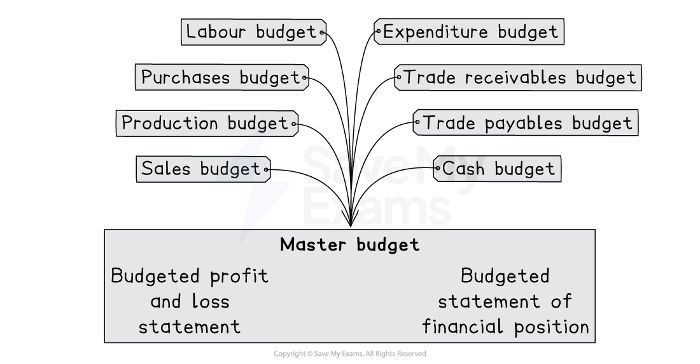

# Budgets

## Budgets

> **Spec point** — `spcpt_Z7DDR5xFhpM6rbtn` · what is meant by a master budget
the effect of limiting factors on the preparation of budgets

## Budgets

### What is a budget?

- This is a** future** financial plan that helps businesses make decisions
- There are two types of budgets:

  - **Incremental budgeting** is based on using previous budgets and adjusting it accordingly
  - **Zero-based budgeting** is starting the budgeting without any prior information

|   | Benefits | Limitations |
|---|---|---|
| Incremental budgeting | - Preparation is easy and quick - Suits businesses that are established and have stable costs and revenue - Easy to compare to previous budgets | - Can lead to inefficiencies from the historical budgets - Less control over costs and can lead to overspending - Not flexible in a climate where there are constant changes |
| Zero-based budgeting | - More efficient use of resource - Can deal with external changes more effectively - Managers and employees involved in setting budgets and decision making | - Can be complex and time-consuming - Each cost needs justifying, which can be demotivating |

### What are the limiting factors when preparing budgets?

- Depending on what the limiting factors are, will depend on what order the different budgets are made:

  - Shortage of material
  
    - This will limit production and purchases
  - Shortage of labour
  
    - This will limit production and labour
  - Limited demand
  
    - This will limit sales and production
  - Limited cash
  
    - This will impact the ability to buy materials and pay workers
    - Will have an impact on cash budget too
  - Shortage of space
  
    - A limited amount of space will limit production

### What are the different budgets?

- There are **8 **budgets and** 2** master budgets that help the business to plan and make decisions

*The different budgets*

- **Master budgets**

  - Budgeted statement of profit and loss
  
    - Forecasted** income **and** expenditure**
    - Same layout as the historical statement of profit and loss
  - Budgeted statement of financial position
  
    - Forecasted **assets**, **liabilities** and **capital**
    - Same layout as the historical statement of financial position
- **Other budgets**

  - Sales
  
    - Shows**  revenue** from sales and  the **volume** of sales
  - Production
  
    - Shows the number of units to** produce** for a particular time period
  - Purchases
  
    - Shows the cost of purchasing** inventory **or **raw materials **and the **volume** needed
  - Labour
  
    - Shows the **labour costs** and **hours** expected for a particular time period
  - Expenditure
  
    - Shows **other cash expenses **that need forecasting which can be incorporated in the** cash budget**
  - Trade receivables
  
    - Shows the amount of money expected from **credit customers** and is linked to the **sales budget**
  - Trade payables
  
    - Shows the amount of money expected to pay **credit suppliers **and is linked to the **purchase budget**
  - Cash
  
    - Shows the money **coming in and out** of the business for a particular period of time

> **Exam Hint**
> Use the 'other' budgets to help compile the master budgets.

## Advantages & disadvantages of budgetary control

> **Spec point** — `spcpt_554yBjSHsMSYGBhX` · the advantages and disadvantages of a budgetary control system to an organisation
the advantages and disadvantages of preparing budgets using spreadsheets

## Advantages & disadvantages of budgetary control

### What are the advantages of budgetary control?

- Can be a **motivating** factor for staff, especially if bonuses are paid on meeting targets
- Can help identify departments that need **improving** and help managers with **decision making**
- Allows greater access to **external sources of finance** such as bank loans
- Allows the business to plan for **expansion** and **growth**

### What are the disadvantages of budgetary control?

- Can be** time-consuming** to put together and take managers away from their daily tasks
- **External factors **are often ignored when budgeting
- Managers may create** inefficiencies** in the budget to give them some **'budgetary slack'**
- An expert is needed to prepare the budgets, which can be** costly**

### What are the advantages and disadvantages of preparing budgets using spreadsheets?

| Advantages | Disadvantages |
|---|---|
| Allows budgets to be made quicker | Could lose data with computer-based systems |
| Can use graphs and charts to present some of the data | Potential security issues as the computers may get hacked |
| Worksheets help organise the files and keep historical data without using physical storage | Training staff to use spreadsheets could be costly |
| With formulas, it's easy to flex the budgets and make changes easily |   |
| Can shape the spreadsheets so it can be tailored to meet the business needs |   |
