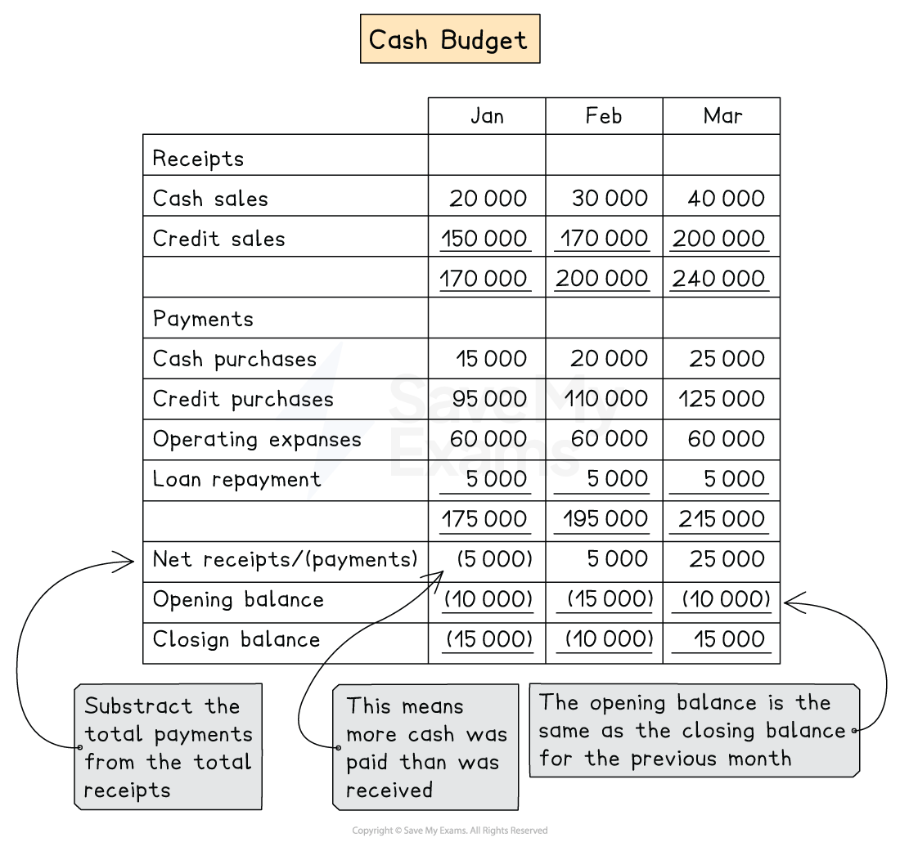

# Cash Budgets

## Cash budgets

> **Spec point** — `spcpt_Zq95ZGFq7wS5fGv2` · how to prepare the following budgets:
– cash

## Cash budgets

### How to prepare a cash budget?

- The cash budget shows all the projected **money coming in **and **going out**
- The cash budget includes all transactions relating to **cash**, **cheque** and** bank transactions**
- Here is an example of the **cash budget**

*Example of a cash budget*

- **STEP 1**
Calculate the **receipts **for each period

  - This may include:
  
    - Receipts of cash sales
    - Receipts from credit sales
    - Sale of non-current assets
    - Capital
    - Loans
- **STEP 2 **
Calculate the **payments** for each period

  - This may include:
  
    - Payment of cash purchases
    - Payments for credit purchases
    - Purchase  of non-current assets
    - Drawings
    - Loan repayments
    - Cash expenses only
- **STEP 3**
Calculate the **net receipts or payments** by using this formula

  - Total receipts - total payments
- **STEP 4**
Write down the **opening balance**

  - This is the same as the closing balance for the previous month
  - Brackets indicate that the bank is overdrawn
- **STEP 5**
Find the **closing balance**

  - Add the net cash flow to the opening balance

> **Exam Hint**
> If depreciation is included in the expenses, then you need to subtract it from the total. Depreciation does not affect the cash budget.

> **Worked Example**
> Cushions manufacture a range of cushions. Here is the following information relating to a cash budget:
> 
> |   | January | February | March |
> |---|---|---|---|
> | Sales \$ | 60 000 | 58 000 | 66 000 |
> | Purchases \$ | 30 000 | 28 000 | 31 000 |
> | Expenses (including depreciation) | 15 000 | 12 000 | 12 000 |
> 
> **Additional information**
> 
> - 40% of sales are made on cash basis. The remaining 60% of customers will pay one month later. Sales in December are expected to be \$40 000.
> - Payments to suppliers are made one month later. The purchases expected in December is to be \$20 000.
> - Expenses are paid in the month they are incurred.
> - The opening balance in January is expected to be \$3 000 overdrawn.
> - Depreciation for existing non-current assets for the year is \$12 000.
> - In February a new van was purchased for \$17 000. The policy is that vehicles are not depreciated in the year of purchase.
> - Loan repayments will be \$1 500 each month starting in February
> 
> Prepare the cash budget for January, February and March
> 
> **Answer**
> 
> - Calculate the receipts for all three months
> 
>   - Sales:
> 
> *January*
> 
> *Cash sales = 40% × \$60 000 = \$24 000*
> 
> *Credit sales = 60% × \$40 000 = \$24 000*
> 
> *February*
> 
> *Cash sales = 40% × \$58 000 = \$23 200*
> 
> *Credit sales = 60% × \$60 000 = \$36 000*
> 
> *March*
> 
> *Cash sales = 40% × \$66 000 = \$26 400*
> 
> *Credit sales = 60% × \$58 000 = \$34 800*
> 
> - Calculate the payments for all three months
> 
>   - Purchases *January = \$20 000* *February = \$30 000*
>   *March = \$28 000*
>   - Expenses
> 
> *Depreciation for the month = \$12 000 ÷ 12 = \$1 000 per month*
> *January = \$15 000 - \$1 000 = \$14 000*
> *February = \$12 000 - \$1 000 = \$11 000*
> *March = \$12 000 - \$1 000 = \$11 000*
> 
> The answer will be presented as the following cash budget:
> 
> |   | January  \$ | February  \$ | March  \$ |
> |---|---|---|---|
> | **Receipts** |   |   |   |
> | Cash sales | 24 000 | 23 200 | 26 400 |
> | Credit customer - one month | <u>24 000</u> | <u>36 000</u> | <u>34 800</u> |
> | **Total receipts** | <u>48 000</u> | <u>59 200</u> | <u>61 200</u> |
> |   |   |   |   |
> | **Payments** |   |   |   |
> | Credit suppliers  - one month | 20 000 | 30 000 | 28 000 |
> | Expenses | 14 000 | 11 000 | 11 000 |
> | Van |   | 17 000 |   |
> | Loan repayment | <u>               </u> | <u>1 500</u> | <u>1 500</u> |
> | **Total Payments** | <u>34 000</u> | <u>59 500</u> | <u>40 500</u> |
> |   |   |   |   |
> | **Net receipts or payments** | 14 000 | (300) | 20 700 |
> | **Opening balance ** | <u>(3 000)</u> | <u>11 000</u> | <u>10 700</u> |
> | **Closing balance** | <u>11 000</u> | <u>10 700</u> | <u>31 400</u> |
