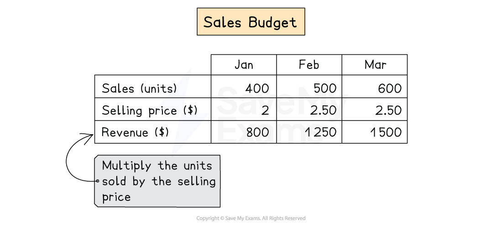
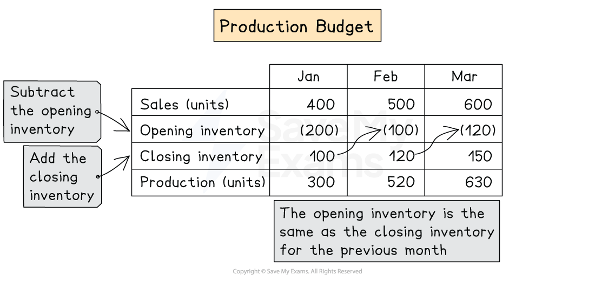
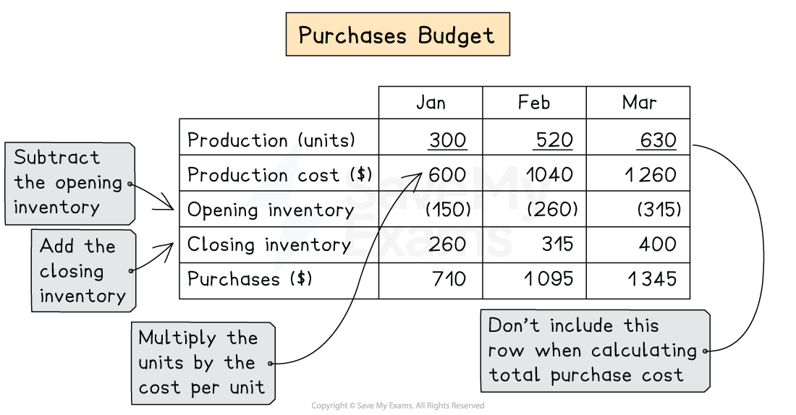

# Sales, Production & Purchases Budgets

## Sales budget

> **Spec point** — `spcpt_G2WpYyF5Bf7wXmHR` · how to prepare the following budgets:
– sales

## Sales budget

### How to prepare a sales budget?

- The sales budget is based on  **selling price** and **volume of sales**
- Here is an example of what  a **sales budget **would look like

*Example of a sales budget*

- **STEP 1**
Calculate the **selling price **relevant to the period needed
- **STEP 2**
Calculate the **number of units** to be sold for each period
- **STEP 3**
Calculate the **total revenue** for the period

  - Revenue = selling price ×  units sold

> **Worked Example**
> Games Ltd makes games consoles. The following information is provided:
> 
> |   | January | February | March |
> |---|---|---|---|
> | Selling price per unit | \$20 | Increase by 10% from January | Increase by a further 5% from February |
> | Units sold | 10 000 | Reduced by 2% from January | Reduced by a further 8% from February |
> 
> Prepare the sales budget for January, February and March
> 
> **Answer**
> 
> - Calculate the selling price for each month
> 
> *January = \$20*
> 
> *February =  \$20 + 10% = \$22*
> 
> *March = \$22 + 5% = \$23.10*
> 
> - Calculate the units sold for each month
> 
> *January = 10 000*
> 
> *February =  10 000 - 2% = 9 800*
> 
> *March = 9 800 - 8% = 9 016*
> 
> - Calculate the revenue for each month
> 
> *January = 10 000 ×  \$20 = ***\$200 000**
> 
> *February = 9 800 ×  \$22 =*** \$215 600**
> 
> *March = 9 016 ×  \$23.10 = ***\$208 269.60**
> 
> - The answer will be shown as the sales budget:
> 
> |   | January | February | March |
> |---|---|---|---|
> | Units sold | 10 000 | 9 800 | 9 016 |
> | Selling price \$ | 20 | 22 | 23.10 |
> | Revenue \$ | 200 000 | 215 600 | 208 269.60 |

## Production budget

> **Spec point** — `spcpt_dJNxTPnymmYKBppk` · "how to prepare the following budgets:
– production

## Production budget

### How to prepare a production budget?

- The production budget is the** number of units** needed for production for a particular period
- Everything in a production budget is calculated in **units **
- Here is an example of what  a **production budget **would look like

*Example of a production budget*

- **STEP 1**
Find the **units sold**

  - This is taken from the sales budget
- **STEP 2**
**Minus** the **opening inventory** as this is already produced and does not need producing

  - The opening inventory will be the closing inventory of the last period
- **STEP 3**
Add the **closing inventory**

  - This will depend on what inventory levels are needed
  - This is usually based on a % of sales of the next period
- **STEP 4**
Calculate the **production needed** for each period

  - Add the sales and closing inventory
  - Minus the opening inventory

> **Worked Example**
> Games Ltd makes games consoles. The following information is provided:
> 
> |   | January | February | March |
> |---|---|---|---|
> | Units sold (based on sales budget) | 10 000 | 9 800 | 9 016 |
> | Closing inventory | Based on 20% of sales for the next month | Based on 25% of sales for the next month | Based on 18% of sales for the next month |
> 
> Additional information
> 
> - The **opening inventory** in January is expected to be **2 000 units**
> - The units sold in **April** is expected to be **9 000 units**
> 
> Prepare the production budget for January, February and March
> 
> **Answer**
> 
> - Calculate the closing inventory for each period
> 
> *January = 9 800 × 20% = 1 960 units*
> 
> *February =  9 016 × 25% = 2 254 units*
> 
> *March = 9 000 × 18% = 1 620 units*
> 
> - Calculate the production for each month
> 
> *January = 10 000 - 2 000 + 1 960= ***9 960 units**
> 
> *February = 9 800 - 1 960 + 2 254 =*** 10 094 units**
> 
> *March = 9 016 - 2 254 + 1 620= ***8 382 units**
> 
> |   | January | February | March |
> |---|---|---|---|
> | Units sold | 10 000 | 9 800 | 9 016 |
> | -Opening inventory | (2 000) | (1 960) | (2 254) |
> | +Closing inventory | 1 960 | 2 254 | 1 620 |
> | = Production | 9 960 | 10 094 | 8 382 |

## Purchases budget

> **Spec point** — `spcpt_J4ZQHP7JdSD9NmyN` · how to prepare the following budgets:
– purchases

## Purchases budget

### How to prepare a purchases budget?

- The purchases budget is based on the **material **needed for the units of production
- The purchase budget is based on the **cost price **and **volume** of material
- Here is an example of what  a **purchases budget **would look like

*Example of a purchases budget*

- **STEP 1**
Calculate the **cost price** relevant for the material for making one unit
- **STEP 2**
Find the **production in units** for the period needed

  - This can be taken from the production budget
  - Multiply the production in units by the material cost price per unit
- **STEP 3**
Find the **opening inventory** valuation

  - This will be same as the closing value as the last period
- **STEP 4**
Find the **closing inventory** valuation

  - This is usually based on a percentage of inventory the business would like to hold
- **STEP 5**
Find the **purchases** for the month

  - Start with the production units
  - Subtract the opening inventory of materials
  - Add the closing inventory of materials

> **Worked Example**
> Suits Ltd makes fitted suits. The following information is provided:
> 
> |   | January | February | March |
> |---|---|---|---|
> | Production  in units | 9 000 | 10 000 | 8 500 |
> 
> - Each unit of production requires **5kg **of material with the cost per kg as** \$7**
> - Closing inventory for direct material will be based on **20%** of production for the next month
> - Closing inventory  is** 2 000 **units in December
> - Production is expected to be **9000** in April
> 
> Prepare the purchases budget for January, February and March
> 
> **Answer**
> 
> - Calculate the cost price for each unit
> 
> *5kg × \$7 = \$35 per unit*
> 
> - Calculate the production cost for each month
> 
> *January = 9 000  ×  \$35= \$315 000*
> 
> *February = 10 000 ×  \$35 = \$350 000*
> 
> *March = 8 500 ×  \$35 = \$297 500*
> 
> - Calculate the opening inventory for the first month
> 
> *January = 2 000 units × \$35  = \$70 000*
> 
> - Calculate the closing inventory for the first month
> 
> *January =  10 000 units × 20% = 2 000 x \$35 = \$70 000*
> 
> *February =  8 500 units × 20% = 1 700 x \$35 = \$59 500*
> 
> *March =  9 000 units × 20% = 1 800 x \$35 = \$63 000*
> 
> - The answer will be shown as the purchases budget:
> 
> |   | January  \$ | February  \$ | March  \$ |
> |---|---|---|---|
> | Production | 315 000 | 350 000 | 297 500 |
> | **Less: **Opening Inventory | (70 000) | (70 000) | (59 500) |
> | **Add:** Closing Inventory | 70 000 | 59 500 | 63 000 |
> | Purchase | 315 000 | 339 500 | 301 000 |

> **Exam Hint**
> When doing the sales, production and purchase budget, it would make it easier to do them in this order:
> 
> 1. Sales
> 2. Production
> 3. Purchases
