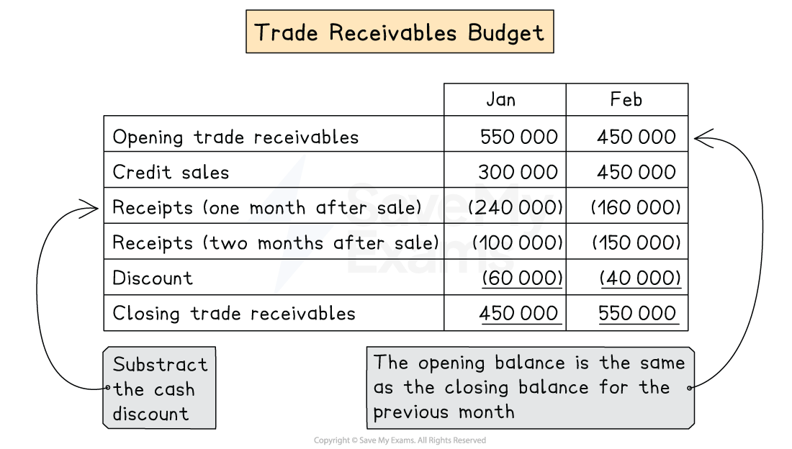
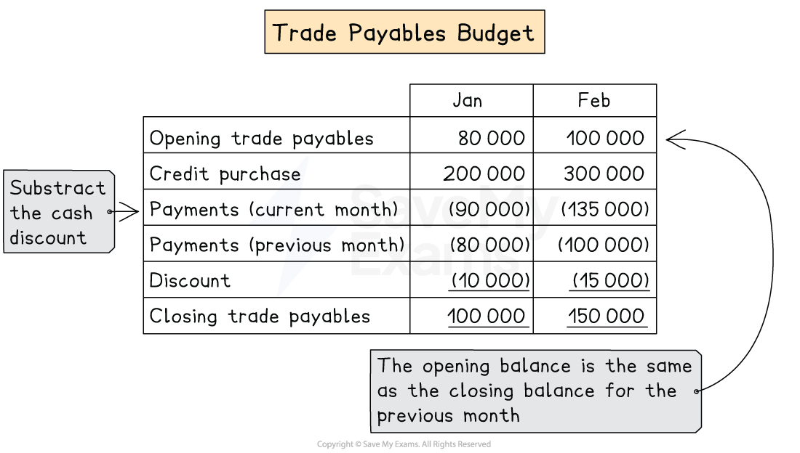

# Trade Receivables & Trade Payables Budgets

## Trade receivables budget

> **Spec point** — `spcpt_sxQRXKhJPtQtMzWc` · how to prepare the following budgets:
– trade receivables

## Trade receivables budget

### How to prepare a trade receivables budget?

- The trade receivable budget shows activities relating to credit customers
- Activities include:

  - Credit sales
  - Sales return
  - Discount allowed
  - Receipts of money received from customers
- Here is an example of what a **trade receivables budget **would look like

*Example of a trade receivables budget*

- **STEP 1**
Work out the **opening balance** for the first period by calculating how much the customers owe at the start of the period
- **STEP 2**
Find the **sales** expected on credit for that period

  - This might come from a sales budget
- **STEP 3**
Calculate the **money received** from customer

  - Usually a percentage of customers pay in that month or the next month
  
    - These normally get a cash discount
  - The rest usually pay in the following month
- **STEP 4**
Find any other transactions relating to credit customer, such as:

  - Sales return
  - Discount allowed

> **Worked Example**
> Furniture Limited makes and sells a range of furniture. The following information is provided:
> 
> Sales budget for Furniture Limited:
> 
> |   | November | December | January | February | March |
> |---|---|---|---|---|---|
> | Units | 55 000 | 62 000 | 70 000 | 80 000 | 75 000 |
> 
> Additional information
> 
> - All sales are made on credit basis
> - The selling price is fixed at \$5
> - 30% of customers pay a month after the sale and get a 5% discount
> - The remainder of customers will pay two months after the sale
> 
> Prepare the trade receivables budget for January, February and March
> 
> **Answer**
> 
> - Calculate the opening balance for the first month
> 
> *January opening balance*
> 
> *November = (55 000 × \$5) × 70% = \$192 500 *
> 
> *December = (62 000 × \$5) × 30% = \$93 000*
> 
> *\$192 500 + \$93 000 = \$285 500*
> 
> - Calculate the sales for each month
> 
> *January sales = 70 000 × \$5 = \$350 000*
> 
> *February sales = 80 000 × \$5 = \$400 000*
> 
> *March sales = 75 000 × \$5 = \$375 000*
> 
> - Calculate the discount allowed for each month
> 
> *January = (62 000 × \$5 × 30%) × 5% = \$4 650*
> 
> *February = (70 000 × \$5 × 30%) × 5% = \$5 250*
> 
> *March = (80 000 × \$5 × 30%) × 5% = \$6 000*
> 
> - Calculate the money received each month
> 
> *January = (55 000 × \$5 × 70%) + (62 000 × \$5 × 30% × 95%) = \$280 850*
> 
> *February = (62 000 × \$5 × 70%) + (70 000 × \$5 × 30% × 95%) = \$316 750*
> 
> *March = (70 000 × \$5 × 70%) + (80 000 × \$5 × 30% × 95%) = \$359 000*
> 
> - The answer will be shown as the trade receivable budget:
> 
> |   | January  \$ | February  \$ | March  \$ |
> |---|---|---|---|
> | Balance b/d | 285 500 | 350 000 | 428 000 |
> | **Add**: Sales | 350 000 | 400 000 | 375 000 |
> | **Less: **Money received from customer | (280 850) | (316 750) | (359 000) |
> | **Less: **Discount allowed | <u>(4 650)</u> | <u>(5 250)</u> | <u>(6 000)</u> |
> | Balance c/d | <u>350 000</u> | <u>428 000</u> | <u>438 000</u> |

## Trade payables budget

> **Spec point** — `spcpt_2fQhv93MSxRZFF9J` · how to prepare the following budgets:
– trade payables

## Trade payables budget

### How to prepare a trade payable budget?

- The trade payable budget shows activities relating to credit supplier
- Activities include:

  - Credit purchases
  - Purchase returns
  - Discount received
  - Payments to credit suppliers
- Here is an example of what a **trade payables budget **would look like

*Example of a trade payables budget*

- **STEP 1**
Work out the **opening balance** for the first period by calculating how much the business owes the suppliers
- **STEP 2**
Find the **purchases** expected on credit for that period

  - This might come from a purchases budget
- **STEP 3**
Calculate the **money paid **to suppliers

  - Usually a percentage of suppliers are paid in that month or the next month
  
    - These normally give a cash discount
  - The rest usually are paid in the following month
- **STEP 4**
Find any other transactions relating to credit suppliers, such as:

  - Purchase return
  - Discount received

> **Worked Example**
> Bottles Limited makes and sells a range of bottles. The following information is provided:
> 
> Extract from the production budget for Bottles Limited:
> 
> |   | November | December | January | February | March |
> |---|---|---|---|---|---|
> | Units of production | 5 000 | 6 000 | 6 400 | 8 000 | 7 000 |
> 
> Additional information
> 
> - Each unit needs 0.25 kg of material at \$8 per kg
> - 40% of the suppliers are paid in the month after the purchase and a 5% discount will be received
> - The remainder of suppliers will be paid two months after the purchase
> - All materials are used up in the same month and no inventory is kept
> 
> Prepare the trade payables budget for January, February and March
> 
> **Answer**
> 
> - Calculate the cost per unit
> 
> *0.25 kg × \$8 = \$2*
> 
> - Calculate the opening balance for the first month
> 
> *January opening balance*
> 
> *(5 000 ×\$2) × 60% = \$6 000 *
> 
> *(6 000 × \$2) × 40% = \$4 800*
> 
> *\$6 000 + \$4 800 = \$10 800*
> 
> - Calculate the purchases for each month
> 
> *January purchases = 6 400 × \$2 = \$12 800*
> 
> *February purchases = 8 000 × \$2 = \$16 000*
> 
> *March purchases = 7 000 × \$2 = \$14 000*
> 
> - Calculate the discount received for each month
> 
> *January = (6 000 × \$2 × 40%) × 5% = \$240*
> 
> *February = (6 400 × \$2 × 40%) × 5% = \$256*
> 
> *March = (8 000 × \$2 × 40%) × 5% = \$320*
> 
> - Calculate the money paid each month
> 
> *January = (5 000 × \$2 × 60%) + (6 000 × \$2 × 40% × 95%) = \$10 560*
> 
> *February = (6 000 × \$2 × 60%) + (6 400 × \$2 × 40% × 95%) = \$12 064*
> 
> *March = (6 400 × \$2 × 60%) + (8 000 × \$2 × 40% × 95%) = \$13 760*
> 
> - The answer will be shown as the trade payable budget:
> 
> |   | January  \$ | February  \$ | March  \$ |
> |---|---|---|---|
> | Balance b/d | 10 800 | 12 800 | 16 480 |
> | **Add**: Purchases | 12 800 | 16 000 | 14 000 |
> | **Less: **Money paid to suppliers | (10 560) | (12 064) | (13 760) |
> | **Less: **Discount received | <u>(240)</u> | <u>(256)</u> | <u>(320)</u> |
> | Balance c/d | <u>12 800</u> | <u>16 480</u> | <u>16 400</u> |

###
