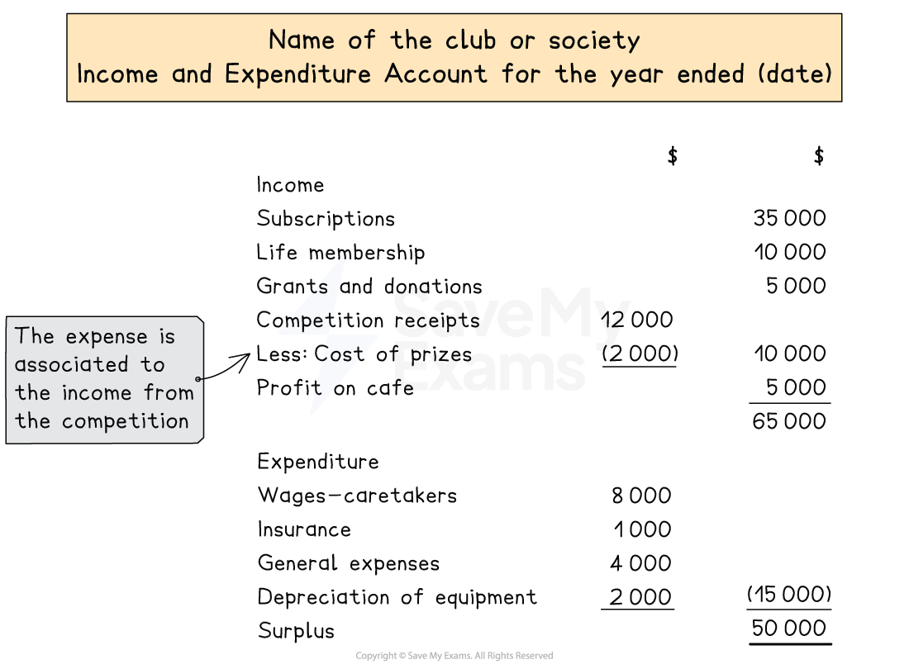

# Income & Expenditure Account

## Income & expenditure account

> **Spec point** — `spcpt_f87fMWCvNyNbfgF5` · how to prepare, from full or incomplete accounting records:
– an income and expenditure account

## Income & expenditure account

### What is an income and expenditure account?

- An **income and expenditure account** is a **statement **that calculates the **surplus or deficit**

  - A **surplus **is comparable to a **profit **for a business
  - A **deficit **is comparable to a **loss **for a business
  
    - Clubs and societies do not operate to make a profit so the terms profit and loss are not used
- The **total expenses** are **subtracted **from the **income**

  - If the **income **is **greater **than the **expenses **then there is a **surplus**
  - If the **income **is **less **than the **expenses **then there is a **deficit**
- The income and expenditure account is **similar **to a **statement of profit or loss** of a business

  - Only expenses and income are included
  - Assets and liabilities are not included
- **Adjustments **are made for:

  - Depreciation of non-current assets
  - Accruals and prepayments of expenses and income
  - Any subscriptions which are written off

### What are the differences between a receipts and payments account and an income and expenditure account?

- The differences are summarised in the table below

| Receipts and payments account | Income and expenditure account |
|---|---|
| Includes only money that is received or paid | Includes only income and expenses |
| Includes only transactions involving money | Includes transactions involving non-monetary items such as depreciation |
| Includes both capital and revenue receipts and expenditure | Includes only revenue receipts and expenditure |
| Does not include adjustments for accruals or prepayments of expenses and income | Includes adjustments for accruals or prepayments of expenses and income |
| The closing balance represents the bank balance or amount of cash | The final amount represents the surplus or deficit |

### What is the layout of an income and expenditure account?

- The account is prepared in a **similar **way as the profit section of the **statement of profit or loss** for other types of businesses
- Deal with any **adjustments**

  - **Accruals**
  
    - Subtract accruals from the previous year
    - Add accruals at the end of the current year
  - **Prepayments**
  
    - Add prepayments from the previous year
    - Subtract prepayments at the end of the current year
  - Calculate any **depreciation **charges
- List the **income **first

  - If there are any costs associated with a source of income then these should be subtracted in this section
  
    - For example, income from a competition should subtract the cost of the competition's prizes
  - Include any profits calculated on the statements of profit or loss for any trading activities
- List the **expenditure **next

  - Include any losses calculated on the statements of profit or loss for any trading activities
  - Do not include expenses related to specific trading activities
  
    - These will be included in the statements of profit or loss for those activities and will contribute to the profit or loss
- Find the **surplus **or **deficit **of the year by subtracting the two totals

*Layout of an income and expenditure account*

> **Exam Hint**
> If the question involves [life memberships or donations](https://www.savemyexams.com/a-level/accounting/cie/21/revision-notes/financial-accounting/financial-statements-for-clubs-and-societies/life-memberships-and-donations/), read the information carefully to determine how much is released as income for the year.

> **Worked Example**
> Paramount Badminton Club owns several courts. It also operates a shop where it sells refreshments and badminton equipment. Shop sales are on a cash basis and purchases made for the shop are on credit.
> 
> The treasurer of the club provided the following information.
> 
> |   | 1 January 2023 | 31 December 2023 |
> |---|---|---|
> | \$ | \$ |   |
> | Subscriptions in advance | 2 200 | 2 050 |
> | Subscriptions in arrears | 6 515 | 6 850 |
> 
> Other information provided for the year ended 31 December 2023:
> 
> | Shop profit | 9 410 |
> |---|---|
> | Subscriptions received during the year | 36 900 |
> | Wages for caretakers | 2 650 |
> | Insurance | 3 640 |
> | Bank charges | 80 |
> | Telephone | 380 |
> | Advertising | 460 |
> | Depreciation of equipment | 520 |
> 
> - There were a total of 15 life members at 31 December 2023, all of whom joined after 1 January 2021.
> - Life members pay \$1 200 for lifelong access to the club. Income is released to the income and expenditure account in equal amounts over 10 years.
> 
> Prepare the income and expenditure account for Paramount Badminton Club for the year ended 31 December 2023.
> 
> **Answer**:
> 
> - Calculate the subscriptions for the year by finding the amount that was due for the year
> 
>   - Add the prepayments from the previous year
>   - Subtract the accruals from the previous year
>   - Add accruals at the end of the current year
>   - Subtract prepayments at the end of the current year
> 
> *\$36 900 + \$2 200 - \$6 515 + \$6 850 - \$2 050 = \$37 385*
> 
> - Calculate the life membership income
> 
>   - Divide the membership cost by 10
>   - Multiply by the number of life members
> 
> *\$1 200 ÷ 10 × 15 = \$1 800*
> 
> - Identify the income:
> 
>   - Subscriptions
>   - Shop profit
> - Identify the expenditure:
> 
>   - Wages
>   - Insurance
>   - Bank charges
>   - Telephone
>   - Advertising
>   - Depreciation
> - Prepare the income and expenditure account using the required format
> 
> | **Final answer:** **Paramount Badminton Club**  **Final answer:** **Income and Expenditure Account for the year ended 31 December 2023** |   |   |
> |---|---|---|
> |   | **Final answer:** **\$** | **Final answer:** **\$** |
> | **Final answer:** **Subscriptions** |   | **Final answer:** **37 385** |
> | **Final answer:** **Life membership** |   | **Final answer:** **1 800** |
> | **Final answer:** **Shop profit** |   | **9**<u> </u>**410** |
> |   |   | **48** **595** |
> | **Final answer:** **Wages for caretakers** | **2** **650** |   |
> | **Final answer:** **Insurance** | **3** **640** |   |
> | **Final answer:** **Bank charges** | **Final answer:** **80** |   |
> | **Final answer:** **Telephone** | **Final answer:** **380** |   |
> | **Final answer:** **Advertising** | **Final answer:** **460** |   |
> | **Final answer:** **Depreciation of equipment** | **Final answer:** **520** | **Final answer:** **(7 730)** |
> | **Final answer:** **Surplus for the year** |   | **Final answer:** **40 865** |
