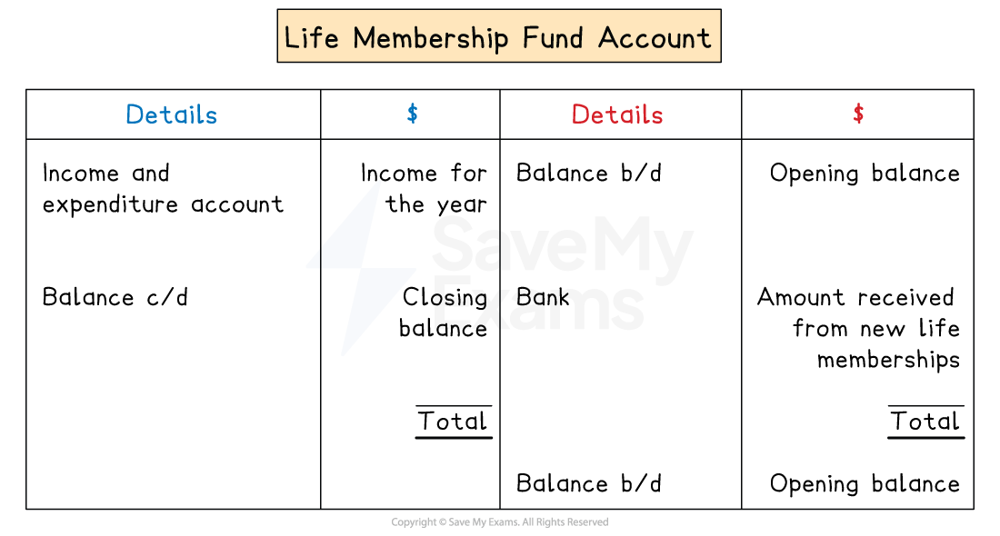

# Life Memberships & Donations

## Life memberships

> **Spec point** — `spcpt_xKHwpBSWfcvVgps7` · how to account for other receipts, including life memberships and donations

## Life memberships

### What are life memberships?

- A **life membership** is where a member makes a **one-off payment **to become a member for life

  - The member no longer needs to pay the annual subscription fee
- **Entry fees** are similar to life memberships as they are one-off payments

### What is the accounting treatment for life memberships?

- The** full amount **received from life memberships does **not **contribute to that year's surplus calculated in the income and expenditure account
- This complies with the accounting concepts

  - **Prudence**
  
    - Taking the full amount as income in the year received would **overstate** that year's income
  - **Accruals**
  
    - The club provides services to life members **over many years**
- The correct accounting treatment is for a **proportion **of the amount received from life memberships to contribute to income for a specified number of years
- The **remaining balance **of the life membership fund is a **non-current liability**

  - It is similar to income received in advance
  - Except, the income is received years in advance

> **Exam Hint**
> The exam question will tell you what percentage is used for yearly income and for how many years.

### What are the journal entries for life memberships?

- When the club receives **payment **for a life membership

  - Enter the **full **amount into the accounts
  - **Debit **the **bank **account
  - **Credit **the **life membership fund** account
- At the end of the financial year

  - Enter the **specified proportion** of the life membership fund as income
  - **Debit **the **life membership fund **account
  - **Credit **the **income and expenditure** account

*Layout of a life membership fund account*

> **Exam Hint**
> The annual amount of the life membership fund that is released as income is not normally apportioned based on when the member joined. In general, the amount is based on the number of life membership holders at the end of the year. Therefore, it is important to include the number of life memberships purchased during the year.

> **Worked Example**
> The TS Club is a club providing tennis facilities to its members. The club admits life members as well as ordinary members.
> 
> The life membership fund on 1 June 2024 amounted to \$10 350.
> 
> The total receipts of the club for the year were as follows:
> 
> |   | \$ |
> |---|---|
> | Subscriptions from ordinary members | 31 500 |
> | Life membership fees | 6 000 |
> 
> On 31 May 2024 the club had 10 life members, all of whom had joined after 31 May 2020. 4 new members took out life membership during the year. The life membership fee is to be transferred to income over ten years in equal amounts.
> 
> Calculate the balance on the life membership fund after the transfer to the income and expenditure account on 31 May 2025.
> 
> **Answer**:
> 
> Calculate the amount received from each life membership
> 
> *\$6 000 ÷ 4 members = \$1 500 per member*
> 
> Calculate the annual income from a life membership
> 
> *\$1 500 ÷ 10 years = \$150 per year*
> 
> Calculate the total number of members at 31 May 2025
> 
> *10 + 4 = 14*
> 
> Calculate the balance on the life membership fund
> 
> |   |   | \$ |
> |---|---|---|
> | Balance on 1 June 2024 |   | 10 350 |
> | New life memberships |   | 6 000 |
> | Income from life memberships | *\$150 × 14* | <u>(2 100)</u> |
> | Balance on 31 May 2025 |   | <u>14 250</u> |
> 
> **Final answer:** **\$14 250**

## Donations

> **Spec point** — `spcpt_DJcYJR9YyzVS7cVj` · how to account for other receipts, including life memberships and donations

## Donations

### What are donations?

- **Donations **are given to clubs and societies from members, other businesses and the government
- The table describes the different types of donations:

| Type of donation | Description |
|---|---|
| General donation | - The club can decide how to spend or use this donation |
| Restricted donation | - The donation is given for a specific purpose    - For example, to build an extension |
| Grants covering multiple years | - This is money given by the government or other organisations to cover multiple years    - For example, a club might receive money from the government to make improvements over the next 3 years |

### What is the accounting treatment for donations?

- The accounting treatment is very similar to **life memberships**
- For a** general donation**

  - The full amount is included in the income and expenditure account
- For a **restricted donation**

  - Amounts are only included in the income and expenditure account when they are used
  - Parts of the donation might be used each year over several years
  - The **remaining balance **of the donation is a **current **or **non-current liability**
- For a **grant **covering multiple years

  - An amount of the grant that is proportional to the year is included in the income and expenditure account
  
    - For example, if a grant of \$3 000 is given at the start of the year and is intended to last for 3 years, then \$1 000 is included as income for the year
  - The **remaining balance **of the grant is a **current **or **non-current liability**

> **Exam Hint**
> The remaining balance of a restricted donation or grant is often called **deferred income **in exam questions.

### What are the journal entries for donations?

#### General donations

- When the club receives the **donation**

  - Enter the **full **amount into the accounts
  - **Debit **the **bank **account
  - **Credit **the **donations** account
- At the end of the financial year

  - Enter the **full amount** of the general donations
  - **Debit **the **donations **account
  - **Credit **the **income and expenditure** account

#### Grants covering multiple years

- When the club receives the **grant**

  - Enter the **full **amount into the accounts
  - **Debit **the **bank **account
  - **Credit **the **donations** account
- At the end of the financial year

  - Enter the **proportion **relating to the current year
  - **Debit **the **donations **account
  - **Credit **the **income and expenditure** account

#### Restricted donations

- When the club receives the **donation **for a specific purpose

  - Open a new bank account for the amount and create a trust fund in the books of account
  - Enter the **full **amount
  - **Debit **the **special bank **account
  - **Credit **the **trust fund **account
- When money is used from the trust fund to cover the cost of an activity

  - Enter the **specific amount** paid into the accounts
  - **Debit **the relevant account
  
    - E.g. non-current asset
  - **Credit **the** special bank** account
- At the end of the financial year

  - Enter the **total amount used** from the trust fund that year into the accounts
  - **Debit **the **trust fund **account
  - **Credit **the **income and expenditure** account

> **Worked Example**
> The TS Club is a club providing tennis facilities to its members.
> 
> The TS Club receives grants and donations which may cover several years.
> 
> At 1 June 2024, TS Club had a liability for deferred income from grants and donations amounting to \$3 400.
> 
> During the year ending 31 May 2025, TS Club received grants and donations totalling \$5 200.
> 
> The amount \$4 400 was posted to the income and expenditure account on 31 May 2025 for grants and donations.
> 
> Calculate the total of deferred income after the transfer to the income and expenditure account on 31 May 2025.
> 
> **Answer**:
> 
> |   | \$ |
> |---|---|
> | Balance on 1 June 2024 | 3 400 |
> | New grants and donations | 5 200 |
> | Income from grants and donations | <u>(4 400)</u> |
> | Balance on 31 May 2025 | <u>4 200</u> |
> 
> **Final answer:** **\$4 200**
