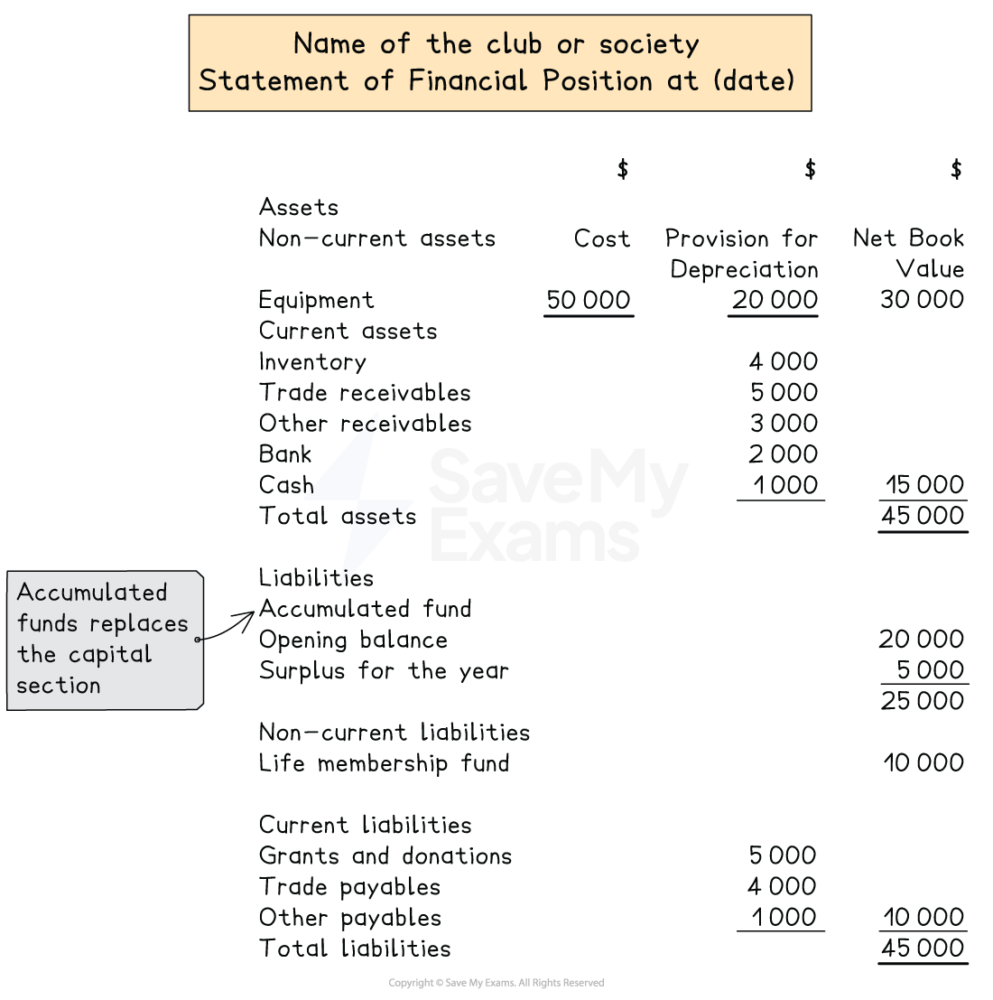

# Statement of Financial Position

## Statements of financial position for clubs & societies

> **Spec point** — `spcpt_VZfMnskZb9GbNxpC` · how to define and calculate the accumulated fund
how to prepare, from full or incomplete accounting records:
– a statement of financial position

## Statements of financial position for clubs & societies

### What is the layout of the statement of financial position of a club or society?

- The statement of financial position for clubs and societies is prepared in a **similar way **to other types of businesses
- The statement is split into **assets **and **liabilities**
- The main **differences **is the **capital/equity section** is **replaced **with an **accumulated fund section**
- **Liabilities **might include:

  - The life membership fund that is yet to be recognised as income
  - Grants and donations that are yet to be recognised as income

*Layout of a statement of financial position for a club or society*

### What is an accumulated fund?

- The capital of a club or society is referred to as the **accumulated fund**

  - This is made up of
  
    - any **capital** which is invested into the organisation
    - the accumulation of **surpluses** of income over expenditure over time
- At the end of each year

  - A **surplus** is added to the accumulated fund
  - A **deficit** is subtracted from the accumulated fund

### How do I calculate the accumulated fund?

- If the accumulated fund is not given in the question, you will need to calculate it by using the** accounting equation**

  - Assets = Capital + Liabilities
  - You can create a [statement of affairs](https://www.savemyexams.com/a-level/accounting/cie/21/revision-notes/fundamentals-of-financial-accounting/financial-statements-for-sole-traders/statement-of-affairs/) to calculate the accumulated fund
- **Accumulated fund** is the capital so the equation becomes:

  - Assets = Accumulated fund + Liabilities
- Use the two known elements of **assets **and **liabilities **to find the accumulated fund

  - Accumulated fund = Assets - Liabilities

### How do I use the accumulated fund to calculate surplus or deficit?

- To calculate the **surplus or deficit** for the year:

  - Calculate the accumulated fund at the **start of the year**
  - Calculate the accumulated fund at the **end of the year**
  - Calculate the **change **in the accumulated fund
  
    - If it has **increased **then this is the **surplus**
    - If it has **decreased **then this is the **deficit**

> **Worked Example**
> The Chill, Chat and Knit Club offers knitting lessons to club members, as well as selling knitting supplies.  It had the following assets and liabilities at 1 January 2023:
> 
> |   | \$ |
> |---|---|
> | Club furniture and fittings | 1 200 |
> | Inventory of knitting supplies | 300 |
> | Amount owed to suppliers | 120 |
> | Bank balance | 820 |
> 
> At 31 December 2023 the assets and liabilities had the following balances:
> 
> |   | \$ |
> |---|---|
> | Club furniture and fittings | 1 080 |
> | Inventory of knitting supplies | 180 |
> | Amount owed to suppliers | 80 |
> | Bank balance | 1 150 |
> 
> Calculate the surplus or deficit for The Chill, Chat and Knit Club for the year ended 31 December 2023.
> 
> **Answer**:
> 
> - Calculate the accumulated fund at the start of the year
> 
> |   | \$ | \$ |
> |---|---|---|
> | Assets |   |   |
> | Club furniture and fittings | 1 200 |   |
> | Inventory of knitting supplies | 300 |   |
> | Bank balance | <u>820</u> | 2 320 |
> | Less: Liabilities |   |   |
> | Amount owed to suppliers |   | <u>(120)</u> |
> | Accumulated fund |   | <u>2 200</u> |
> 
> - Calculate the accumulated fund at the end of the year
> 
> |   | *\$* | *\$* |
> |---|---|---|
> | Assets |   |   |
> | Club furniture and fittings | 1 080 |   |
> | Inventory of knitting supplies | 180 |   |
> | Bank balance | <u>1 150</u> | 2 410 |
> | Less: Liabilities |   |   |
> | Amount owed to suppliers |   | <u>(80)</u> |
> | Accumulated fund |   | <u>2 330</u> |
> 
> - The accumulated fund has increased so there has been a surplus
> - Find the difference between the start and the end of the year
> 
> *\$2 330 - \$2 200 = \$130*
> 
> **Final answer:** **The surplus for the year was \$130**

> **Worked Example**
> The Locust Football Club is an amateur football club with members of all ages.
> 
> The following information was provided at 1 April 2023.
> 
> |   | \$ |
> |---|---|
> | Equipment at cost | 16 500 |
> | Provision for depreciation of equipment | 3 300 |
> | Trade payables | 2 100 |
> | Subscriptions prepaid | 500 |
> | Life membership fund | 1 000 |
> | Accumulated fund | ? |
> 
> The following information was provided at 31 March 2024.
> 
> |   | \$ |
> |---|---|
> | Trade payables | 1 250 |
> | Subscriptions prepaid | 1 130 |
> | Subscriptions owing | 800 |
> | Bank balance | 4 780 |
> | Life membership fund | 1 100 |
> 
> Additional notes:
> 
> - The income and expenditure account for the year ended  31 March 2024 had a surplus of \$3 060
> - No equipment was sold or purchased during the year
> - Depreciation is charged on equipment using the reducing balance method at 20% per annum
> 
> Prepare the statement of financial position of Locust Football Club at 31 March 2024.
> 
> **Answer**:
> 
> - Calculate the accumulated fund at the start of the year
> 
>   - Calculate the total assets
>   
>     - Net book value of equipment (\$16 500 - \$3 300) = \$13 200
>   - Calculate the total liabilities
>   
>     - Trade payables = \$2 100
>     - Subscriptions prepaid = \$500
>     - Life membership fund
>     - Total liabilities = £2 100 + \$500 = \$3 600
>   - Calculate the difference
>   
>     - \$13 200 - \$3 600 = \$9 600
> - Calculate the total depreciation to date
> 
>   - Find the year's depreciation using the net book value of the equipment
>   
>     - 20%  × \$13 200 = \$2 640
>   - Find the total depreciation to date
>   
>     - \$3 300 + \$2 640 = \$5 940
>   - Find the current net book value of the equipment
>   
>     - \$16 500 - \$5 940 = \$10 560
> - Identify whether the subscriptions owing and prepaid are assets or liabilities
> 
>   - Subscriptions prepaid are current liabilities
>   - Subscriptions owing are current assets
> - Prepare the statement using the required format
> 
> | **Final answer:** **The Locust Football Club**  **Final answer:** **Statement of Financial Position at 31 March 2024** |   |   |   |
> |---|---|---|---|
> |   | **Final answer:** **\$** | **Final answer:** **\$** | **Final answer:** **\$** |
> | **Final answer:** **Non-current Assets** | **Final answer:** **Cost** | **Final answer:** **Provision for Depreciation** | **Final answer:** **Net Book Value** |
> | **Final answer:** **Equipment** | **Final answer:** **16 500** | **Final answer:** **5 940** | **Final answer:** **10 560** |
> | **Final answer:** **Current assets** |   |   |   |
> | **Final answer:** **Other receivables** |   | **Final answer:** **800** |   |
> | **Final answer:** **Bank balance** |   | **Final answer:** **4 780** | **Final answer:** **5 580** |
> | **Final answer:** **Total assets** |   |   | **Final answer:** **16 140** |
> |   |   |   |   |
> | **Final answer:** **Accumulated Fund** |   |   |   |
> | **Final answer:** **Opening balance** |   |   | **Final answer:** **9 600** |
> | **Final answer:** **Add: Surplus for the year** |   |   | **Final answer:** **3 060** |
> |   |   |   | **Final answer:** **12 660** |
> | **Final answer:** **Non-current Liabilities** |   |   |   |
> | **Final answer:** **Life membership fund** |   |   | **Final answer:** **1 100** |
> | **Final answer:** **Current Liabilities** |   |   |   |
> | **Final answer:** **Trade payables** |   | **Final answer:** **1 250** |   |
> | **Final answer:** **Subscription prepaid** |   | **Final answer:** **1 130** | **Final answer:** **2 380** |
> | **Final answer:** **Total liabilities** |   |   | **Final answer:** **16 140** |
