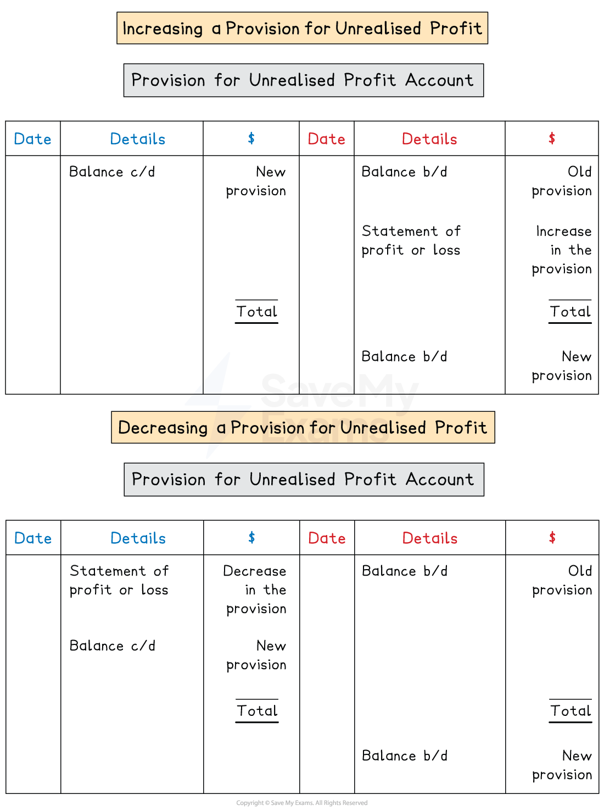

# Factory Profit & Unrealised Profit

## Factory profit

> **Spec point** — `spcpt_sKCQYyntTSXsHS9Q` · how to account for manufacturing profit
the reasons why a business may account for manufacturing profit

## Factory profit

### What is factory profit?

- **Factory profit** is an **additional amount added** to the cost of production before the finished goods are transferred to the statement of profit or loss

  - Factory profit is also called **manufacturing profit**
- It is usually expressed as a **percentage mark-up** on the cost of production

### Why might businesses account for factory profit?

- Businesses apply a rate of factory profit so that they can **compare **the transfer value with the sale prices of the same goods offered by **competitors**

  - This is known as **benchmarking**
  - The managers can then decide whether to continue to **produce **the goods or **purchase **them from a supplier
- The manufacturing department can be treated as a **separate profit centre** and its **performance **can be evaluated

  - Targets can be set for the factory profit

### What is the accounting treatment for factory profit?

- The factory profit is **calculated**

  - **Multiply **the **cost of production** by the **rate of factory profit**
- **Add **the **factory profit **to the** cost of production** to give the transfer value in the **manufacturing account**

  - This is a **debit **entry to the manufacturing account
- The transfer value is then used to calculate the **cost of sales **and then the **gross profit**
- The factory profit is then **added **to the **gross profit**

  - This essentially **eliminates** the factory profit from the transfer value
  - This ensures that the factory profit does not lower the profit for the year
  - This is a **credit **entry to the statement of profit or loss

> **Worked Example**
> P Limited is a manufacturing business. It applies a rate of factory profit of 20%.
> 
> At 1 January 2025, the finished goods inventory at transfer value was \$28 800.
> 
> The cost of production for the goods produced during the year ended 31 December 2025 was \$314 000.
> 
> At 31 December 2025, the finished goods at transfer value was \$21 600.
> 
> Find the transfer value of the goods produced for the year ended 31 December 2025.
> 
> **Answer**:
> 
> Multiply the cost of production by the rate of factory profit to find the factory profit
> 
> *20% × \$314 000 = \$62 800*
> 
> Add this to the cost to find the transfer value
> 
> *\$314 000 + \$62 800 =* **\$376 800**

## Unrealised profit

> **Spec point** — `spcpt_TDTX8DBMthWqXDtV` · how to account for manufacturing profit and the elimination of unrealised profit from unsold inventory

## Unrealised profit

### What is unrealised profit?

- **Unrealised profit** is the amount of the **factory profit** that is included in the valuation of **closing inventory** of the manufactured goods
- Goods are transferred to the statement of profit or loss using the **transfer value** which includes the factory profit

  - This profit has **not been earned** for the goods that remain **unsold **at the end of the year

### What is a provision for unrealised profit?

- A **provision for unrealised profit** is used to show the true valuation of the inventory held at the end of the year

  - It is very similar to an **allowance for irrecoverable debts**
- It complies with the **prudence concept** by ensuring that the assets are not overstated
- The balance on the provision for unrealised profit account is the amount of valuation of the closing finished goods that arises due to the **rate of factory profit**

### How do I calculate the balance of the provision for unrealised profit?

- Use the formula `fraction numerator Factory space profit percent sign over denominator 100 percent sign plus Factory space profit percent sign end fraction cross times Transfer space value space of space the space closing space finished space goods`

  - For example, suppose the rate of factory profit is 25% mark-up on cost and finished goods at transfer value is \$20 000
  - `25 over 125 cross times $ 20 space 000 equals $ 4 space 000`
- The fractional part of the formula is the **factory profit margin**

  - In the example above, the factory profit margin is `25 over 125 cross times 100 percent sign equals 20 percent sign`
- The remaining value of the closing finished goods is the **cost to produce them**

  - In the example above, the goods cost `$ 20 space 000 space minus $ 4 space 000 equals $ 16 space 000`
- If you know the balance of the provision, then you can find the **transfer value **of the finished goods by rearranging the formula

  - `Transfer space value equals Provision space for space unrealised space profit cross times fraction numerator 100 percent sign plus Factory space profit percent sign over denominator Factory space profit percent sign end fraction`

> **Exam Hint**
> Remember, you use a mark-up percentage to find the transfer value. But if you have the transfer value, you use the margin percentage to find the provision for unrealised profit.

### How do I make entries in the provision for unrealised profit account?

- **STEP 1**
Calculate the **opening balance** and enter this on the **credit side**

  - This uses the value of the opening finished goods
  - This might be given in the question
- **STEP 2**
Calculate the **closing balance** and enter this on the **debit side**

  - This uses the value of the closing finished goods
- **STEP 3**
Calculate the **change **in the balance of the provision

  - It is entered on the **credit **side if it is an **increase**
  - It is entered on the **debit **side if it is a **decrease**
  - The other side of the transaction is entered in the **statement of profit or loss**

*Layout of the provision for unrealised profit account*

> **Worked Example**
> P Limited is a manufacturing business. It applies a rate of factory profit of 20%.
> 
> At 1 January 2025, the finished goods inventory at transfer value was \$28 800.
> 
> The cost of production for the goods produced during the year ended 31 December 2025 was \$314 000.
> 
> At 31 December 2025, the finished goods at transfer value was \$21 600.
> 
> Prepare the provision for unrealised profit account for the year ended 31 December 2025.
> 
> **Answer**:
> 
> Calculate the opening balance of the provision for unrealised profit
> 
> `20 over 120 cross times $ 28 space 800 equals $ 4 space 800`
> 
> Calculate the closing balance of the provision for unrealised profit
> 
> `20 over 120 cross times $ 21 space 600 equals $ 3 space 600`
> 
> Calculate the decrease
> 
> `$ 4 space 800 minus $ 3 space 600 equals $ 1 space 200`
> 
> **Provision for unrealised profit account**
> 
> |   | \$ |   | \$ |
> |---|---|---|---|
> | Statement of profit or loss | 1 200 | Balance b/d | 4 800 |
> | Balance c/d | <u>3 600</u> |   | <u>              </u> |
> |   | <u>4 800</u> |   | <u>4 800</u> |
> |   |   | Balance b/d | 3 600 |
