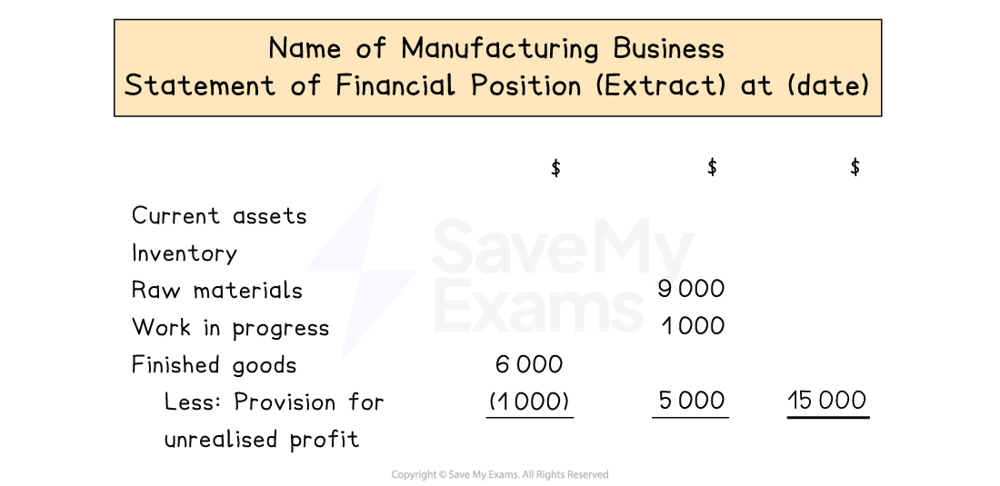

# Statement of Financial Position

## Statements of financial position for manufacturing businesses

> **Spec point** — `spcpt_3wQgg5JZ58HjQWMq` · how to prepare, for a manufacturing business, a statement of financial position

## Statements of financial position for manufacturing businesses

### What is the layout of the statement of financial position of a manufacturing business?

- The **statement of financial position** of a manufacturing business is prepared in a **similar way **to the other types of retail businesses
- The only difference is how the **inventory **is displayed in the current assets section
- **All three inventories** are shown separately and the total is calculated
- The balance of the **provision for unrealised profit** is **subtracted **from the **closing inventory of finished goods**

*Layout of the inventory entry on the statement of financial position for a manufacturing business*

> **Exam Hint**
> Make sure you subtract the balance of the provision for unrealised profit and not just the annual change. Remember, the change is transferred to the statement of profit or loss. This works similarly to an allowance for irrecoverable debts and a provision for depreciation.

> **Worked Example**
> Pablo owns a small carpet and rug factory, making bespoke carpets for local furniture businesses. He applies a rate of factory profit of 20%.
> 
> Inventory at 31 December 2023:
> 
> - Raw materials \$6 860
> - Work in progress \$10 885
> - Finished goods at transfer value \$14 640
> 
> Prepare an extract of the statement of financial position at 31 December 2023 showing the inventories.
> 
> **Answer**:
> 
> - Calculate the balance of the provision for unrealised profit account
> 
> `20 over 120 cross times $ 14 space 640 equals $ 2 space 440`
> 
> Prepare an extract of the statement of financial position to show the inventories
> 
> | **Final answer:** **Pablo**  **Final answer:** **Statement of Financial Position (Extract) at 31 December 2023** |   |   |   |
> |---|---|---|---|
> |   | **Final answer:** **\$** | **Final answer:** **\$** | **Final answer:** **\$** |
> | **Final answer:** **Current Assets** |   |   |   |
> | **Final answer:** **Closing Inventory:** |   |   |   |
> | **Final answer:** ** Raw materials** |   | **Final answer:** **6 860** |   |
> | **Final answer:** ** Work in progress** |   | **Final answer:** **10 885** |   |
> | **Final answer:** ** Finished goods at transfer value** | **Final answer:** **14 650** |   |   |
> | **Final answer:** **     Less: Provision for unrealised profit** | **Final answer:** **(2 440)** | **Final answer:** **12 210** | **Final answer:** **29 955** |
