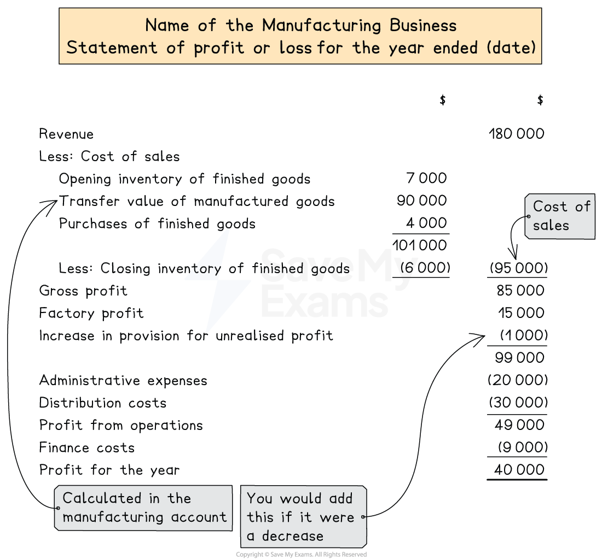

# Statement of Profit or Loss

## Statements of profit or loss for manufacturing businesses

> **Spec point** — `spcpt_ckM82Bsqbv89cg9q` · how to prepare, for a manufacturing business, a statement of profit or loss

## Statements of profit or loss for manufacturing businesses

### What is the layout of the statement of profit or loss of a manufacturing business?

- The **statement of profit or loss** for a manufacturing business is prepared in a **similar way **to the other types of trading businesses
- The statement of profit or loss is **prepared after the manufacturing account**
- For the **trading section**:

  - Use the inventory for **finished goods**
  - Use the **goods at transfer value** in place of **purchases**
  
    - The business might have also **purchased extra finished goods**
    - **Add **this in the calculation of the cost of sales
- Make **adjustments **after the gross profit for the **factory profit** and the **change **in the **provision for unrealised profit**

  - **Add **the **factory profit**
  - If the provision for unrealised profit has **increased**, then **subtract **the change
  - If the provision for unrealised profit has **decreased**, then **add **the change
- For the **profit and loss section**:

  - Only include **expenses **that relate to the **non-production aspects** of the business
  
    - Such as advertising, carriage outwards, etc
  - The expenses related to manufacturing are included in the cost of production
  - A business might use a **factory **and an **office**
  
    - The** factory expenses **are included in the **cost of production**
    - The **office expenses** are included in the **profit and loss section**

*Layout of a statement of profit or loss for a manufacturing business*

> **Worked Example**
> Pablo owns a small carpet and rug factory, making bespoke carpets for local furniture businesses. He applies a rate of factory profit of 20%.
> 
> The following balances are provided at 31 December 2023.
> 
> |   | \$ |
> |---|---|
> | Revenue | 280 050 |
> | Inventory at 1 January 2023 |   |
> | Raw materials | 7 100 |
> | Work in progress | 10 420 |
> | Finished goods | 12 450 |
> | Purchases of raw materials | 96 200 |
> | Wages of factory workers | 38 000 |
> | Wages of factory supervisors | 28 500 |
> | Wages of office and sales staff | 48 000 |
> | Insurance and rates | 15 000 |
> | General factory expenses | 13 180 |
> | General office expenses | 25 750 |
> | Factory equipment at cost | 120 000 |
> | Provision for depreciation of factory equipment at 1 January 2023 | 40 000 |
> | Provision for unrealised profit at 1 January 2023 | 2 075 |
> 
> Additional Information
> 
> - Inventory at 31 December 2023
> 
>   - Raw materials \$6 860
>   - Work in progress \$10 885
>   - Finished goods \$14 640
> - Insurance and rates are to be apportioned ⅓ to the office and ⅔ to the factory
> - Factory equipment is to be depreciated at 15% using the reducing balance method
> 
> (a) Prepare the manufacturing account for the year ended 31 December 2023.
> 
> (b) Prepare the statement of profit or loss for the year ended 31 December 2023.
> 
> **Answer**:
> 
> Deal with the additional information
> 
> - Inventory at 31 December 2023
> 
>   - These appear as current assets on the statement of financial position
>   - The raw materials and work in progress appear on the manufacturing account
>   - The finished goods appear on the statement of profit or loss
> - Insurance and rates are to be apportioned ⅓ to the office and ⅔ to the factory
> 
>   - Find the amount for the office
>   
>     - ⅓ × \$15 000 = \$5 000
>     - This appears in the profit and loss section of the statement of profit or loss
>   - Find the amount for the factory
>   
>     - ⅔ × \$15 000 = \$10 000
>     - This appears on the manufacturing account as a factory overhead
> - Factory equipment is to be depreciated at 15% using the reducing balance method
> 
>   - Find the net book value of the factory equipment
>   
>     - \$120 000 - \$40 000 = \$80 000
>   - Calculate the year's depreciation charge
>   
>     - 15% × \$80 000 = \$12 000
>     - This appears on the manufacturing account as a factory overhead
> - Multiply the cost of production by 20% to find the factory profit
> 
> *\$197 655 × 20% = \$39 531*
> 
> **(a) **
> 
> Prepare the manufacturing account
> 
> | **Final answer:** **Pablo**  **Final answer:** **Manufacturing Account for the year ended 31 December 2023** |   |   |
> |---|---|---|
> |   | **Final answer:** **\$** | **Final answer:** **\$** |
> | **Final answer:** **Cost of material consumed** |   |   |
> | **Final answer:** **Opening inventory of raw materials** |   | **Final answer:** **7 100** |
> | **Final answer:** **Purchases of raw materials** |   | **Final answer:** **96 200** |
> |   |   | **Final answer:** **103 300** |
> | **Final answer:** **Less: Closing inventory of raw materials ** |   | **Final answer:** **(6 860)** |
> |   |   | **Final answer:** **96 440** |
> | **Final answer:** **Direct wages - factory workers** |   | **Final answer:** **38 000** |
> | **Final answer:** **Prime cost ** |   | **Final answer:** **134 440** |
> | **Final answer:** **Factory overheads** |   |   |
> | **Final answer:** **Wages - Supervisors** | **Final answer:** **28 500** |   |
> | **Final answer:** **Insurance and rates** | **Final answer:** **10 000** |   |
> | **Final answer:** **General expenses** | **Final answer:** **13 180** |   |
> | **Final answer:** **Depreciation of factory equipment** | **Final answer:** **12 000** | **Final answer:** **63 680** |
> |   |   | **Final answer:** **198 120** |
> | **Final answer:** **Add: Opening work in progress ** |   | **Final answer:** **10 420** |
> |   |   | **Final answer:** **208 540** |
> | **Final answer:** **Less: Closing work in progress** |   | **Final answer:** **(10 885)** |
> | **Final answer:** **Cost of production** |   | **Final answer:** **197 655** |
> | **Final answer:** **Factory profit** |   | **Final answer:** **39 531** |
> | **Final answer:** **Transfer value** |   | **Final answer:** **237 186** |
> 
> **(b) **
> 
> - Calculate the balance of the provision for unrealised profit account
> 
> `20 over 120 cross times $ 14 space 640 equals $ 2 space 440`
> 
> - Calculate the increase in the provision
> 
> *\$2 440 - \$2 075 = \$365*
> 
> Prepare the trading section of the statement of profit or loss
> 
> | **Final answer:** **Pablo**  **Final answer:** **Statement of Profit or Loss (trading section) for the year ended 31 December 2023** |   |   |
> |---|---|---|
> |   | **Final answer:** **\$** | **Final answer:** **\$** |
> | **Final answer:** **Revenue** |   | **Final answer:** **280 050** |
> | **Final answer:** **Less: Cost of sales** |   |   |
> | **Final answer:** **Opening inventory of finished goods** | **Final answer:** **12 450** |   |
> | **Final answer:** **Goods at transfer value** | **Final answer:** **237 186** |   |
> |   | **Final answer:** **249 636** |   |
> | **Final answer:** **Less: Closing inventory of finished goods** | **Final answer:** **(14 640)** | **Final answer:** **(234 996)** |
> | **Final answer:** **Gross Profit** |   | **Final answer:** **45 054** |
> | **Final answer:** **Factory profit** |   | **Final answer:** **39 531** |
> | **Final answer:** **Increase in provision for unrealised profit** |   | **Final answer:** **(365)** |
> |   |   | **Final answer:** **84 220** |
> | **Final answer:** **Insurance and rates** | **Final answer:** **5 000** |   |
> | **Final answer:** **Wages of office and sales staff** | **Final answer:** **48 000** |   |
> | **Final answer:** **General office expenses** | **Final answer:** **25 750** | **Final answer:** **(78 750)** |
> | **Final answer:** **Profit for the year** |   | **Final answer:** **5 470** |
