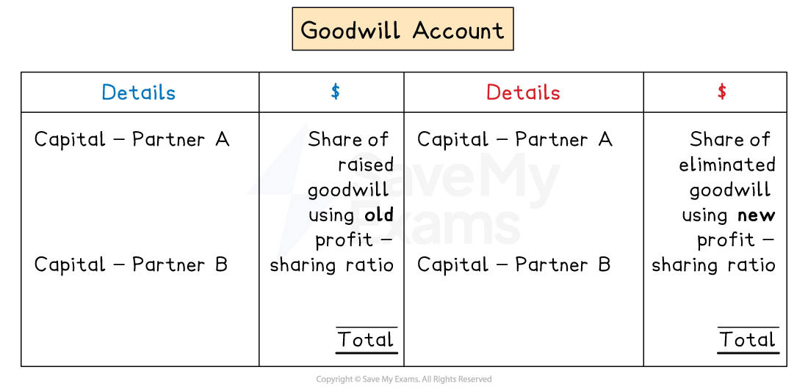

# Goodwill

## Goodwill

> **Spec point** — `spcpt_wMJytKJpJPVWbQSG` · goodwill and the difference between purchased goodwill and inherent goodwill

## Goodwill

### What is goodwill?

- Goodwill is an **intangible non-current asset**
- It has** no physical existence**
- It **cannot be sold separately** from the business

### Why might a business have goodwill?

- The following are reasons why a business might have goodwill

  - A good **reputation**, well-known **brand **and strong **image**
  - Having many **loyal customers**
  - Having **good relationships** with **suppliers**
  - Being in a **good location**
  - Having **experienced **and **efficient employees**

### What is the difference between inherent and purchased goodwill?

- **Inherent **goodwill is **internally generated**

  - A business gains this naturally over time by their continued efforts
- **Inherent **goodwill is **not included** in the financial statements or maintained in the book of accounts because:

  - its valuation is highly subjective as there is not an agreed formula to measure it
  - the assets of a business should not be overstated according to the prudence concept
  - the factors that create goodwill (like reputation) are difficult to measure in monetary terms

- **Purchased **goodwill  is gained when a business is **purchased **or **taken over **by another business
- **Purchased **goodwill is calculated by **subtracting **the **fair value** of the net assets from the** price paid**
- **Purchased **goodwill is included in the financial statements and maintained in the book of accounts

### Why should I use a goodwill account for inherent goodwill?

- Use a goodwill account  when there is a **change in a partnership**

  - change in the partners' profit-sharing ratio
  - introduction of a new partner
  - retirement of an existing partner
  - *dissolution *of a partnership
- The **partners' capital** accounts are adjusted so that the goodwill account can be immediately written off

  - The value of the goodwill is **added **to the partners' capital accounts using the **old **profit-sharing ratio
  
    - These are **credit **entries to the capital accounts
  - The goodwill is then **eliminated **by **subtracting **the value from the partners' capital accounts using the **new **profit-sharing ratio
  
    - These are **debit **entries to the capital accounts

### What is the layout of a goodwill account?

- Goodwill is **raised **by making entries on the **debit **side

  - It is shared between the partners' capital accounts using the **old **ratio
  - It is on the debit side as it represents an **asset**
- Goodwill is **written off** by making entries on the **credit **side

  - It is shared between the partners' capital accounts using the **new **ratio

*Layout of a goodwill account for inherent goodwill*

> **Exam Hint**
> You will not be asked to prepare a goodwill account for inherent goodwill. However, you can still use one if you find them helpful.

> **Worked Example**
> Tom and Jerry are in a partnership and they share profits and losses equally.
> 
> On 1 January 2026, they changed their partnership agreement so that the profit and loss sharing ratio would be Tom 40% and Jerry 60%.
> 
> The balances on the capital accounts at 31 December 2025 were:
> 
> |   | \$ |
> |---|---|
> | Tom | 40 000 |
> | Jerry | 50 000 |
> 
> Goodwill was valued at two times the average profits of the last three years.
> 
> The profits for the last three years were:
> 
> |   | \$ |
> |---|---|
> | 2025 | 42 000 |
> | 2024 | 38 000 |
> | 2023 | 31 000 |
> 
> Calculate the capital account balance of each partner at 1 January 2026.
> 
> **Answer**:
> 
> Calculate the average profit of the last three years
> 
> $\frac{\$ 42 000 + \$ 38 000 + \$ 31 000}{3} = \$ 37 000$
> 
> Find the value of the goodwill
> 
> $2 \times \$ 37 000 = \$ 74 000$
> 
> Calculate the share of the goodwill using the old ratio
> 
> *Tom: *$\$ 74 000 \div 2 = \$ 37 000$
> 
> *Jerry: *$\$ 74 000 \div 2 = \$ 37 000$
> 
> Calculate the share of the goodwill using the new ratio
> 
> *Tom: *$\$ 74 000 \times 40 \% = \$ 29 600$
> 
> *Jerry: *$\$ 74 000 \times 60 \% = \$ 44 400$
> 
> Calculate the new capital balances
> 
> - Add the share of goodwill using the old ratio
> - Subtract the share of goodwill using the new ratio
> 
> |   | Tom  \$ | Jerry  \$ |
> |---|---|---|
> | Balance at 31 December 2025 | 40 000 | 50 000 |
> | Goodwill | 37 000 | 37 000 |
> | Goodwill eliminated | <u>(29 600)</u> | <u>(44 400)</u> |
> | Capital account at 1 January 2026 | **Final answer:** **47 400** | **Final answer:** **42 600** |
