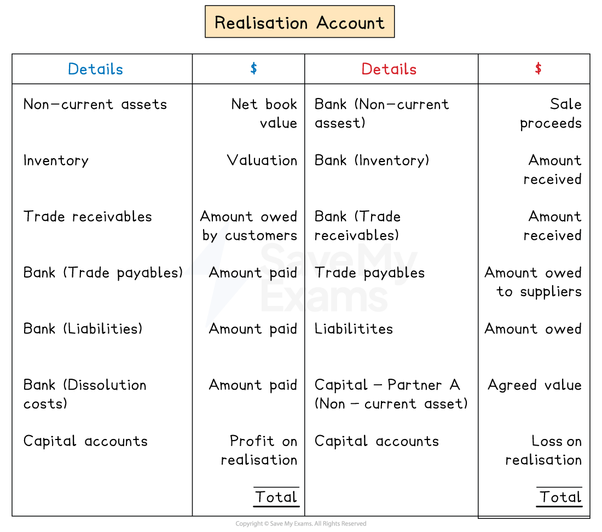

# Realisation Account

## Realisation account

> **Spec point** — `spcpt_k2g6TWNZw2YspKn3` · how to prepare a realisation account

## Realisation account

### What is a realisation account?

- A realisation account is used when a business (usually a partnership) is being **dissolved**, **sold**, or **acquired **by another business
- It is a **temporary account**

  - It is **opened **only when the **business is closing**
- It is used to **close the accounting books** of the old partnership and calculate the **final profit or loss on realisation**

  - This is the overall net gain or loss made from selling off or dissolving the business
- The resulting profit or loss is then **transferred** to the **partners' capital accounts** in their profit-sharing ratio

  - The realisation account is then closed
- It is very similar to a **revaluation account**

### How do I prepare a realisation account?

- **STEP 1**
Enter the **non-current assets **into the realisation account

  - Non-The **current net book value** is entered on the **debit **side
  - The **proceeds **from the sale of the assets is entered on the **credit **side
  
    - This includes an agreed amount if a partner takes an asset for their personal use
- **STEP 2**
Enter the **current assets **(apart from the bank balance) into the realisation account

  - The** current amount owed **by customers is entered on the **debit **side
  - The **actual amount received **is entered on the **credit **side
- **STEP 3**
Enter the **liabilities** (apart from the bank overdraft)** **into the realisation account

  - The **current amount owed** to suppliers is entered on the **credit **side
  - The **actual amount paid** is entered on the **debit **side
- **STEP 4**
Enter any additional amounts such as **discounts **or **realisation costs**

  - **Expenses **are entered on the **debit **side
  
    - Such as discount allowed, realisation costs
  - **Incomes **are entered on the **credit **side
  
    - Such as discount received
- **STEP 5**
Find the **balancing figure**

  - It is a net **profit **on realisation if it is on the **debit **side
  - It is a net **loss **on realisation if it is on the **credit **side
- **STEP 6**
Share the net profit or loss on realisation between the **partners' capital accounts** using the profit-sharing ratio

*Layout of a realisation account*

> **Exam Hint**
> Remember, the bank balance or the bank overdraft is not entered into the realisation account.
> 
> If you struggle to remember what goes on which side, then consider the other side of the transaction.
> 
> For example, to remove a loan, a debit entry is made in its account. Therefore, the entry in the realisation account is on the credit side.

> **Worked Example**
> Clark and Lois were in partnership sharing profits and losses in the ratio 3:2 respectively.
> 
> The statement of financial position at 31 December 2025 was as follows:
> 
> |   | \$ | \$ | \$ |
> |---|---|---|---|
> | **Assets** |   |   |   |
> | Non-current assets |   |   | 125 000 |
> | Current assets |   |   |   |
> | Inventory |   | 37 000 |   |
> | Trade receivables |   | <u>23 000</u> | <u>60 000</u> |
> | Total assets |   |   | <u>185 000</u> |
> | **Capital and liabilities** |   |   |   |
> | Capital | Clark | Lois | Total |
> | Capital accounts | 80 000 | 60 000 | 140 000 |
> | Current accounts | <u>(1 000)</u> | <u>5 000</u> | <u>4 000</u> |
> |   | <u>79 000</u> | <u>65 000</u> | 144 000 |
> | Non-current liabilities |   |   |   |
> | Bank loan |   |   | 20 000 |
> | Current liabilities |   |   |   |
> | Bank overdraft |   | 8 000 |   |
> | Trade payables |   | <u>13 000</u> | <u>21 000</u> |
> | Total capital and liabilities |   |   | <u>185 000</u> |
> 
> The partners agreed to dissolve the partnership on 31 December 2025.
> 
> The following transactions took place as part of the dissolution process.
> 
> 1. As part of his settlement, Clark took a vehicle with a net book value of \$20 000.
> 2. As part of her settlement, Lois took a vehicle with a net book value of \$25 000.
> 3. All remaining non-current assets were sold for \$75 000.
> 4. Inventory was sold for \$29 000.
> 5. Irrecoverable debts of \$500 were written off and the remaining credit customer paid their balances in full.
> 6. \$22 500 was paid to clear the bank loan including early repayment charges.
> 7. Trade payables were paid in full.
> 8. Dissolution costs of \$3 000 were paid.
> 
> Prepare the realisation account to record the dissolution of the partnership.
> 
> **Answer**:
> 
> Calculate the amount received from trade receivables
> 
> *\$23 000 - \$500 = \$22 500*
> 
> Enter the amounts into the realisation account
> 
> - Find the balancing figure
> 
> *\$223 500 - \$204 500 = \$19 000*
> 
> - Share the figure between Clark and Lois
> 
> *\$19 000 ÷ (3 + 2) = \$3 800*
> 
> *Clark: 3 × \$3 800 = \$11 400*
> 
> *Lois: 2 × \$3 800 = \$7 600*
> 
> |   | \$ |   | \$ |
> |---|---|---|---|
> | Non-current assets | 125 000 | Capital - Clark (Vehicle) | 20 000 |
> | Inventory | 37 000 | Capital - Lois (Vehicle) | 25 000 |
> | Trade receivables | 23 000 | Bank (Non-current assets) | 75 000 |
> | Bank (Bank loan) | 22 500 | Bank (Inventory) | 29 000 |
> | Bank (Trade payables) | 13 000 | Bank (Trade receivables) | 22 500 |
> | Dissolution costs | 3 000 | Bank loan | 20 000 |
> |   |   | Trade payables | 13 000 |
> |   |   | Capital - Clark (Loss on realisation) | 11 400 |
> |   | <u>                </u> | Capital - Lois (Loss on realisation) | <u>7 600</u> |
> |   | <u>223 500</u> |   | <u>223 500</u> |
