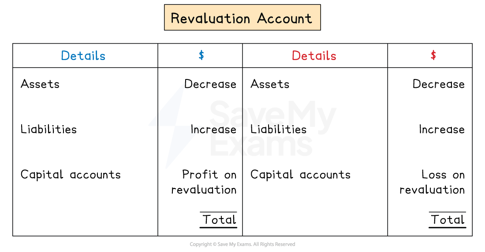

# Revaluation Account

## Revaluation account

> **Spec point** — `spcpt_9rRTbyYVscYnRWwh` · how to prepare a revaluation account

## Revaluation account

### What is a revaluation account?

- A **revaluation **account is a **temporary** account
- It is used to calculate the **net profit or loss** when **adjusting **the book values of assets and liabilities to their **current fair values**
- It is used when a **partnership continues to operate** but its **structure changes**

  - Such as the introduction of a new partner or the retirement of an existing partner

### Why is a revaluation account used?

- It is important that an **accurate current value** of a business is found before making any changes to the structure of the partnership
- The **assets **might have** increased** in value since their purchase

  - The current partners should benefit from this increase before changing the structure
- Revaluing assets and liabilities, **before **changing the structure of the partnership, ensure that

  - new partners do not unfairly benefit from past gains
  - new partners are not unfairly penalised for past losses

### How do I prepare a revaluation account?

- **STEP 1**
Work out the increase or decrease of each **asset**

  - **Increases **are on the **credit **side
  - **Decreases **are on the **debit **side
- **STEP 2**
Work out the increase or decrease of each **liability**

  - **Increases **are on the **debit **side
  - **Decreases **are on the **credit **side
- **STEP 3**
Find the **balancing figure**

  - It is a net **profit **on revaluation if it is on the **debit **side
  - It is a net **loss **on revaluation if it is on the **credit **side
- **STEP 4**
Share the net profit or loss on revaluation between the **partners' capital accounts** using the **old **profit-sharing ratio

*Layout of a revaluation account*

> **Exam Hint**
> If you struggle to remember what goes on which side, then consider the other side of the transaction.
> 
> For example, if an asset increases in value, then the asset account will have a debit entry to increase its value. Therefore, the revaluation account will have a credit entry.
> 
> Questions do not tend to ask you to prepare the revaluation account, they mainly ask you to find the effects on the capital accounts. However, it is helpful to sketch a quick revaluation account to help with this calculation.

> **Worked Example**
> Ameena and Bilal are in partnership and share profits and losses in the ratio 7:4 respectively.
> 
> The following balances were available on 31 December 2025.
> 
> |   | \$ |
> |---|---|
> | Vehicles at cost | 30 000 |
> | Accumulated depreciation of vehicles | 12 500 |
> | Trade receivables | 62 500 |
> | Inventory | 11 000 |
> | Capital accounts |   |
> | Ameena | 60 000 |
> | Bilal | 35 000 |
> 
> Ameena and Bilal admit a new partner, Carry, on 1 January 2026. Profits and losses are to be shared between Ameena, Bilal and Carry in the ratio 4:2:1 respectively.
> 
> They agree the following valuations:
> 
> |   | \$ |
> |---|---|
> | Vehicles | 20 000 |
> | Inventory | 9 000 |
> 
> They also agreed to write off trade receivables' balances totalling \$6 000 as irrecoverable debts.
> 
> Find the balance on Ameena's capital account after the revaluation.
> 
> **Answer**:
> 
> Calculate the net book value of the vehicles before the revaluation
> 
> *\$30 000 - \$12 500 = \$17 500*
> 
> Calculate the increase in value of the vehicles
> 
> *\$20 000 - \$17 500 = \$2 500*
> 
> Calculate the decrease in inventory
> 
> *\$11 000 - \$9 000 = \$2 000*
> 
> Work out the net loss on revaluation
> 
> |   | \$ |
> |---|---|
> | Increase in vehicles | 2 500 |
> | Decrease in inventory | (2 000) |
> | Decrease in trade receivables | <u>(6 000)</u> |
> | Loss on revaluation | <u>(5 500)</u> |
> 
> Find the share of the loss for Ameena using the old ratio
> 
> `$ 5 500×7 / 11=$ 3 500`
> 
> Note that the revaluation account would look like:
> 
> **Revaluation account**
> 
> |   |   | \$ |   |   | \$ |
> |---|---|---|---|---|---|
> | 2026 |   |   | 2026 |   |   |
> | Jan 1 | Inventory | 2 000 | Jan 1 | Vehicles | 2 500 |
> |   | Trade receivables | 6 000 |   | Capital - Ameena (loss on revaluation) | 3 500 |
> |   |   | <u>                 </u> |   | Capital - Bilal (loss on revaluation) | <u>2 000</u> |
> |   |   | <u>8 000</u> |   |   | <u>8 000</u> |
> 
> Calculate Ameena's capital account balance
> 
> |   | \$ |
> |---|---|
> | Increase in vehicles | 2 500 |
> | Balance on 31 December 2025 | 60 000 |
> | Loss on revaluation | <u>(3 500)</u> |
> | Balance on 1 January 2026 | **Final answer:** **56 500** |
> 
> **Final answer:** **\$56 500**
