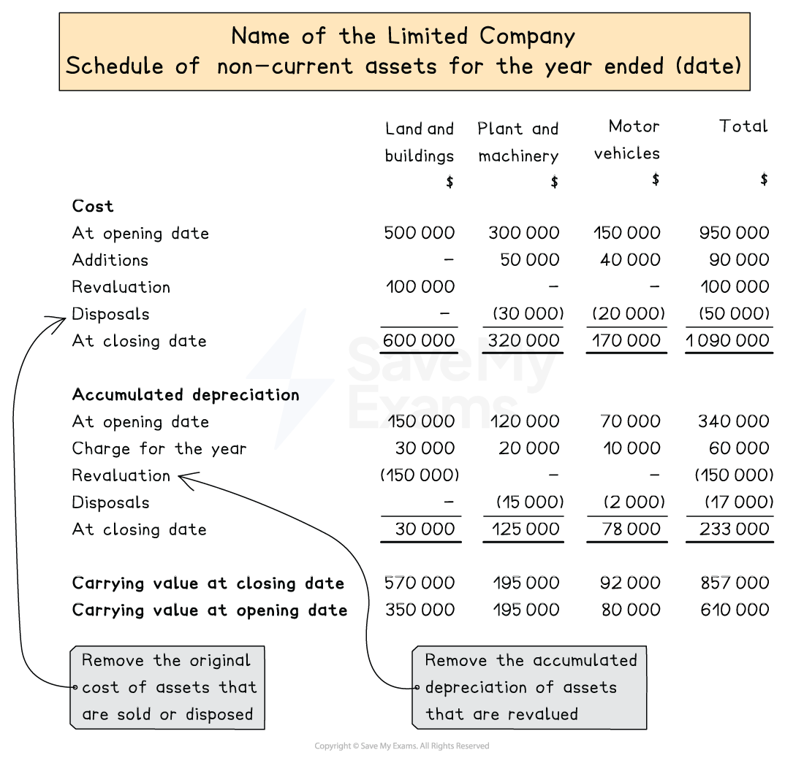

# Schedule of Non-current Assets

## Schedule of non-current assets

> **Spec point** — `spcpt_YGJwhf94RgqVzkyn` · how to prepare for a limited company in line with the relevant international accounting standards and legal requirements:
– schedule of non-current assets

## Schedule of non-current assets

### What is a schedule of non-current assets?

- A schedule of non-current assets is a **note **to the **statement of financial position**

  - It is required under ***IAS 16***
- It shows the movement in **cost or valuation** and **accumulated depreciation** for each class of non-current asset
- It has a **column **for each **class **of non-current asset and a column for the total

  - Classes include: land and buildings, plant and machinery, motor vehicles, etc

### How do I prepare a schedule of non-current assets?

#### Cost section

- Start with the balances at the **start of the year**
- **Add **any **additions **or **acquisitions**

  - These are the non-current assets that the business has gained during the year
- **Subtract **any **disposals**
- **Add **or **subtract **any amounts due to **revaluations**
- This gives you the balances at the **end of the year**

#### Accumulated depreciation section

- Start with the balances at the **start of the year**
- **Add **the depreciation **charge for the year**

  - Check whether assets sold or purchased during the year are charged depreciation
- **Subtract **the accumulated depreciation for **disposed assets**
- **Subtract **the accumulated depreciation for **revalued assets**
- This gives you the balances at the **end of the year**

#### Carrying value section

- State the carrying values at the **start of the year**
- State the carrying values at the **end of the year**

  - They should equal the closing balances for the cost minus the closing balances for the accumulated depreciation

*Layout of a schedule of non-current assets*

#### Actions for each transaction

| Event | Cost section | Accumulated depreciation section |
|---|---|---|
| Addition (purchase) | Add the cost | No entry |
| Disposal | Deduct the original cost | Deduct the accumulated depreciation |
| Revaluation (upward) | Add the increase in value | Deduct any existing accumulated depreciation |
| Revaluation (downward) | Deduct the decrease in value | Deduct any existing accumulated depreciation |
| Depreciation charge for the year | No entry | Add the charge for the year |

> **Exam Hint**
> When an asset is **revalued**, the existing accumulated depreciation on that asset is **eliminated** (deducted) from the accumulated depreciation section. After revaluation, the asset sits at its new fair value with a clean slate of zero accumulated depreciation.

> **Worked Example**
> The cost section and accumulated depreciation section of Omega plc’s schedule of non-current assets at 31 December 2024 are as follows:
> 
> |   | **Land and buildings**  **\$** | **Plant and machinery**  **\$** | **Motor vehicles**  **\$** |
> |---|---|---|---|
> | **Cost** |   |   |   |
> | At 1 January 2024 | 300 000 | 210 000 | 140 000 |
> | Additions | 100 000 | 40 000 | - |
> | **At 31 December 2024** | **400 000** | **250 000** | **140 000** |
> |   |   |   |   |
> | **Accumulated depreciation** |   |   |   |
> | At 1 January 2024 | 70 000 | 85 000 | 56 000 |
> | Charge for the year | 10 000 | 33 000 | 28 000 |
> | **At 31 December 2024** | **80 000** | **118 000** | **84 000** |
> 
> **The following information has been provided for the year ended 31 December 2025:**
> 
> 1. The 'Land and buildings' balance at 31 December 2024 consists of Land costing \$200 000 and Buildings costing \$200 000. On 1 January 2025, the directors decided to revalue the land upwards to \$290 000.
> 2. On 1 April 2025, a new machine was purchased at a cost of \$55 000.
> 3. During the year, a motor vehicle which had originally cost \$30 000 was sold for \$11 000. There was a \$1 000 loss on disposal.
> 4. The company's depreciation policy is as follows:
> 
>   - **Land:** No depreciation is charged.
>   - **Buildings:** 5% per annum using the straight-line method.
>   - **Plant and machinery:** 20% per annum using the reducing balance method.
>   - **Motor vehicles:** 20% per annum using the straight-line method.
> 5. A full year's depreciation is provided in the year of acquisition and none is provided in the year of disposal.
> 
> Prepare the schedule of non-current assets for Omega plc for the year ended 31 December 2025, suitable for use as a note to the financial statements.
> 
> **Answer**:
> 
> Calculate the carrying values at 31 December 2024
> 
> |   | **Land and buildings**  **\$** | **Plant and machinery**  **\$** | **Motor vehicles**  **\$** |
> |---|---|---|---|
> | Cost | 400 000 | 250 000 | 140 000 |
> | Accumulated depreciation | <u>80 000</u> | <u>118 000</u> | <u>84 000</u> |
> | Carry value | <u>320 000</u> | <u>132 000</u> | <u>56 000</u> |
> 
> Calculate the increase in the value of the land due to the revaluation
> 
> *\$290 000 - \$200 000 = \$90 000*
> 
> Calculate the accumulated depreciation of the sold vehicle
> 
> - Calculate the net book value by adding the loss to the sale proceeds
> 
> *\$11 000 + \$1 000 = \$12 000*
> 
> - Subtract this from the original cost
> 
> *\$30 000 - \$12 000 = \$18 000*
> 
> Calculate the depreciation charge for the year
> 
> - Buildings
> 
> *5% × \$200 000 = \$10 000*
> 
> - Plant and machinery
> 
>   - Add the purchase price to the carrying value from the start of the year
> 
> *20% × (\$132 000 + \$55 000) = \$37 400*
> 
> - Motor vehicles
> 
>   - Subtract the cost of the sold vehicle
> 
> *20% × (\$140 000 - \$30 000) = \$22 000*
> 
> **Omega plc**
> 
> **Schedule of Non-Current Assets for the year ended 31 December 2025**
> 
> |   | **Land and buildings**  **\$** | **Plant and machinery**  **\$** | **Motor vehicles**  **\$** | Total  \$ |
> |---|---|---|---|---|
> | **Cost or Valuation** |   |   |   |   |
> | At 1 January 2025 | 400 000 | 250 000 | 140 000 | 790 000 |
> | Revaluation | 90 000 | - | - | 90 000 |
> | Additions | - | 55 000 | - | 55 000 |
> | Disposals | <u>-</u> | <u>-</u> | <u>(30 000)</u> | <u>(30 000)</u> |
> | At 31 December 2025 | <u>490 000</u> | <u>305 000</u> | <u>110 000</u> | <u>905 000</u> |
> |   |   |   |   |   |
> | **Accumulated Depreciation** |   |   |   |   |
> | At 1 January 2025 | 80 000 | 118 000 | 84 000 | 282 000 |
> | Charge for the year | 10 000 | 37 400 | 22 000 | 69 400 |
> | Disposals | <u>-</u> | <u>-</u> | <u>(18 000)</u> | <u>(18 000)</u> |
> | At 31 December 2025 | <u>90 000</u> | <u>155 400</u> | <u>88 000</u> | <u>333 400</u> |
> |   |   |   |   |   |
> | **Carrying Amount** |   |   |   |   |
> | At 31 December 2025 | 400 000 | 149 600 | 22 000 | 571 600 |
> | At 31 December 2024 | 320 000 | 132 000 | 56 000 | 508 000 |
