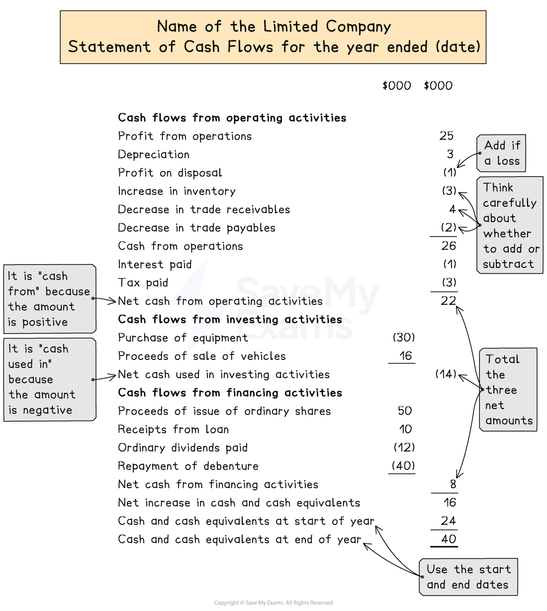

# Statement of Cash Flows

## Statements of cash flows

> **Spec point** — `spcpt_VmYQT3pbR4jgPTQv` · how to prepare for a limited company in line with the relevant international accounting standards and legal requirements:
– statement of cash flows

## Statements of cash flows

### What is a statement of cash flows?

- A statement of cash flows shows the **movement of cash** and cash equivalents during the year
- It separates the cash flows into three sections to show the** cash from or used in** these activities

  - Cash flows from **operating **activities
  - Cash flows from **investing **activities
  - Cash flows from **financing **activities
- Use "**cash from**" if the net cash for the activities is **positive**
- Use "**cash used in**" if the net cash for the activities is **negative**

### What are the uses of a statement of cash flows?

- To show the amount of money that has **entered **and **left **the business during a period
- To show why the **profit **for a period is **different **to the **increase in cash**
- To show **sources of finance** during a period
- To enable the directors to assess the **liquidity **of the business
- To enable stakeholders to see **how well cash has been used**
- To enable stakeholders to **compare **the year's cash flow with **previous years** or with **other businesses**

### How do I prepare a statement of cash flows?

#### Cash flows from operating activities

- Start with the **profit from operations**

  - This is the profit **before **loan interest and tax
- Make adjustments for **non-cash items** included in the calculation for the profit

  - **Add **the **depreciation **charge for the year
  - **Add **the **loss on disposal **of non-current assets
  - **Subtract **the **profit on disposal** of non-current assets
- Make adjustments for** changes in working capital**

  - Change in **inventories**
  
    - **Add **if it is a **decrease**
    - **Subtract **if it is an **increase**
  - Change in **trade receivables**
  
    - **Add **if it is a **decrease**
    - **Subtract **if it is an **increase**
  - Change in **trade payables**
  
    - **Add **if it is an **increase**
    - **Subtract **if it is a **decrease**
- This gives the **cash from or used in operations**
- **Subtract **the actual amount paid for **interest **and **tax**
- This gives the **net cash from or used in operating activities**

> **Exam Hint**
> It can be helpful to understand why changes to assets and liabilities are added or subtracted from the cash flows from operating activities.
> 
> A decrease to an asset is added to the cash flow because a part of its balance at the beginning of the year has been converted to cash. Whereas, a decrease to a liability is subtracted from the cash flow because the company has paid some of the balance off.

#### Cash flows from investing activities

- **Add **the **sale proceeds** from the disposals of non-current assets
- **Subtract **the **purchase **amounts of non-current assets
- The net amount is the** net cash from or used in investing activities**

  - It is usually net cash used in investing activities

#### Cash flows from financing activities

- **Add** the **amounts raised** to finance the company

  - Issue of share capital
  - Money from new debentures or loans
- **Subtract **the amounts paid to investors, lenders and shareholders

  - Repayment of debentures or loans
  - Dividends paid
- The net amount is the** net cash from or used in financing activities**

> **Exam Hint**
> A bonus issue raises no cash, so it is excluded from the cash flow statement. A rights issue raises cash, so the full amount received (nominal value + share premium) appears as a cash inflow under financing activities.

*Layout of a statement of cash flows*

### How do I calculate the profit from operations?

- You might be given the profit from operations in the question or you might be required to calculate it
- You can calculate the profit or the loss for the year by looking at the **change in equity**

  - Calculate the change in **retained earnings**
  - **Add **back the **dividends **paid
  - Add back any amounts of retained earnings that were **transferred **or used in a **bonus issue of shares**
- You can then **work backwards** from the profit or loss to find the profit from operations

  - **Add **back the amount due for **finance costs** for the year
  - **Add **back the amount due for **taxation **for the year

> **Exam Hint**
> The amounts due for interest and tax might not be the amounts that were actually paid. The amounts due are used to calculate the profit from operations. The amounts paid are used to calculate the net cash from operating activities.

> **Worked Example**
> W plc's financial year ends on 31 December.
> 
> The following information for the year ended 31 December 2025 is available.
> 
> 1. The following balances are given.
> 
> |   | 1 January 2025  \$ | 31 December 2025  \$ |
> |---|---|---|
> | Inventory | 29 000 | 21 000 |
> | Trade receivables | 32 000 | 33 000 |
> | Trade payables | 27 000 | 30 000 |
> | Cash and cash equivalents | 11 000 | 17 000 |
> | Accrued loan interest | - | 1 000 |
> | Ordinary share capital | 100 000 | 120 000 |
> | Share premium | 10 000 | 20 000 |
> | Retained earnings | 30 000 | 34 000 |
> | Debentures | 20 000 | 20 000 |
> 
> 2. The following balances were on 1 January 2025.
> 
> |   | \$ |
> |---|---|
> | Non-current assets at cost | 200 000 |
> | Provision for depreciation | 85 000 |
> 
> 3. Office equipment costing \$25 000 was sold for \$7 000. It had a carrying value of \$10 000 at the point of sale. New office equipment was purchased for \$105 000. Non-current assets are depreciated at 20% per annum using the straight-line method. A full year's depreciation is charged in the year of purchase but none is charged in the year of disposal.
> 4. There was a rights issue of shares during the year.
> 5. Loan interest, \$1 000, was paid.
> 6. Taxation, \$2 000, was paid.
> 7. Dividends, \$12 000, were paid.
> 
> (a) Calculate the profit for the year 2025.
> 
> (b) Prepare the statement of cash flows for the year ended 31 December 2025.
> 
> **Answer**:
> 
> **(a)**
> 
> Calculate the profit
> 
> - Find the increase in the retained earnings
> - Add the dividends paid
> 
> |   | \$ |
> |---|---|
> | Retained earnings at 31 December 2025 | 34 000 |
> | Retained earnings at 1 January 2025 | (30 000) |
> | Dividends paid | <u>12 000</u> |
> | Profit for the year | <u>16 000</u> |
> 
> **Final answer:** **Profit for the year was \$16 000**
> 
> **(b)**
> 
> Calculate the loan interest that was due
> 
> - Add the amount paid to the amount that is still accrued
> 
> *\$1 000 + \$1 000 = \$2 000*
> 
> Calculate the profit from operations
> 
> |   | \$ |
> |---|---|
> | Profit for the year | 16 000 |
> | Add: Loan interest | 2 000 |
> | Add: Tax | <u>2 000</u> |
> | Profit from operations | <u>20 000</u> |
> 
> Calculate the depreciation charge for the year
> 
> - Find the total cost of the non-current assets at the end of the year
> 
> *\$200 000 - \$25 000 + \$105 000 = \$280 000*
> 
> - Find 20% of this amount
> 
> *20% × \$280 000 = \$56 000*
> 
> Calculate the loss on sale of equipment
> 
> *\$10 000 - \$7 000 = \$3 000*
> 
> Calculate the amount received from the rights issue
> 
> - Subtract the old share capital from the new share capital
> 
> *(\$120 000 + \$20 000) - (\$100 000 + \$10 000) = \$30 000*
> 
> Calculate the change in inventory, trade receivables and trade payables
> 
> |   |   | \$ |   |
> |---|---|---|---|
> | Inventory | *29 000 - 21 000* | 8 000 | Decrease |
> | Trade receivables | *33 000 - 32 000* | 1 000 | Increase |
> | Trade payables | *30 000 - 27 000* | 3 000 | Increase |
> 
> Prepare the statement of cash flows
> 
> |   | \$000 | \$000 |
> |---|---|---|
> | **Cash flows from operating activities** |   |   |
> | Profit from operations |   | 20 |
> | Depreciation |   | 56 |
> | Loss on sale of equipment |   | 3 |
> | Decrease in inventory |   | 8 |
> | Increase in trade receivables |   | (1) |
> | Increase in trade payables |   | <u>3</u> |
> | Cash from operations |   | 89 |
> | Interest paid |   | (1) |
> | Tax paid |   | <u>(2)</u> |
> | Net cash from operating activities |   | 86 |
> | **Cash flows from investing activities** |   |   |
> | Purchase of equipment | (105) |   |
> | Proceeds of sale of equipment | <u>7 </u> |   |
> | Net cash used in investing activities |   | (98) |
> | **Cash flows from financing activities** |   |   |
> | Proceeds of rights issue of ordinary shares | 30 |   |
> | Dividends paid | <u>(12)</u> |   |
> | Net cash from financing activities |   | <u>18 </u> |
> | Net increase in cash and cash equivalents |   | 6 |
> | Cash and cash equivalents at 1 January 2025 |   | <u>11 </u> |
> | **Cash and cash equivalents at 31 December 2025** |   | <u>17 </u> |
