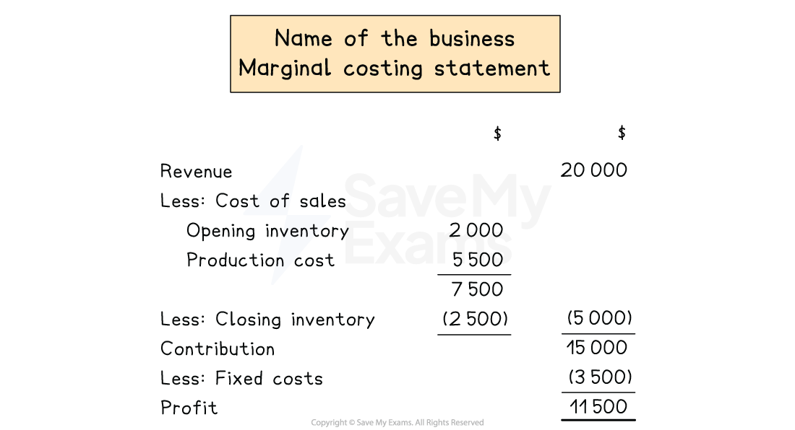
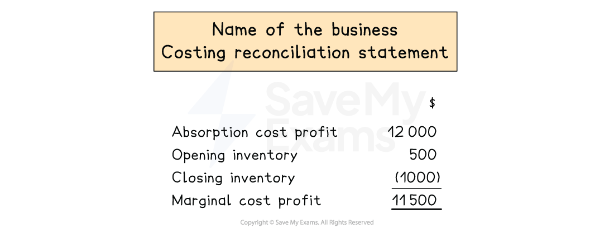

# Reconciliation between Profit Statements

## Profit statements using marginal costing

> **Spec point** — `spcpt_N8ptD5gtGYddDW2S` · how to prepare costing and profit statements using marginal costing

## Profit statements using marginal costing

### What are profit statements?

- Profit statements show the **profit **or** loss **made from selling a product/service

### How do I prepare a profit statement using marginal costing?

- **STEP 1** Calculate the **sales revenue **

  - Selling price per unit × number of units sold
- **STEP 2 ** Calculate the **cost of sales**

  - Start with opening inventory
  - **Add** production cost
  
    - **Excluding **the fixed costs
  - **Subtract** closing inventory
- **STEP 3**
Calculate the** contribution**

  - Revenue - variables
- **STEP 4**
**Subtract **the fixed costs

*Layout of a profit statement using marginal costing*

> **Worked Example**
> Jane manufactures a single product. She uses a system of marginal costing.
> 
> The following budgeted data is available for one unit of the product.
> 
> |   | \$ |
> |---|---|
> | Selling price | 14 |
> | Direct materials | 4 |
> | Direct labour | 3 |
> 
> On 1 August, Jane held 2 000 units.
> 
> The following actual results are available.
> 
> Sales: 12 000 units
> 
> Production: 18 000 units
> 
> Fixed overheads: \$25 000
> 
> Prepare the profit statement for the month of August to calculate the profit or loss.
> 
> **Answer: **
> 
> - Sales revenue *\$14 × 12 000 = \$168 000*
> - Production cost
> 
>   - Direct materials *\$4 × 18 000 = \$72 000 *
>   - Direct labour *\$3 × 18 000 = \$54 000*
>   - Total
> 
> *\$72 000 + \$54 000 = \$126 000*
> 
> - Opening inventory *(\$4 + \$3) × 2 000 = \$14 000*
> - Closing inventory *Opening inventory + Production - Sales * *= 2 000 + 18 000 - 12 000 * *= 8 000 units* *(\$4 + \$3) ×  8 000 = \$56 000*
> 
> **Profit statement for the month of August**
> 
> |   |   | \$ |
> |---|---|---|
> | Revenue |   | 168 000 |
> | Cost of sales: |   |   |
> | Opening inventory | 14 000 |   |
> | Production costs | 126 000 |   |
> | Less: Closing inventory | <u>(56 000)</u> | <u>(84 000)</u> |
> | Contribution |   | 84 000 |
> | Less: Fixed overheads |   | <u>(25 000)</u> |
> | Profit for the month |   | <u>59 000</u> |
> 
> **Final answer:** **Profit for August is \$57 000**

## Reconciliation between absorption and marginal costing

> **Spec point** — `spcpt_MDdJ65q7q84xnbF8` · how to prepare a statement reconciling the reported profits using marginal costing and absorption costing

## Reconciliation between absorption and marginal costing

### How is reconciliation between absorption and marginal costing done?

- A **statement **reconciling the reported **profits** using absorption and marginal costing is prepared
- A difference arises because of **fixed manufacturing overheads **being treated** differently **

  - In **marginal** costing, fixed manufacturing overheads are charged fully **to the period **
  - In **absorption** costing, fixed manufacturing overheads are absorbed into **product cost** and can be carried forward in closing inventory or released from opening inventory
- When **opening **inventory is **greater **than the **closing **inventory

  - **Marginal **profit is **higher **than **absorption **profit
- When **closing **inventory is **greater **than **opening **inventory

  - **Absorption **profit is **higher **than **marginal **profit

### How is inventory valued using absorption and marginal costing?

- In **absorption **costing, **fixed costs** are **absorbed** into inventory

  - Fixed manufacturing overheads are included when calculating the value of inventory
  - When calculating value of opening inventory: `Opening スペース units スペース かける 開き括弧 Total スペース direct スペース costs スペース たす スペース Variable スペース manufacturing スペース overheads スペース たす スペース Fixed スペース manufacturing スペース overheads 閉じ括弧`
  - When calculating value of closing inventory: `Closing スペース units スペース かける スペース 開き括弧 Total スペース direct スペース costs スペース たす スペース Variable スペース manufacturing スペース overheads スペース たす スペース Fixed スペース manufacturing スペース overheads 閉じ括弧`
- In **marginal **costing, **fixed costs** are** excluded** from inventory

  - Only variable costs are included when calculating the value of inventory
  - When calculating value of opening inventory: `Opening スペース units スペース かける スペース 開き括弧 Total スペース direct スペース costs スペース たす スペース Variable スペース manufacturing スペース overheads 閉じ括弧`
  - When calculating value of closing inventory: `Closing スペース units スペース かける 開き括弧 Total スペース direct スペース costs スペース たす 狭い空白文字 Variable スペース manufacturing スペース overheads 閉じ括弧`

### How is a reconciliation statement prepared?

- **STEP 1** Calculate profit as per** absorption costing **

  - Start with sales revenue
  - **Subtract** production cost which includes:
  
    - Direct materials
    - Direct labour
    - Other direct costs
    - Variable manufacturing overheads
    - Fixed  manufacturing overheads
  - **Subtract** operating expenses
  
    - Administration costs
    - Selling & distribution costs
- **STEP 2** Add the difference in** opening inventory **

  - Calculate opening inventory for** absorption** costing
  - Calculate opening inventory for **marginal** costing
  - Calculate the **difference** in opening inventory value
- **STEP 3 ** Subtract the difference in **closing inventory **

  - Calculate closing inventory for **absorption** costing
  - Calculate closing inventory for** marginal** costing
  - Calculate the **difference** in closing inventory value
- **STEP 4 ** Check that the value equals the **profit as per marginal costing **

  - Start with sales revenue
  - **Subtract** production costs which includes:
  
    - Direct materials
    - Direct labour
    - Other direct costs
    - Variable manufacturing overheads
  - **Subtract** operating expenses
  
    - Administration costs
    - Selling & distribution costs

*Example of a cost reconciliation statement *

> **Worked Example**
> With absorption costing:
> 
> - Profit: \$9 200
> - Opening inventory: \$1 600
> - Closing inventory: \$2 000
> 
> With marginal costing:
> 
> - Profit: \$9 100
> - Opening inventory: \$1 500
> - Closing inventory: \$1 800
> 
> Prepare a statement reconciling the profit from absorption costing and marginal costing.
> 
> **Answer: **
> 
> Calculate the difference in the inventory values
> 
> *Difference in opening inventory: 1 600 - 1 500 = 100 *
> 
> *Difference in closing inventory: 2 000 - 1 800 = 200 *
> 
> |   | \$ |
> |---|---|
> | Profit from absorption costing | 9 200 |
> | Difference in opening inventory | 100 |
> | Less: Difference in closing inventory | <u>(200)</u> |
> | Profit from marginal costing | <u>9 100</u> |
