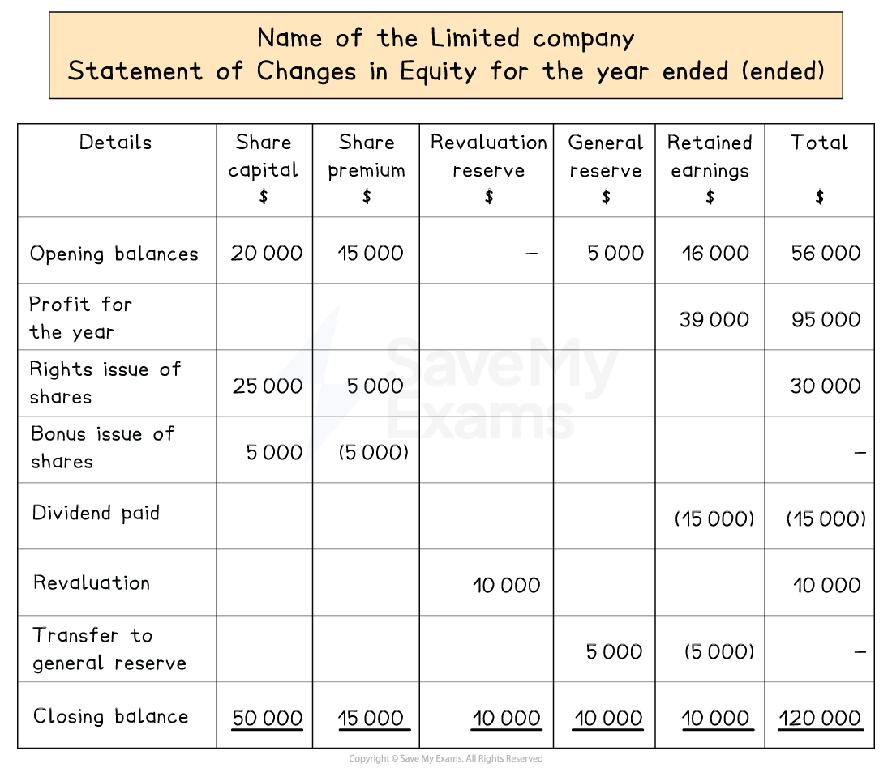

# Statement of Changes in Equity

## Statements of changes in equity

> **Spec point** — `spcpt_z6fb8VMKgKYSzBgv` · how to prepare a statement of profit or loss, statement of financial position and statement of changes in equity for a limited company. The business may be a trading or a service business

## Statements of changes in equity

### What is a statement of changes in equity?

- A **statement of changes in equity** is a statement showing how the **equity **of a limited company has **changed over a year**
- It shows the changes to:

  - The share capital
  - The share premium
  - The revaluation reserve
  - The retained earnings
  - The general reserve
- It shows how the profits are used

  - Some of the profits will be distributed to the shareholders as **dividends**
  - The remaining profits are carried forward to the next financial year as **retained earnings**
  
    - Some of the retained earnings might be transferred to the **general reserve**

*Layout of a statement of changes in equity*

### What are the reasons for the changes in the value of the total equity?

- The **equity **of the limited company is **likely to change** due to the following

  - The profit for the year is added to the retained earnings
  - The profit is distributed or paid to shareholders in the form of interim and final dividends
  - Some of the profit for the year is transferred to the general reserve

### How are dividends treated on the statement of changes in equity?

- **Shareholders **get a share or portion of the profits as **dividends**
- The statement of changes in equity shows the dividends **paid **to shareholders** during the year **for any **ordinary **shares

  - Dividends that are **paid halfway through the year **are known as **interim dividends **
  - Dividends that are **paid at the end of the year** are known as **final dividends **
- Dividends **proposed **by the directors **to be paid **are **not **to be **included in **the statement of changes in equity **until the amount is paid**

### How are rights issues and bonus issues treated on the statement of changes in equity?

- A **rights issue** **increases **the **total equity**

  - Increase the share capital and share premium
  - The total equity increases
- A **bonus issue** does **not change** the **total equity**

  - Increase the share capital
  - Decrease the share premium before other reserves
  
    - Do not use the revaluation reserve

> **Worked Example**
> On 1 April 2023, P and Q Limited supplied the following information:
> 
> - In total, there were 800 000 ordinary shares of \$0.75 each
> - The balance of the share premium was \$100 000
> - The balance of the general reserve was \$62 000
> - The retained earnings amounted to \$55 000
> 
> On 31 March 2024, P and Q Limited supplied the following information:
> 
> - The profit for the year ended 31 March 2024 was \$70 000
> - On 1 January 2024, an interim dividend of \$32 000 was paid
> - On 1 February 2024, a bonus issue of shares was made of one ordinary shares for every eight shares held
> Reserves were maintained in their most flexible form
> - On 31 March 2024, \$12 000 was transferred from the retained earnings to the general reserve
> - On 31 March 2024, the directors proposed the payment of an ordinary share dividend of 10%
> 
> Prepare the statement of changes in equity for the year ended 31 March 2024 for P and Q Limited.
> 
> **Answer**:
> 
> Identify the key information given on **1 April 2023**
> 
> - In total, there were 800 000 ordinary shares of \$0.75 each
> 
>   - Calculate the ordinary share capital on 1 April 2023 by multiplying the number of shares by the price of a share
> 
> *Ordinary share capital: 800 000 × \$0.75 = \$600 000*
> 
> - The balance of the share premium was \$100 000
> 
>   - This is the opening balance on the statement of changes in equity
> - The balance of the general reserve was \$62 000
> 
>   - This is the opening balance on the statement of changes in equity
> - The retained earnings amounted to \$55 000
> 
>   - This is the opening balance on the statement of changes in equity
> 
> Identify the key information given on **31 March 2024**
> 
> - The profit from operations for the year ended 31 March 2024 was \$90 000
> 
>   - This is before the finance costs are subtracted
> 
> - On 1 January 2024, an interim dividend of \$32 000 for the ordinary shares was paid
> 
>   - This will decrease the retained earnings
>   
>     - The interim dividend was paid in the current year so it is entered on the statement of changes in equity
> - On 1 February 2024, a bonus issue of shares was made of one ordinary shares for every eight shares held
> Reserves were maintained in their most flexible form
> 
>   - 800 000 ÷ 100 000 new shares issues
>   - 100 000 × \$0.75 = \$75 000 increase in share capital
>   - Decrease the hare premium
> - On 31 March 2024, \$12 000 was transferred from the retained earnings to the general reserve
> 
>   - This will decrease the retained earnings but increase the general reserve
> - On 31 March 2024, the directors proposed the payment of an ordinary share dividend of 10%
> 
>   - Any proposed dividend at the end of the year that remains unpaid, should not be included on the statement of changes in equity
> - Complete the statement of changes in equity using the required format
> 
>   - Remember to total up rows and columns
>   - Put brackets around values if they are to be subtracted.
> 
> | **Final answer:** **P and Q Limited**  **Final answer:** **Statement of Changes in Equity for the year ended 31 March 2024** |   |   |   |   |   |
> |---|---|---|---|---|---|
> |   | **Final answer:** **Share capital**  **Final answer:** **\$** | **Final answer:** **Share premium**  **Final answer:** **\$** | **Final answer:** **General Reserve**  **Final answer:** **\$** | **Final answer:** **Retained Earnings**  **Final answer:** **\$** | **Final answer:** **Total**  **Final answer:** **\$** |
> | **Final answer:** **On 1 April 2023** | **Final answer:** **600 000** | **Final answer:** **100 000** | **Final answer:** **62 000** | **Final answer:** **55 000** | **Final answer:** **817 000** |
> | **Final answer:** **Profit for the year** |   |   |   | **Final answer:** **70 000** | **Final answer:** **70 000** |
> | **Final answer:** **Dividend paid** |   |   |   | **Final answer:** **(32 000)** | **Final answer:** **(32 000)** |
> | **Final answer:** **Bonus issue** | **Final answer:** **75 000** | **Final answer:** **(75 000)** |   |   | **Final answer:** **-** |
> | **Final answer:** **Transfer to general reserve** |   |   | **Final answer:** **12 000** | **Final answer:** **(12 000)** | **Final answer:** **-** |
> | **Final answer:** **On 31 March 2024** | **Final answer:** **600 000** | **Final answer:** **25 000** | **Final answer:** **74 000** | **Final answer:** **81 000** | **Final answer:** **855 000** |
