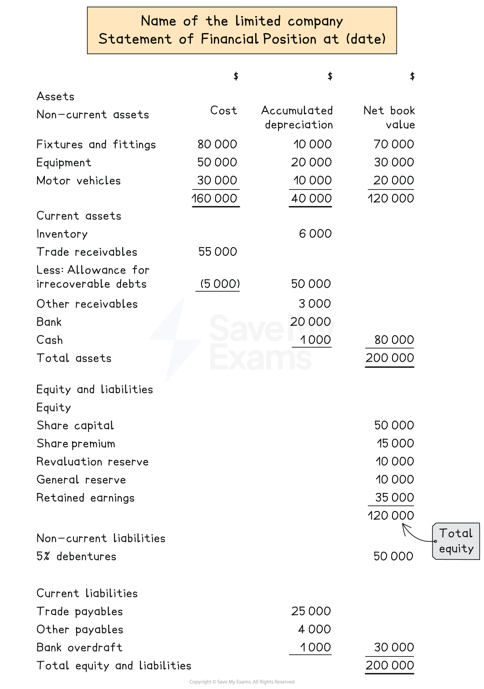

# Statement of Financial Position

## Statements of financial position for limited companies

> **Spec point** — `spcpt_2nY2VZsGBnXjsPXN` · how to prepare a statement of profit or loss, statement of financial position and statement of changes in equity for a limited company. The business may be a trading or a service business

## Statements of financial position for limited companies

### What is the layout of the statement of financial position of a limited company?

- The statement of financial position for limited companies is **mostly the same **as that of a sole trader and a partnership

  - There is **no change** to the **non-current assets**, **current assets**  and **current liabilities** sections
- Any **debentures** are included in the **non-current liabilities**
- The **capital **section of the statement of financial position is called the **equity **section
- The equity section includes

  - The share capital
  - The share premium
  - The revaluation reserve
  - The general reserve
  - The retained earnings
- The information for the equity section is obtained from the **statement of changes in equity**

*Layout of a statement of financial position for a limited company*

> **Worked Example**
> Abrakadabra Limited prepares its financial statements to 31 March each year.
> 
> On 31 March 2024, the following balances were provided:
> 
> |   | \$ |
> |---|---|
> | Inventory | 7 080 |
> | Fittings at book value | 140 000 |
> | Trade receivables | 14 400 |
> | Other receivables | 1 800 |
> | Bank | 14 965 |
> | Trade payables | 8 415 |
> | Other payables | 6 390 |
> | 4% Debentures (repayable 2034) | 46 000 |
> | Share capital (ordinary shares of \$0.50 each) | 80 000 |
> | Retained earnings | 25 800 |
> | General reserve | 2 200 |
> 
> Additional information:
> 
> - No additional shares were issued during the year
> - On 1 January 2024, dividends were paid on ordinary shares at \$0.035 per share
> - The profit for the year ended 31 March 2024 was \$15 040
> 
> Prepare the statement of financial position at 31 March 2024 for Abrakadabra Limited.
> 
> **Answer**:
> 
> Calculate the cost of the dividends payment
> 
> - Calculate the number of shares
> 
> *\$80 000 ÷ \$0.50 = 160 000 shares*
> 
> - Multiply by the payment per share
> 
> *160 000 × \$0.035 = \$5 600*
> 
> Find the updated retained earnings:
> 
> - Add the profit for the year
> - Subtract the dividends paid
> 
> *\$25 800 + \$15 040 - \$5 600 = \$35 240*
> 
> | **Final answer:** **Abrakadabra Limited**  **Final answer:** **Statement of Financial Position at 31 March 2024** |   |   |
> |---|---|---|
> |   | **Final answer:** **\$** | **Final answer:** **\$** |
> | **Final answer:** **Non-current assets** |   |   |
> | **Final answer:** **Fittings at book value** |   | **Final answer:** **140 000** |
> | **Final answer:** **Current assets** |   |   |
> | **Final answer:** **Inventory** | **Final answer:** **7 080** |   |
> | **Final answer:** **Trade receivables** | **Final answer:** **14 400** |   |
> | **Final answer:** **Other receivables** | **Final answer:** **1 800** |   |
> | **Final answer:** **Bank** | **Final answer:** **14 965** | **Final answer:** **38 245** |
> | **Final answer:** **Total assets** |   | **Final answer:** **178 245** |
> | **Final answer:** **Equity and liabilities** |   |   |
> | **Final answer:** **Equity** |   |   |
> | **Final answer:** **Share capital** |   | **Final answer:** **80 000** |
> | **Final answer:** **General reserve** |   | **Final answer:** **2 200** |
> | **Final answer:** **Retained earnings** |   | **Final answer:** **35 240** |
> |   |   | **Final answer:** **117 440** |
> | **Final answer:** **Non-current liabilities** |   |   |
> | **Final answer:** **4% Debentures (repayable 2034)** |   | **Final answer:** **46 000** |
> | **Final answer:** **Current liabilities** |   |   |
> | **Final answer:** **Trade payables** | **Final answer:** **8 415** |   |
> | **Final answer:** **Other payables** | **Final answer:** **6 390** | **Final answer:** **14 805** |
> | **Final answer:** **Total equity and liabilities** |   | **Final answer:** **178 245** |
