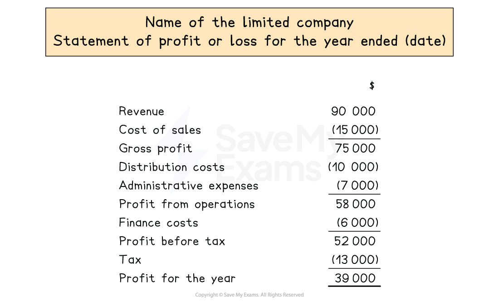

# Statement of Profit or Loss

## Statements of profit or loss for limited companies

> **Spec point** — `spcpt_k8MzwxJNfKF2gRRs`

## Statements of profit or loss for limited companies

### What is the layout of the statement of profit or loss of a limited company?

- The **statement of profit or loss** for a limited company is prepared in the **same way **it is prepared for that of a sole trader or a partnership business
- It is prepared** annually**
- It is the **first of the three financial statements** that must be prepared for limited companies
- Differences include:

  - **Debenture interest** are included as part of finance costs
  
    - These appear **after the profit from operations**
    - The finance costs are subtracted to give the **profit before tax**
  - **Tax is included** and is then subtracted from the profit before tax
- Expenses for a limited company are usually **grouped by function **

  - **Cost of sales**
  - **Distribution costs**
  
    - Including delivery costs to customers, drivers' wages, warehouse costs, etc.
  - **Administrative expenses**
  
    - Including other expenses such as office costs, heat and light, etc.
  - **Finance costs**
  
    - Including debenture interest, loan interest, etc.
- Dividends for **ordinary shareholders** do **not **appear on the statement of profit or loss

*Layout of a statement of profit or loss for a limited company*

> **Worked Example**
> The trial balance of Abrakadabra Limited at 31 March 2024 was as follows:
> 
> | **Abrakadabra Limited**  **Trial Balance at 31 March 2024** |   |   |
> |---|---|---|
> |   | **Debit**  **\$** | **Credit**  **\$** |
> | Revenue |   | 166 000 |
> | Inventory at 1 April 2023 | 6 820 |   |
> | Purchases | 65 900 |   |
> | Distribution costs | 10 280 |   |
> | Administrative expenses | 35 450 |   |
> | Fittings at cost | 250 000 |   |
> | Provision for depreciation of fittings |   | 75 000 |
> | Trade receivables | 14 400 |   |
> | Bank | 14 965 |   |
> | Trade payables |   | 8 415 |
> | 4% Debenture (repayable in 10 years) |   | 46 000 |
> | Share capital |   | 80 000 |
> | Retained earnings |   | 28 000 |
> | Dividends paid on ordinary shares | 5 600 |   |
> |   | **403** **415** | **403** **415** |
> 
> **Additional information**:
> 
> 1. Inventory at 31 March 2024 was valued at \$7 080
> 2. Depreciation on fittings is to be charged at 20% method per annum using the reducing balance Depreciation should be allocated: administrative expenses 60%; distribution costs 40%
> 3. Distribution costs include a rent payment of \$2 700 for the 3 months from 1 March 2024 to 31 May 2024
> 4. Administrative expenses include accrued wages of \$4 550
> 5. No debenture interest has been paid for the year ended 31 March 2024
> 6. Tax for the year is estimated to be \$3 700
> 
> Prepare the statement of profit or loss for Abrakadabra Limited for the year ended 31 March 2024.
> 
> **Answer**:
> 
> - Identify which balances affect the statement of profit or loss
> 
> | **Abrakadabra Limited**  **Trial Balance at 31 March 2024** |   |   |   |
> |---|---|---|---|
> |   | **Debit**  **\$** | **Credit**  **\$** | **Statement of profit or loss?** |
> | Revenue |   | 166 000 | *SoPoL* |
> | Inventory at 1 April 2023 | 6 820 |   | *SoPoL* |
> | Purchases | 65 900 |   | *SoPoL* |
> | Distribution costs | 10 280 |   | *SoPoL* |
> | Administrative expenses | 35 450 |   | *SoPoL* |
> | Fittings at cost | 250 000 |   |   |
> | Provision for depreciation of fittings |   | 75 000 |   |
> | Trade receivables | 14 400 |   |   |
> | Bank | 14 965 |   |   |
> | Trade payables |   | 8 415 |   |
> | 4% Debenture (repayable in 10 years) |   | 46 000 |   |
> | Share capital |   | 80 000 |   |
> | Retained earnings |   | 28 000 |   |
> | Dividends paid on ordinary shares | 5 600 |   |   |
> |   | **403** **415** | **403** **415** |   |
> 
> Deal with the additional notes and identify how they affect the statement of profit or loss
> 
> **Item 1** - Calculate the cost of sales
> 
> *\$6 820 + \$65 900 - \$7 080 = \$65 640*
> 
> **Item 2** - Find the year's depreciation charge
> 
> - Find the current net book value
> 
> *\$250 000 - \$75 000 = \$175 000*
> 
> - Multiply the net book value by 20%
> 
> *20% × \$175 000 = \$35 000*
> 
> - Find the allocations to the different functions
> 
> *Administrative expenses: 60% × \$35 000 = \$21 000*
> 
> *Distribution costs: 40% × \$35 000 = \$14 000*
> 
> - Add the depreciation charge to the relevant expenses
> 
> *Administrative expenses: \$35 450 + \$21 000 = \$56 450*
> 
> *Distribution costs: \$10 280 + \$14 000 = \$24 280*
> 
> **Item 3** - Subtract the prepaid rent from the balance
> 
> - Find the cost per month
> 
> *\$2 700 ÷ 3 = \$900*
> 
> - Multiply this by two for the prepaid months (April & May)
> 
> *\$900 × 2 = \$1 800*
> 
> - Subtract this from the balance for the distribution costs
> 
> *\$24 280 - \$1 800 = \$22 480*
> 
> **Item 4** - Add the accrued wages to the balance for administrative expenses
> 
> *\$56 450 + \$4 550 = \$61 000*
> 
> **Item 5 **- Calculate the debenture interest
> 
> *4% × \$46 000 = \$1 840*
> 
> **Item 6 **- Subtract the tax from the profit before tax
> 
> | **Final answer:** **Abrakadabra  Limited**  **Final answer:** **Statement of Profit or Loss for the year ended 31 March 2024** |   |
> |---|---|
> |   | **Final answer:** **\$** |
> | **Final answer:** **Revenue ** | **Final answer:** **166 000** |
> | **Final answer:** **Cost of sales** | **Final answer:** **65 640** |
> | **Final answer:** **Gross profit** | **Final answer:** **100 360** |
> | **Final answer:** **Distribution costs** | **Final answer:** **(22 480)** |
> | **Final answer:** **Administrative expenses** | **Final answer:** **(61 000)** |
> | **Final answer:** **Profit from operations** | **Final answer:** **16 880** |
> | **Final answer:** **Finance costs** | **Final answer:** **1 840** |
> | **Final answer:** **Profit before tax** | **Final answer:** **15 040** |
> | **Final answer:** **Tax** | **Final answer:** **(3 700)** |
> | **Final answer:** **Profit for the year** | **Final answer:** **11 340** |
