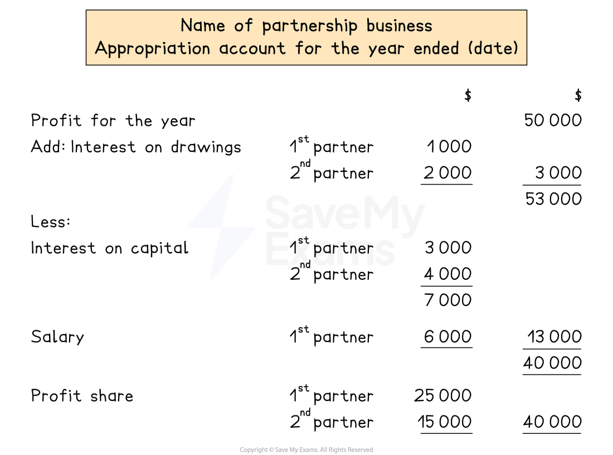

# Appropriation Account

## Appropriation accounts

> **Spec point** — `spcpt_tH6PZ2Rb4T89k3zC` · how to prepare a statement of profit or loss, appropriation account and statement of financial position for a partnership from full or incomplete accounting records. The business may be a trading or a service business

## Appropriation accounts

### What is the profit and loss appropriation account?

- The **profit and loss appropriation account** is one of the **financial statements** prepared by businesses that operate as a **partnership**

  - The partnership prepares the **statement of profit or loss first**
  - And then they prepare the profit and loss appropriation account
- It shows how the **profit or loss** from the statement of profit or loss is **split **between the partners

  - The distribution of the profit for the year is based on the **terms of the partnership agreement**
- The appropriation account is part of the **double entry system**

  - The profit or loss for the year is transferred from the statement of profit or loss

|   | Account to be debited | Account to be credited |
|---|---|---|
| Transferring the **profit for the year **to the appropriation account | Statement of profit or loss | Appropriation account |
| Transferring the **loss for the year** to the appropriation account | Appropriation account | Statement of profit or loss |

### How do I complete the profit and loss appropriation account?

- **STEP 1**
Put the **profit **for the year in the right column

  - You get this value from the statement of profit or loss
- **STEP 2**
**Add **the **total interest on drawings**

  - List the interest for each partner
  - Put the total in the right column
  - Add it on to the profit
- **STEP 3**
**Total** the **interest on the partners' capital**

  - List the interest for each partner
  - Put the total underneath
- **STEP 4**
**Total **the **partner's salaries**

  - List the salary for each partner underneath the previous total
  
    - If there is more than one salary you can create a new column for totalling them up
- **STEP 5**
**Subtract **the **total **interest on capital and partners' salaries

  - Subtract from the previous value in this column
  - This gives the ***residual profit***
- **STEP 6**
**Share **the residual profit in the **ratio **described in the partnership agreement

  - List the profit for each partner
  - Put the total in the right column

*Layout of the profit and loss appropriation account*

> **Exam Hint**
> Students can get confused when trying to remember whether to add or subtract interest on drawings. Remember that this statement is from the point of view of the business. Therefore, the interest on drawings is added as the business is owed more money from the partners.
> 
> Also remember partner's loan interest is charged to the statement of profit or loss not the appropriation account.

> **Worked Example**
> Jetlin & Leander are in partnership, their year end is 31st December 2023.
> 
> The following information was taken from their books:
> 
> |   | \$ |   |
> |---|---|---|
> | Profit for the year | 30 000 |   |
> | Capital: | Jetlin | 50 000 |
> |   | Leander | 35 000 |
> | Salaries: | Jetlin | 5 000 |
> |   | Leander | 6 000 |
> | Drawings: | Jetlin | 7 500 |
> |   | Leander | 1 000 |
> 
> The partnership agreement provides for the following:
> 
> - interest on capital of 5% per annum
> - interest on drawings of 10%
> - a salary to Leander of \$6 000 per annum
> - residual profits and losses shared 75% to Jetlin and 25% to Leander.
> 
> Prepare the appropriation account for Jetlin and Leander for the year ended 31 December 2023.
> 
> **Answer**:
> 
> - Calculate the interest on capital by multiplying each partner's capital by 5%
> 
> *Jetlin: 5% × \$50 000  = \$2 500*
> 
> *Leander: 5% × \$35 000 = \$1 750*
> 
> - Calculate the interest on drawings by multiplying each partner's drawings by 10%
> 
> *Jetlin: 10% × \$7 500  = \$750*
> 
> *Leander: 10% × \$1 000 = \$100*
> 
> - Calculate the residual profit (this is usually done in the appropriation account)
> 
>   - Start with the profit for the year \$30 000
>   - Add the interest on drawings: + \$750 + \$100
>   - Subtract the interest on capital: - \$2 500 - \$1 750
>   - Subtract the salary: - \$6 000
>   - Residual profit: \$20 600
> - Calculate the share of profit for each partner by multiplying the residual profit by the given percentages
> 
> *Jetlin: 75% × \$20 600  = \$15 450*
> 
> *Leander: 25% × \$20 600 = \$5 150*
> 
> Complete the appropriation account using the required format
> 
> | **Final answer:** **Jetlin & Leander**  **Final answer:** **Appropriation Account for the year ended 31 December 2023 ** |   |   |   |
> |---|---|---|---|
> | **Final answer:** ** ** |   | **Final answer:** **\$** | **Final answer:** **\$** |
> | **Final answer:** **Profit for the year** |   | **Final answer:** ** ** | **Final answer:** **30 000 ** |
> | **Final answer:** **Add: Interest on drawings ** | **Final answer:** **Jetlin** | **Final answer:** **750 ** | **Final answer:** ** ** |
> |   | **Final answer:** **Leander ** | **Final answer:** **100 ** | **Final answer:** **850**** ** |
> |   |   |   | **Final answer:** **30 850 ** |
> | **Final answer:** ** Less:** |   | **Final answer:** ** ** | **Final answer:** ** ** |
> | **Final answer:** **Interest on capital ** | **Final answer:** **Jetlin** | **Final answer:** **2 500 ** | **Final answer:** ** ** |
> |   | **Final answer:** **Leander ** | **Final answer:** **1 750**** ** | **Final answer:** ** ** |
> |   |   | **Final answer:** **4 250 ** | **Final answer:** ** ** |
> | **Final answer:** ** Salary** | **Final answer:** **Leander** | **Final answer:** **6 000**** ** | **Final answer:** **10 250 ** |
> |   |   | **Final answer:** ** ** | **Final answer:** **20 600**** ** |
> | **Final answer:** **Profit share** | **Final answer:** **Jetlin** | **Final answer:** **15 450** | **Final answer:** ** ** |
> |   | **Final answer:** **Leander ** | **Final answer:** **5 150 ** | **Final answer:** **20 600 ** |
