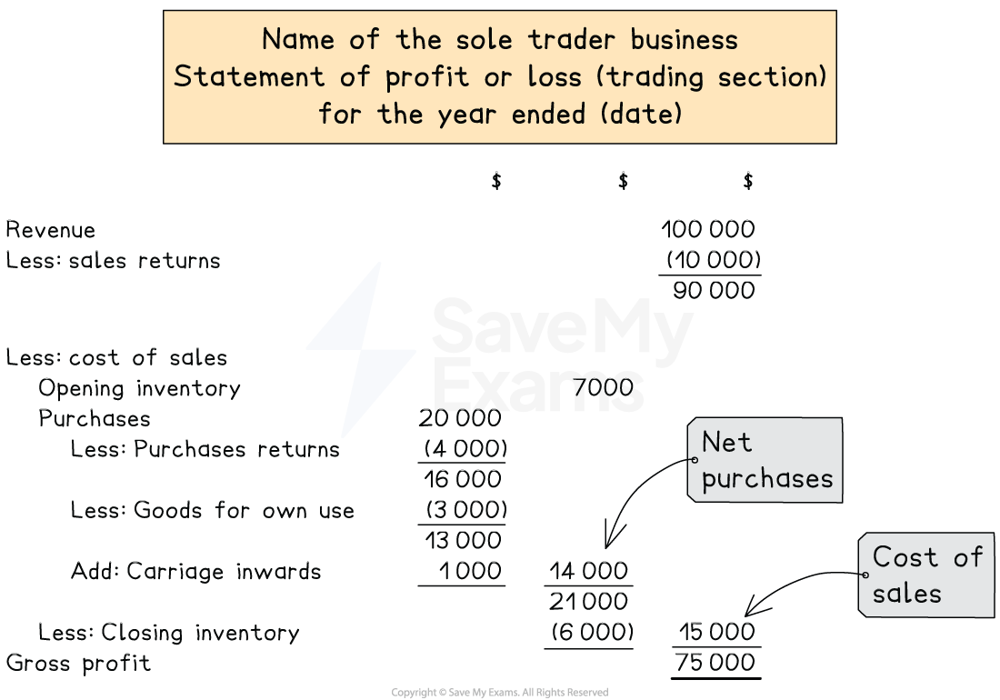
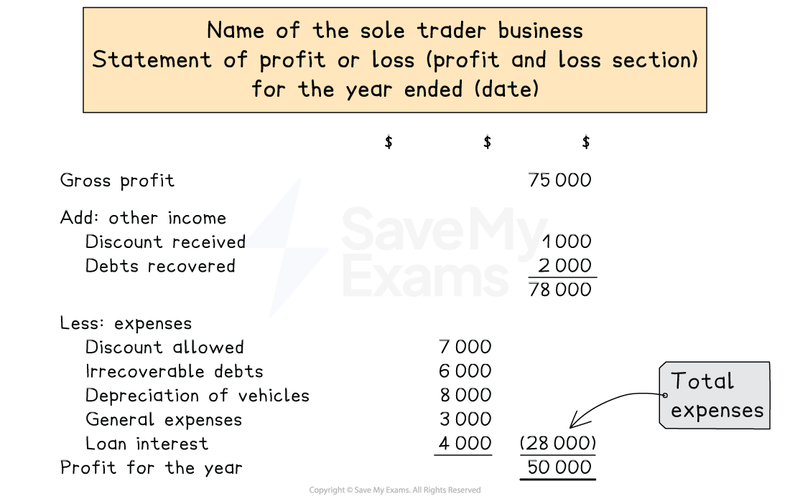
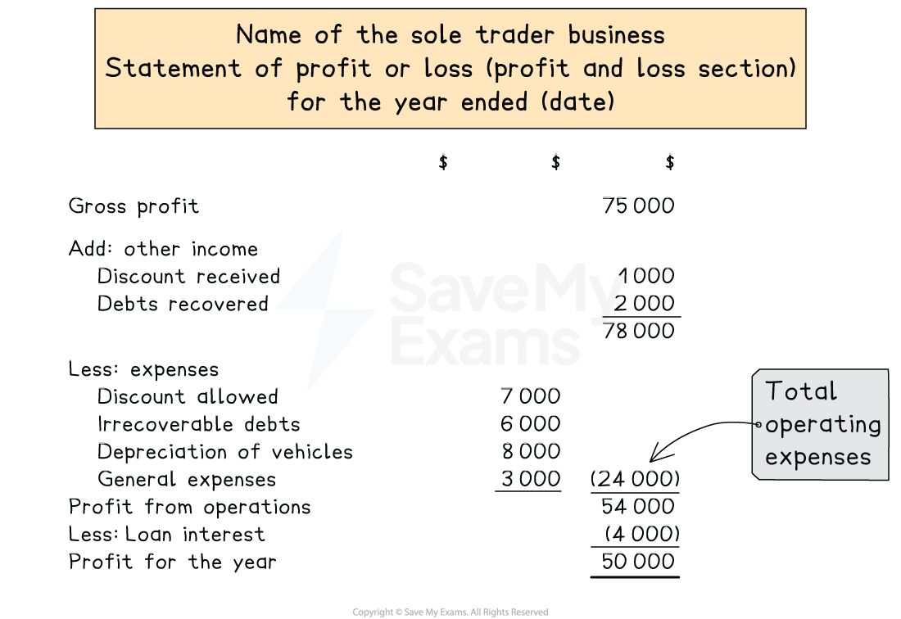
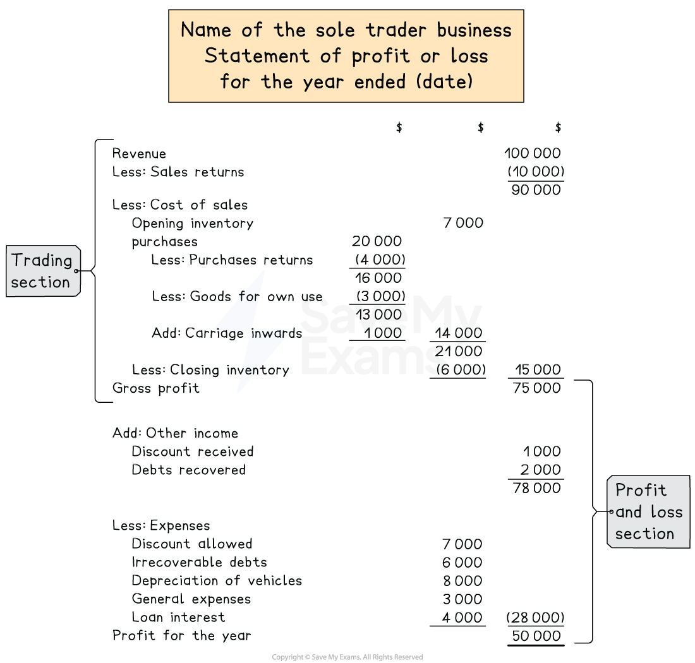

# Statement of Profit or Loss

## Statements of profit or loss for sole traders

> **Spec point** — `spcpt_G3dh2S8YCkN4h9JJ` · how to prepare a statement of profit or loss and statement of financial position for a sole trader from full or incomplete accounting records. The business may be a trading or a service business

## Statements of profit or loss for sole traders

### What is the purpose of a statement of profit or loss for a sole trader?

- It is a statement prepared for a trading period to show the **gross profit** and the **profit for the year**

  - A financial year** does not necessarily follow the calendar year **from January to December
  
    - For example, if a business commences trading on 1 July 2023 then the first financial year would run from 1 July 2023 to 30 June 2024
- The statement of profit or loss consists of two parts

  - The **trading section** shows the calculation of the **gross profit**
  - The **profit and loss section** shows the calculation of the **profit for the year**
- The statement of profit or loss is part of the **double entry system of book-keeping**

  - **Debit **entries to the statement of profit or loss **decrease **profit
  
    - These are usually the **expenses**
  - **Credit **entries to the statement of profit or loss **increase **profit
  
    - These are usually the **sources of income**

### How do I calculate the cost of sales?

- The **cost of sales** is **not **necessarily **equal **to the **purchases**
- The cost of sales needs to be **adjusted **so that it aligns with the financial period
- **Add **the **opening **inventory

  - This was used during the period
- **Subtract **the **closing **inventory

  - This has not been used during the period
- **Add **the cost of getting the goods **delivered to the business**

  - Do not include the cost of delivery to customers
- **Subtract **any goods that have been **returned **to supplier or any goods that have been **taken by the owner**

### How do I complete the trading section of a statement of profit or loss?

- **STEP 1**
Calculate the **total revenue** and put the value in the far right column

  - Revenue
  - Less sales returns
- **STEP 2**
Calculate the **cost of sales** and put the value in the far right column

  - Opening inventory
  - Add net purchases
  
    - Purchases
    - Less purchases returns
    - Less goods for own use
    - Add carriage inwards
  - Less closing inventory
- **STEP 3**
Calculate the **gross profit** and put the value in the far right column

  - Revenue
  - Less cost of sales

*The layout of the trading section of a statement of profit or loss*

> **Exam Hint**
> In general, you move one column to the left if a calculation is needed that involves more than one item and a subtraction. When you are subtracting a number, you normally put it in brackets to make it clear.
> 
> For example:
> 
> - cost of sales involves a calculation and it is subtracted from the sales
> 
>   - therefore the calculation is done in the middle column
> 
> It is normally only the calculation for the net purchases that is displayed in the far left column.

### How do I complete the profit and loss section of a statement of profit or loss?

- **STEP 1**
Put the **gross profit** in the far right column
- **STEP 2**
Total up any **other incomes** which increase the profit for the year such as

  - Discount received
  - Other income received
  - Recovery of irrecoverable debts
  - Profit on sale of non-current asset
- **STEP 3**
Total up any **other expenses** which decrease the profit for the year such as

  - Discount allowed
  - *Carriage outwards*
  - Irrecoverable debts written off
  - Depreciation of non-current assets
  - Loss on sale of non-current assets
  - *Sundry expenses*
  - Other expenses
- **STEP 4**
Calculate the **profit or loss for the year**

  - Gross profit
  - Add other income
  - Less other expenses
- If the **final value** is a **negative**

  - Put brackets around the value
  - This means it is a loss not a profit
  
    - E.g. (500) represents a loss of \$500

*The layout of the profit and loss section of a statement of profit or loss*

> **Exam Hint**
> The items for the other income can be put in the far right column as they are added to the gross profit. However, if you prefer you can put them in the middle column, find the total and put that in the far right column. Whereas the expenses need to go in the middle column because the total is subtracted from the previous figure in the far right column.

### What is operating profit?

- **Operating profit** is also known as **profit from operations**
- It is the profit for the year **before subtracting the loan interest**
- Some businesses show this in the profit and loss section of their statement of profit or loss
- If a business does not have finance costs then **profit from operations** is the **same **as **profit for the year**

*The layout of the profit and loss section of a statement of profit or loss including profit from operations*

### How is the statement of profit or loss of a trading business created?

- The statement of profit or loss of a **trading business contains both the**

  - Trading section
  - Profit and loss section
- The **gross profit** links the two sections together

  - You do not need to state this value twice

*The layout of the statement of profit or loss*

> **Exam Hint**
> The exam might provide you the information in a trial balance along with additional information underneath. Identify items from the trial balance that would appear on the statement of profit or loss.  You might find it helpful to annotate with *SoPoL *to differentiate from those which would appear on the statement of financial position.

> **Worked Example**
> The following trial balance has been extracted by the book-keeper of Ali Baba, a wholesaler of school supplies, at 31 December 2023.
> 
> | ** ** | **Debit**  **\$** | **Credit**  **\$** |
> |---|---|---|
> | Trade receivables | 25 325 |   |
> | Trade payables |   | 20 684 |
> | Capital |   | 40 000 |
> | Bank |   | 2 083 |
> | Rent and rates | 11 862 |   |
> | Electricity | 3 054 |   |
> | Telephone | 2 695 |   |
> | Salaries | 56 891 |   |
> | Vehicles | 23 250 |   |
> | Office equipment | 8 500 |   |
> | Vehicle expenses | 13 855 |   |
> | Drawings | 16 275 |   |
> | Discount allowed | 478 |   |
> | Discount received |   | 591 |
> | Purchases | 139 960 |   |
> | Revenue (Sales) |   | 258 258 |
> | Inventory at 1 January 2023 | <u>19 471 </u> | <u>                     </u> |
> |   | <u>321 616 </u> | <u>321 616 </u> |
> 
> **Additional information: **
> 
> - Inventory at 31 December 2023 is valued at  \$15 075
> - The vehicles and office equipment were purchased during the year and Ali Baba does not charge depreciation in the year of purchase
> 
> Prepare a statement of profit or loss for Ali Baba for the year ended 31 December 2023.
> 
> **Answer**:
> 
> - Identify which items appear on the statement of profit or loss by labelling them as *SoPoL*
> - Add an extra row for the closing inventory
> 
> | ** ** | **Debit**  **\$** | **Credit**  **\$** | **Statement of profit or loss?** |
> |---|---|---|---|
> | Trade receivables | 25 325 |   |   |
> | Trade payables |   | 20 684 |   |
> | Capital |   | 40 000 |   |
> | Bank |   | 2 083 |   |
> | Rent and rates | 11 862 |   | *SoPoL* |
> | Electricity | 3 054 |   | *SoPoL* |
> | Telephone | 2 695 |   | *SoPoL* |
> | Salaries | 56 891 |   | *SoPoL* |
> | Vehicles | 23 250 |   |   |
> | Office equipment | 8 500 |   |   |
> | Vehicle expenses | 13 855 |   | *SoPoL* |
> | Drawings | 16 275 |   |   |
> | Discount allowed | 478 |   | *SoPoL* |
> | Discount received |   | 591 | *SoPoL* |
> | Purchases | 139 960 |   | *SoPoL* |
> | Revenue (Sales) |   | 258 258 | *SoPoL* |
> | Inventory at 1 January 2023 | <u>19 471 </u> | <u>                     </u> | *SoPoL* |
> |   | <u>321 616 </u> | <u>321 616 </u> |   |
> | *Inventory at 31 December 2023* |   | *15 075* | *SoPoL* |
> 
> Complete the statement of profit or loss using the formula to help:
> 
> - Complete the trading section to find the gross profit
> 
>   - Revenue (sales)
>   - Minus cost of sales
>   
>     - Opening inventory
>     - Plus purchases
>     - Minus closing inventory
> - Complete the profit and loss section to find the profit for the year
> 
>   - Gross profit
>   - Plus other income
>   - Minus expenses
> 
> | **Final answer:** **Ali Baba **  **Final answer:** **Statement of profit or loss for the year ended 31 December 2023 ** |   |   |
> |---|---|---|
> |   | **Final answer:** **\$** | **Final answer:** **\$** |
> | **Final answer:** **Revenue ** | **Final answer:** ** ** | **Final answer:** **258 258 ** |
> | **Final answer:** **Less: Cost of sales** | **Final answer:** ** ** | **Final answer:** ** ** |
> | **Final answer:** **   Opening inventory ** | **Final answer:** **19 471 ** | **Final answer:** ** ** |
> | **Final answer:** **   Purchases ** | **Final answer:** **139 960**** ** | **Final answer:** ** ** |
> | **Final answer:** ** ** | **Final answer:** **159 431 ** | **Final answer:** ** ** |
> | **Final answer:** **   Less: Closing inventory ** | **Final answer:** **(15 075)** | **Final answer:** **(144 356)****  ** |
> | **Final answer:** **Gross Profit ** | **Final answer:** ** ** | **Final answer:** **113 902 ** |
> | **Final answer:** **Add: Other income ** | **Final answer:** ** ** | **Final answer:** ** ** |
> | **Final answer:** **   Discount received ** | **Final answer:** ** ** | **Final answer:** **591 ** |
> | **Final answer:** ** ** | **Final answer:** ** ** | **Final answer:** **114 493 ** |
> | **Final answer:** **Less: Expenses ** | **Final answer:** ** ** | **Final answer:** ** ** |
> | **Final answer:** **   Discount allowed ** | **Final answer:** **478 ** | **Final answer:** ** ** |
> | **Final answer:** **   Rent and rates ** | **Final answer:** **11 862 ** | **Final answer:** ** ** |
> | **Final answer:** **   Electricity ** | **Final answer:** **3 054 ** | **Final answer:** ** ** |
> | **Final answer:** **   Telephone ** | **Final answer:** **2 695 ** | **Final answer:** ** ** |
> | **Final answer:** **   Salaries ** | **Final answer:** **56 891 ** | **Final answer:** ** ** |
> | **Final answer:** **   Vehicle expenses ** | **Final answer:** **13 855 ** | **Final answer:** **(88 835)**** ** |
> | **Final answer:** **Profit for the year** | **Final answer:** ** ** | **Final answer:** **25 658**** ** |

## Statements of profit or loss for service businesses

> **Spec point** — `spcpt_MGhPzRVF2HpYsXsH` · how to prepare a statement of profit or loss and statement of financial position for a sole trader from full or incomplete accounting records. The business may be a trading or a service business

## Statements of profit or loss for service businesses

### How is the statement of profit or loss of a service business created?

- The statement of profit or loss of a **service business does not have a trading section**

  - Because they do not buy or sell goods
  - Therefore there will **not be a gross profit**
- The statement of profit or loss for a service business **only contains the profit and loss section**

  - Therefore the statement of profit or loss will start with the income received

### How do I complete a statement of profit or loss for a service business?

- **STEP 1**
Total up any **income **such as:

  - Commission
  - Rent
  - Other income received
- **STEP 2**
Total up any **expenses** such as:

  - Wages
  - General expenses
  - Operating expenses
- **STEP 3**
Calculate the **profit or loss for the year**

  - The total income minus the total expenses

> **Worked Example**
> Sherwin operates a taxi service and has provided the following information at the end of the financial year on 31 October 2023. Prepare the statement of profit or loss for Sherwin’s Taxi Service for that period.
> 
> |   | \$ |
> |---|---|
> | General expenses | 9 250 |
> | Insurance | 3 200 |
> | Printing and stationery | 1 560 |
> | Income from taxi fares | 85 250 |
> | Motor expenses | 15 750 |
> | Loan interest | 1 200 |
> 
> **Answer**:
> 
> - Start with the income
> - Subtract the expenses
> - Calculate the profit for the year
> 
> | **Final answer:** **Sherwin’s Taxi Service**  **Final answer:** **Statement of profit or loss for the year ended 31 October 2023** |   |   |
> |---|---|---|
> |   | **Final answer:** **\$** | **Final answer:** **\$** |
> | **Final answer:** **Income from taxi fares** |   | **Final answer:** **85 250** |
> | **Final answer:** **Less: Expenses** |   |   |
> | **General expenses** | **Final answer:** **9 250** |   |
> | **Insurance** | **Final answer:** **3 200** |   |
> | **Printing and stationery** | **Final answer:** **1 560** |   |
> | **Motor expenses** | **Final answer:** **15 750** |   |
> | **Loan interest** | **1**<u> </u>**200** | **Final answer:** **( 30 960)** |
> | **Final answer:** **Profit for the year** |   | **Final answer:** **54 290** |
> 
> You can also state the profit from operations.
> 
> - Start with the income
> - Subtract the operating expenses
> - Calculate the profit from operations
> - Subtract the loan interest
> - Calculate the profit for the year
> 
> | **Final answer:** **Sherwin’s Taxi Service**  **Final answer:** **Statement of profit or loss for the year ended 31 October 2023** |   |   |
> |---|---|---|
> |   | **Final answer:** **\$** | **Final answer:** **\$** |
> | **Final answer:** **Income from taxi fares** |   | **Final answer:** **85 250** |
> | **Final answer:** **Less: Expenses** |   |   |
> | **General expenses** | **9** **250** |   |
> | **Insurance** | **3** **200** |   |
> | **Printing and stationery** | **1** **560** |   |
> | **Motor expenses** | **15**<u> </u>**750** | **(29**<u> </u>**760)** |
> | **Final answer:** **Profit from operations** |   | **55** **490** |
> | **Final answer:** **Less: Loan interest** |   | **(1**<u> </u>**200)** |
> | **Final answer:** **Profit for the year** |   | **54**<u> </u>**290** |
