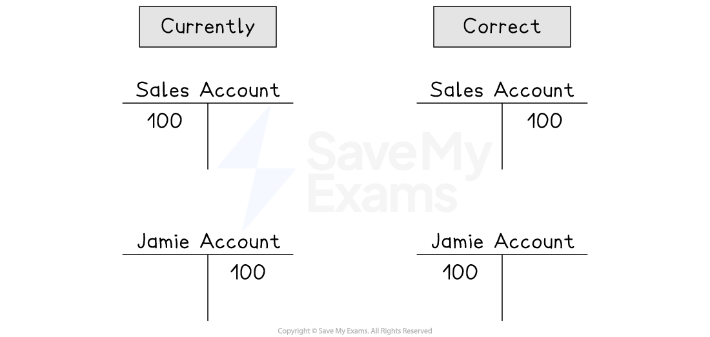
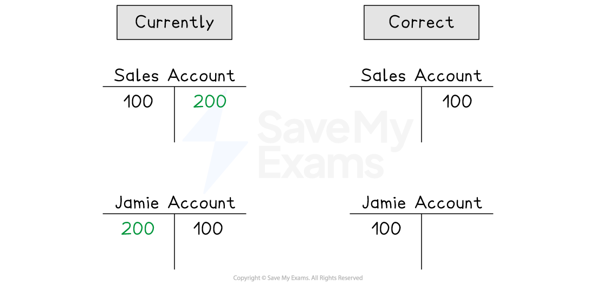

# Correction of Errors Using Journal Entries

## Correction of errors using journal entries

> **Spec point** — `spcpt_XRwRNHcWg2wkhj2N` · how to prepare ledger accounts and journal entries to correct errors

## Correction of errors using journal entries

### How do I correct accounting errors?

- **STEP 1**
Identity how the accounts **currently look** with the errors
- **STEP 2**
Identify how the accounts **should look** if the transactions were entered correctly

*Example of errors in accounts*

- **STEP 3**
Make the **necessary entries** to fix the errors

*Example of correction of errors*

> **Exam Hint**
> If you are not given the actual figures, then you can make them up to help you spot how to correct them. For example, if the sales account is overcast by \$20, then pretend it should be \$100 which means it currently has a balance of \$120.

### How do I correct errors using journal entries?

- You can correct errors by making the **appropriate entries** into the ledger accounts
- The journal will be used as the **book of prime entry**
- Enter the account that needs to be **debited**

  - It is conventional for **debit entries to appear first**
- Enter the account that needs to be **credited**

  - It is conventional to** indent the details for credit entries**
- Give a **narrative** for the journal entry

  - State “Correction of error”
  - Give a brief description of the error

> **Exam Hint**
> Narratives are not always required. The exam question will make it clear whether they are needed.

> **Worked Example**
> Constance is a trader. On 1 December 2025, Constance identified an error in her accounts. She had sold \$100 goods on credit to Jamie but make the entries on the wrong side of both accounts.
> 
> Prepare journal entries to fix the error. Narratives are required.
> 
> **Answer**:
> 
> \$200 needs to be entered on the correct side of both accounts
> 
> - \$100 to undo the error
> - \$100 to enter the correct transaction
> 
> Make the journal entries
> 
> **Final answer:** **Journal**
> 
> | **Final answer:** **Details** | **Final answer:** **Debit** **\$** | **Final answer:** **Credit** **\$** |
> |---|---|---|
> | **Final answer:** **Jamie** | **Final answer:** **200** |   |
> | **Final answer:** **      Sales** |   | **Final answer:** **200** |
> | **Final answer:** **Correction of error of putting the values on the wrong side of the accounts** |   |   |
