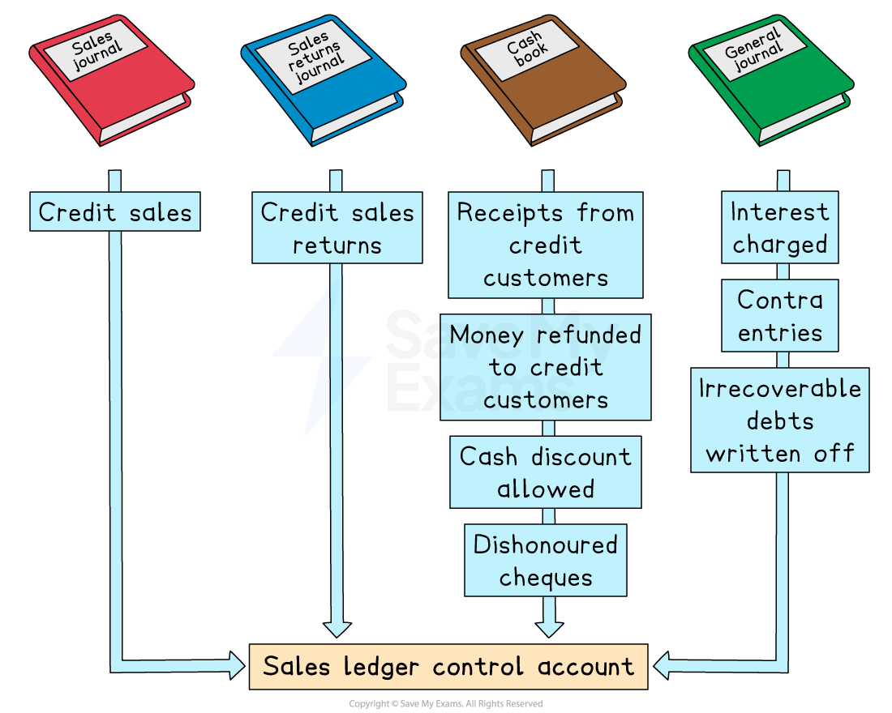
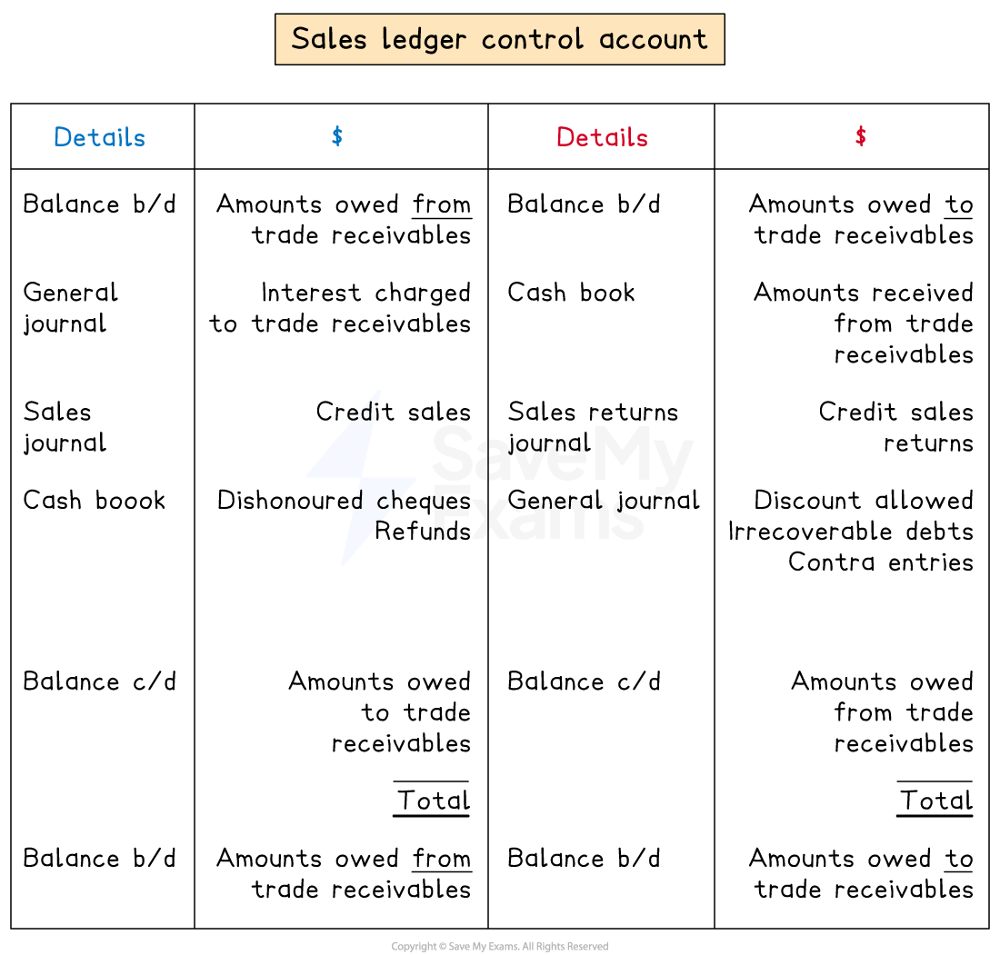

# Sales Ledger Control Accounts

## Sales ledger control accounts

> **Spec point** — `spcpt_kQjPYmk2QN4qnZtz` · entries in control accounts
sales ledger control accounts and purchases ledger control accounts

## Sales ledger control accounts

### What is a sales ledger control account?

- A **sales ledger control account** is an account that **summarises** all the **transactions** for** trade receivables**
- A sales ledger control account can either be a **ledger account** or a ***memorandum account***

  - If it is part of the **double-entry system**, then the individual ledger accounts are memorandum accounts
  
    - The sales ledger control account is used for journal entries instead of the individual trade receivables accounts

### Where do I find the information to complete a sales ledger control account?

- The** books of prime entry **are used to find the **totals**
- The **sales journal **is used to find the total value of **credit sales**
- The **sales returns journal **is used to find the total value of **returned goods**
- The **cash book** is used to find the total values for:

  - **Money received** from credit customers
  - **Money refunded **to credit customers
  - **Cash discounts allowed** to credit customers
  - **Dishonoured cheques received** from credit customers
- The** journal **is used to find the total values for:

  - **Interest charged** to credit customers on overdue accounts
  - ***Contra entries*** against the purchases ledger
  - **Irrecoverable debts written off**

> **Exam Hint**
> The ledger accounts are not used when preparing control accounts. The information is taken from the books of prime entry.

### Why might there be a credit balance in a sales ledger control account?

- A **trade receivables account** will usually have a **debit balance**

  - This indicates that the **credit customer owes the business money**
- However, a trade receivables account could have a **credit balance**

  - This indicates that the **credit customer is owed money**
- **Credit balances** can occur when:

  - Credit customers **pay in advance** of buying goods
  - Credit customers make an **overpayment**
  - The business **owes refunds** to credit customers
  
    - The customers have paid for goods and then returned them
- **Debit and credit balances** are **totalled separately** in the sales ledger control account

  - This means there could be **two opening balances** and **two closing balances**

### What is the layout of a sales ledger control account?

- The layout looks very **similar to the layout of a trade receivables ledger account**
- The main differences are:

  - There could be two opening balances
  - There could be two closing balances

| **Entries on the debit side:** | **Entries on the credit side:** |
|---|---|
| - **Opening balance**    - Credit customers who owe money - **Sales**    - Credit sales only - **Interest** - **Bank**    - Dishonoured cheques from credit customers   - Refunds to credit customers | - **Opening balance**    - Credit customers who are owed money - **Sales returns**    - Credit sales only - **Bank**    - Bank transfers from credit customers - **Cash**    - Cash received from credit customers - **Discount allowed** - **Irrecoverable debts** - **Contra entries** |

*Layout of a sales ledger control account*

> **Exam Hint**
> Remember that cash sales are not recorded in the sales ledger. Only enter cash received from credit customers when the cash is used to make a payment towards an invoice.

> **Worked Example**
> Kimi maintains a full set of account records but does not maintain control accounts. She provides the following information for February 2024.
> 
> |   | \$ |
> |---|---|
> | **On 1 February 2024** |   |
> | Sales ledger control account debit balance b/d | 12 780 |
> | Sales ledger control account credit balance b/d | 150 |
> | **Totals for February 2024** |   |
> | Credit sales | 25 470 |
> | Cash sales | 5 780 |
> | Credit sales returns | 7 000 |
> | Cheques received by credit customers | 18 450 |
> | Cash received by credit customers | 1 400 |
> | Discount allowed | 3 290 |
> | Interest charged to credit customers | 860 |
> | Contra purchases ledger | 1 050 |
> | Irrecoverable debts written off | 870 |
> | **On 29 February 2024** |   |
> | Amount Kimi owes to her credit customers | 460 |
> 
> Prepare the sales ledger control account for February 2024. Balance the account and bring down the balances on 1 March 2024.
> 
> **Answer**:
> 
> Identify which side each transaction appears on.
> 
> - Sales ledger control account debit balance b/d \$12 780
> 
>   - Debit side
> - Sales ledger control account credit balance b/d \$150
> 
>   - Credit side
> - Credit sales \$25 470
> 
>   - Debit side
>   
>     - The customers owe more money to Kimi
> - Cash sales \$5 780
> 
>   - Does not appear in the control account
> - Credit sales returns \$7 000
> 
>   - Credit side
>   
>     - The customers owe less money to Kimi
> - Cheques received by credit customers \$18 450
> 
>   - Credit side
>   
>     - The customers owe less money to Kimi
> - Cash received by credit customers \$1 400
> 
>   - Credit side
>   
>     - The customers owe less money to Kimi
> - Discount allowed \$3 290
> 
>   - Credit side
>   
>     - The customers owe less money to Kimi
> - Interest charged to credit customers \$860
> 
>   - Debit side
>   
>     - The customers owe more money to Kimi
> - Contra purchases ledger \$1 050
> 
>   - Credit side
>   
>     - The customers owe less money to Kimi
> - Irrecoverable debts written off \$870
> 
>   - Credit side
>   
>     - The customers owe less money to Kimi
> - Amount Kimi owes to her credit customers \$460
> 
>   - This is a credit balance as it is money that Kimi owes to her customers
>   
>     - The balance c/d is on the debit side when balancing the account
>     - The balance b/d is brought down on the credit side
> 
> **Final answer:** **Kimi**
> **Sales Ledger Control Account**
> 
> | **Final answer:** **Date** | **Final answer:** **Details** | **Final answer:** **\$** | **Final answer:** **Date** | **Final answer:** **Details** | **Final answer:** **\$** |
> |---|---|---|---|---|---|
> | **Final answer:** **2024**  **Final answer:** **Feb 1** | **Final answer:** ** **  **Final answer:** **Balance b/d** | **Final answer:** **12 780** | **Final answer:** **2024**  **Final answer:** **Feb 1** | **Final answer:** **Balance b/d** | **Final answer:** **150** |
> | **Final answer:** **29** | **Final answer:** **Sales** | **Final answer:** **25 470** | **Final answer:** **29** | **Final answer:** **Sales returns** | **Final answer:** **7 000** |
> | **Final answer:** **29** | **Final answer:** **Interest** | **Final answer:** **860** | **Final answer:** **29** | **Final answer:** **Bank** | **Final answer:** **18 450** |
> | **Final answer:** **29** | **Final answer:** **Balance c/d** | **Final answer:** **460** | **Final answer:** **29** | **Final answer:** **Cash** | **Final answer:** **1 400** |
> |   |   |   | **Final answer:** **29** | **Final answer:** **Discount allowed** | **Final answer:** **3 290** |
> |   |   |   | **Final answer:** **29** | **Final answer:** **Contra** | **Final answer:** **1 050** |
> |   |   |   | **Final answer:** **29** | **Final answer:** **Irrecoverable debts** | **Final answer:** **870** |
> |   |   | **Final answer:** **              ** | **Final answer:** **29** | **Final answer:** **Balance c/d** | **Final answer:** **7 360** |
> |   |   | **Final answer:** **39 570** |   |   | **Final answer:** **39 570** |
> | **Final answer:** **Mar 1** | **Final answer:** **Balance b/d** | **Final answer:** **7 360** | **Final answer:** **Mar 1** | **Final answer:** **Balance b/d** | **Final answer:** **460** |
