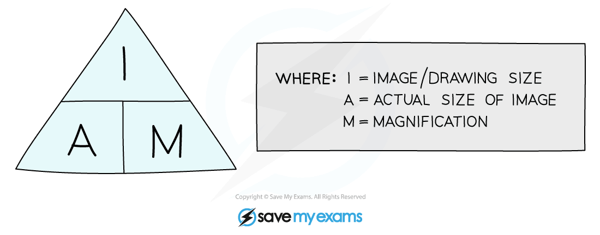

# Calculating Actual Size

## Calculating Actual Size

> **Spec point** — `spcpt_qC3W9GXMkVMChMrV`

## Calculating actual size

- When using microscopes to study biological specimens, it is possible to calculate the **actual size** of organisms, cells, and parts of cells
- The actual size of specimens can be calculated using the** magnification** and the **measured size of an image** as follows: **Actual size = image size ÷ magnification **

  - Magnification is sometimes provided in an exam question stem
  - Magnification can be calculated from the **scale bar** of an image
  - Sometimes magnification is calculated from information about the magnification of the eyepiece lens and the objective lens

- Remember that the equation above is part of the equation triangle from calculating magnification

> **Worked Example**
> ### Using a scale bar to calculate actual size
> 
> A lab technician observed bacterial cells with an electron microscope, and produced the image below.
> 
> The scale bar measures 2 cm in length, and the length of the technician's image of one bacterial cell measures 7.6 cm.
> 
> 
> 
> Use the information provided to calculate the actual length of a bacterial cell in the image.
> 
> **Answer:**
> 
> **Step 1: Use the scale bar to calculate the magnification of the image**
> 
> The equation triangle for magnification tells us that:
> 
> Magnification = image size ÷ actual size
> 
> The scale bar measures 2 cm = 20 mm = 20 000 μm
> 
> The scale bar represents an actual size of 1 μm
> 
> Magnification = 20 000 ÷ 1
> 
> = 20 000
> 
> **Step 2: Substitute values into the equation for actual size**
> 
> Actual size = image size ÷ magnification
> 
> The question stem tells us that one cell = 7.6 cm = 76 mm = 76 000 μm
> 
> Magnification is ×20 000
> 
> Actual size = 76 000 ÷ 20 000
> 
> = 3.8
> 
> Therefore, the actual length of a bacterial cell in this image is **3.8 μm**

> **Worked Example**
> ### Using lens magnification to calculate actual size
> 
> A scientist looked at a sample of red blood cells under a light microscope.
> 
> The eyepiece lens of the microscope had a magnification of ×10 and the objective lens had a magnification of ×40.
> 
> The scientist produced a photomicrograph of the blood cells, shown below, in which the red blood cells have an average diameter of 3 mm when measured using a ruler.
> 
> 
> 
> Calculate the average diameter of the red blood cells in the sample. Give your answer in micrometres.
> 
> **Answer:**
> 
> **Step 1:** **Calculate the total magnification of the specimen**
> 
> Total magnification = eyepiece lens magnification × objective lens magnification
> 
> 10 × 40 = 400
> 
> Magnification = ×400
> 
> **Step 2: Convert the image size into μm **
> 
> 1 mm = 1000 μm
> 
> 3 × 1000 = 3000
> 
> Image size = 3000 μm
> 
> **Step 3: Substitute values into equation for actual size**
> 
> Actual size = image size ÷ magnification
> 
> Actual size = 3000 ÷ 400
> 
> = 7.5
> 
> Therefore, the average size of a red blood cell in this sample is **7.5 μm**

> **Exam Hint**
> Note that you would be expected to use your **own ruler** to provide image size measurements in actual size calculations.
> 
> Don't forget to **convert units** in calculations like this!
