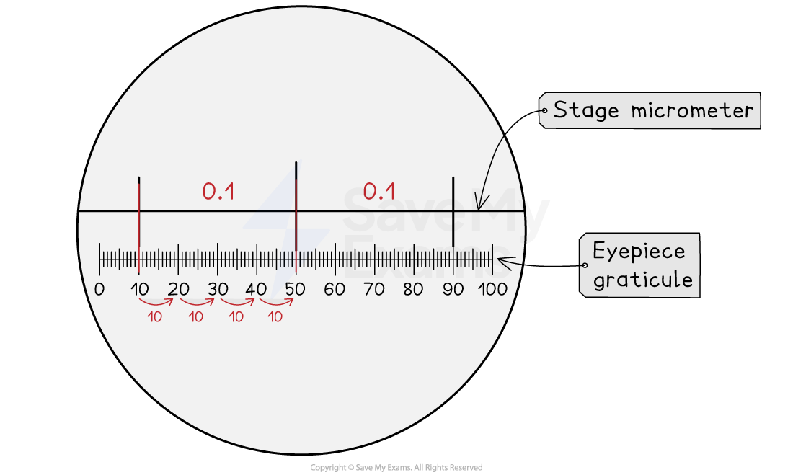

# Eyepiece Graticules & Stage Micrometers

## Eyepiece Graticules & Stage Micrometers

> **Spec point** — `spcpt_FrpR3hVBjy2Sx42z` · use an eyepiece graticule and stage micrometer scale to make measurements and use the appropriate units, millimetre (mm), micrometre (μm) and nanometre (nm)

## Eyepiece graticules & stage micrometers

- An **eyepiece graticule** and **stage micrometer** are used to measure the size of an object when viewed under a microscope
- The eyepiece graticule is an engraved ruler that is visible when looking through the eyepiece of a microscope

  - Eyepiece graticules are often divided into 100 smaller divisions known as **graticule** **divisions**, or** eyepiece units**
- The values of the divisions in an eyepiece graticule** vary depending on the magnification used, **so the graticule needs to be** *****calibrated*** every time an object is viewed
- The calibration is done using a stage micrometer; this is a slide that contains a tiny ruler with an accurate known scale

  - Stage micrometer rulers can vary, but often have larger divisions of 0.1 mm (100 μm) and smaller divisions of 0.01 mm (10 μm)

### Calibrating the eyepiece graticule

*Calibrating the eyepiece graticule*

- In the diagram, two stage micrometer divisions of 0.1 mm, or 100 μm, are visible
- Each 100 µm division is equal to 40 eyepiece graticule divisions

  - 40 graticule divisions = 100 µm

**1 graticule division = number of µm  ÷ number of graticule divisions**

- 1 graticule division = 100 ÷ 40 = 2.5 µm; this is the **calibration value** (µm per eyepiece graticule division)

### Calculating the size of a specimen

- The calibrated eyepiece graticule can be used to measure the length of an object
- The number of graticule divisions covered by an object needs to be multiplied by the calibration value (µm per graticule division):

Graticule divisions covered by object x calibration value (µm per division) = length of object (µm)

> **Worked Example**
> A student viewed some onion cells under a microscope.
> 
> The image below shows the cells with an eyepiece graticule (left) and the eyepiece graticule alongside a stage micrometer (right).
> 
> Note that each large division on the stage micrometer here is 100 μm, and each small division is 10 μm.
> 
> 
> 
> Use the stage micrometer to calibrate the eyepiece graticule and calculate the actual length of the cell labelled C-D in the image.
> 
> **Answer:**
> 
> **Step 1: Calculate the size of each eyepiece division**
> 
> There are 40 graticule divisions per large micrometer division, or per 100 μm
> 
> 1 graticule division = no. of μm ÷ no. of graticule divisions
> 
> = 100 ÷ 40
> 
> = 2.5 μm
> 
> This value is the **calibration value** (µm per graticule division)
> 
> **Step 2: Calculate the length of the cell**
> 
> Specimen size = no. of graticule divisions x calibration value
> 
> The cell closest to the ruler covers 27 graticule divisions
> 
> =  27 x 2.5
> 
> =  67.5 μm
> 
> **Step 3: Consider whether this answer makes sense in context**
> 
> Plant cells usually measure between 10-100 μm, so a result of 67.5 μm sounds sensible in this context

> **Exam Hint**
> The calculations involving stage micrometers and eyepiece graticules are often seen in** exam questions**, so make sure that you are comfortable with how to calibrate the graticule and calculate the length of an object on the slide.
> 
> Note that both of the examples given above are carried out at the same magnification, so the calibration value calculated is 2.5 µm per graticule division in both cases. **This may not always be the same in an exam.**
