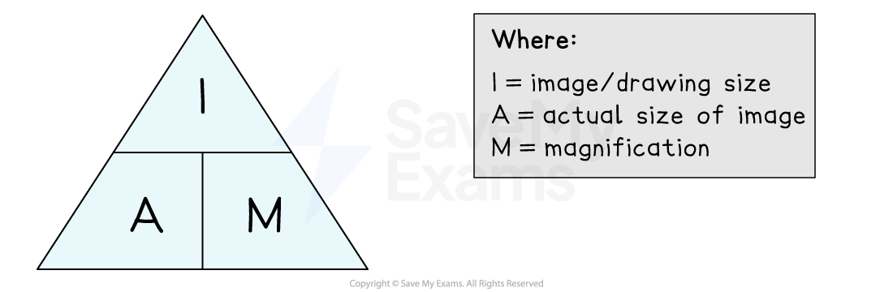
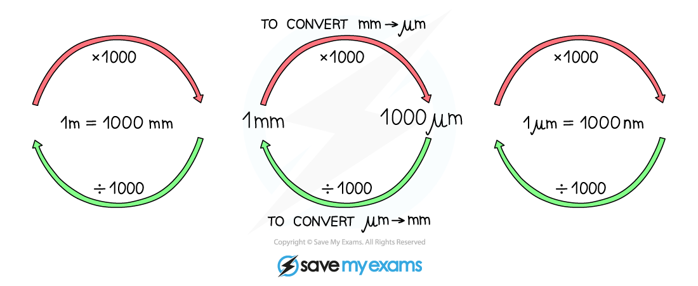

# Magnification Calculations

## Magnification Calculations

> **Spec point** — `spcpt_hc6cyNFQDMjgXwzX` · calculate magnifications of images and actual sizes of specimens from drawings, photomicrographs and electron micrographs (scanning and transmission)

## Magnification calculations

- **Magnification** is the **number of times** that a real-life specimen has been **enlarged** to give a larger view/image

  - E.g. a magnification of x100 means that a specimen has been enlarged 100 times to give the image shown
- The **magnification** (*M*) of an object can be calculated if both the size of the image (*I*), and the actual size of the specimen (*A*), is known

*An equation triangle allows the magnification equation to be easily rearranged*

- When carrying out calculations relating to magnification, the following steps should be followed:

  1. Rearrange the equation
  
    - A = I ÷ M
    - M = I ÷ A
    - I = A x M
  2. Read and measure the relevant values from the question stem and/or any images provided
  3. Convert any units
  4. Substitute numbers into the rearranged equation
  5. Consider whether this value makes sense in the context provided

### Converting units during magnification calculations

- Cellular structures are usually measured in either **micrometres** (μm) or **nanometres** (nm), while any measurements carried out in an exam with a ruler are likely to be in **millimetres** (mm)

  - There are 1000 µm in a mm
  - There are 1000 nm in a µm
- When doing calculations all measurements must be expressed using the **same units**

  - It is best to use the **smallest unit** of measurement shown in the question
  - Note that **magnification does not have units**
- To convert units, multiply or divide depending on whether the units are** increasing or decreasing**

  - Multiply when converting from a larger unit to a smaller unit
  - Divide when converting a smaller unit to a larger unit

*Units can be multiplied or divided by a factor of 1000 when converting between mm and µm*

> **Worked Example**
> A starch grain inside a plant cell was viewed under a microscope at a magnification of x850. The image of the starch grain captured using the microscope is shown below.
> 
> 
> 
> Calculate the actual diameter of the starch grain between points C-D in the image.
> 
> Give your answer in μm.
> 
> **Answer:**
> 
> **Step 1: Rearrange the equation**
> 
> We have been asked to calculate actual size, *A*, so the new equation should be:
> 
> Actual size = image size ÷ magnification
> 
> **Step 2: Read and measure relevant values**
> 
> We need to know the image size and the magnification
> 
> The image size has been given in the image as 20 mm
> 
> The magnification has been included in the question stem and is x850
> 
> **Step 3: Convert any units**
> 
> The actual diameter of a structure inside a cell would normally be measured in μm
> 
> The image size has been given in mm, so we need to convert this to μm
> 
> 1 mm = 1000 μm, so we multiply mm by 1000 to give the value in μm
> 
> 20 x 1000 = 20 000 μm
> 
> **Step 4: Substitute number into the equation**
> 
> Actual size = 20 000 ÷ 850
> 
> Actual size = 23.53 μm
> 
> **Step 5: Consider whether the value makes sense**
> 
> Plant cells measure between 10-100 μm, and the starch grain takes up a large proportion of the cell in the image
> 
> A diameter of around 23 μm could therefore be correct for this starch grain
> 
> If we had forgotten to convert the units and come up with a value of 0.024 μm, then this step would show us that this is probably too small and that we must have therefore made a mistake somewhere

> **Exam Hint**
> Magnification calculations will usually involve measuring images on a page, so you must have a **ruler** with you in an exam!
> 
> Be aware that the unit conversions given above only work if the** initial measurement is taken in mm, not in cm**. Any measurements taken in cm will need to be converted into mm before multiplying by 1000 to give μm.
> 
> Some exam questions may expect you to <u>**[use a scale bar](https://www.savemyexams.com/a-level/biology/cie/25/revision-notes/1-cell-structure/1-1-the-microscope-in-cell-studies/calculating-actual-size/)**</u> to calculate the magnification of an image. Remember that you can use a scale bar to find both actual size (written on the scale bar) and image size (the measured length of the bar), so these values can be used to calculate magnification using the equation M = I ÷ A
