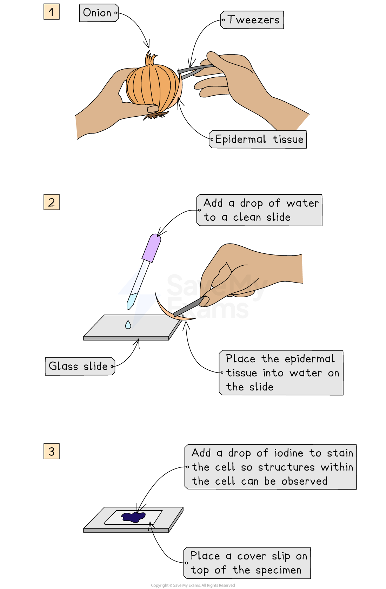
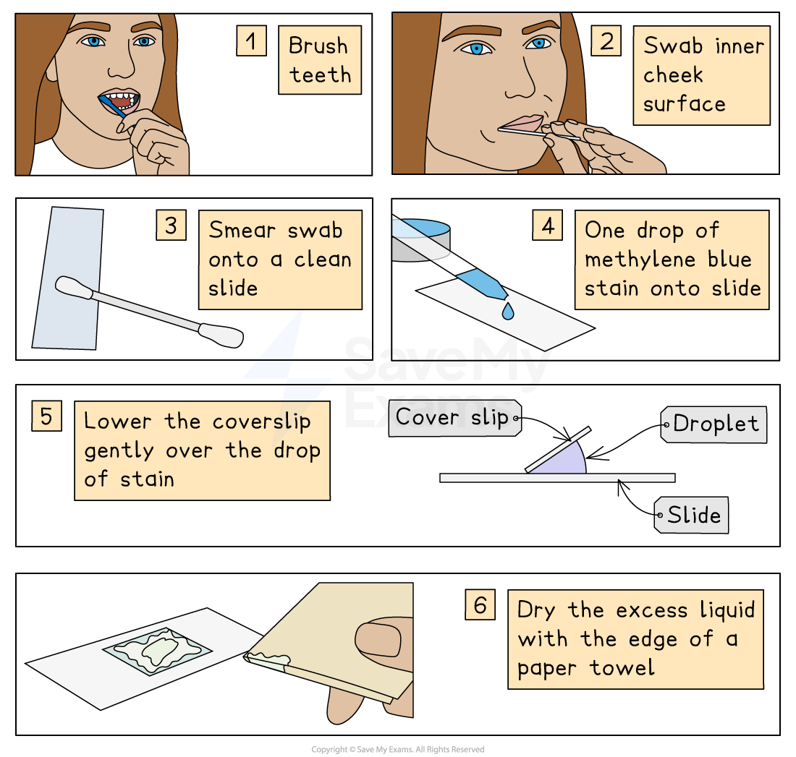
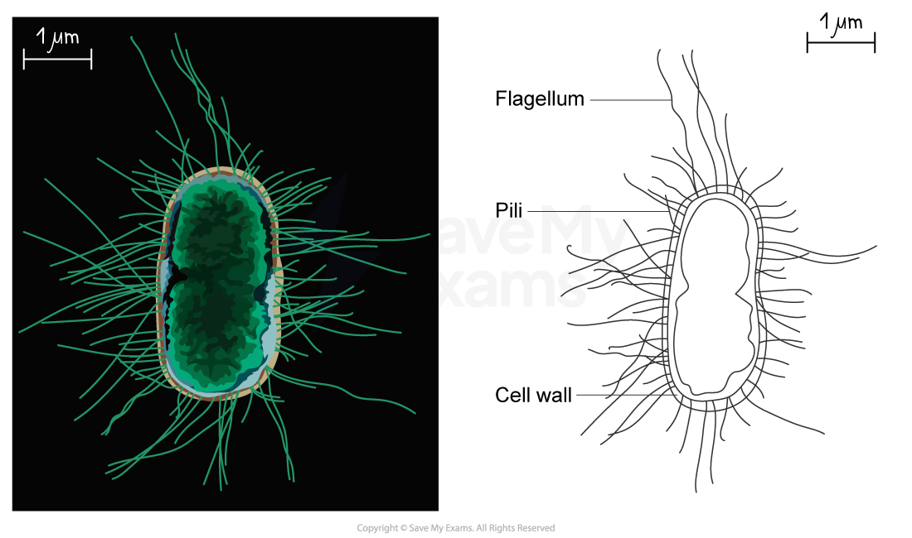
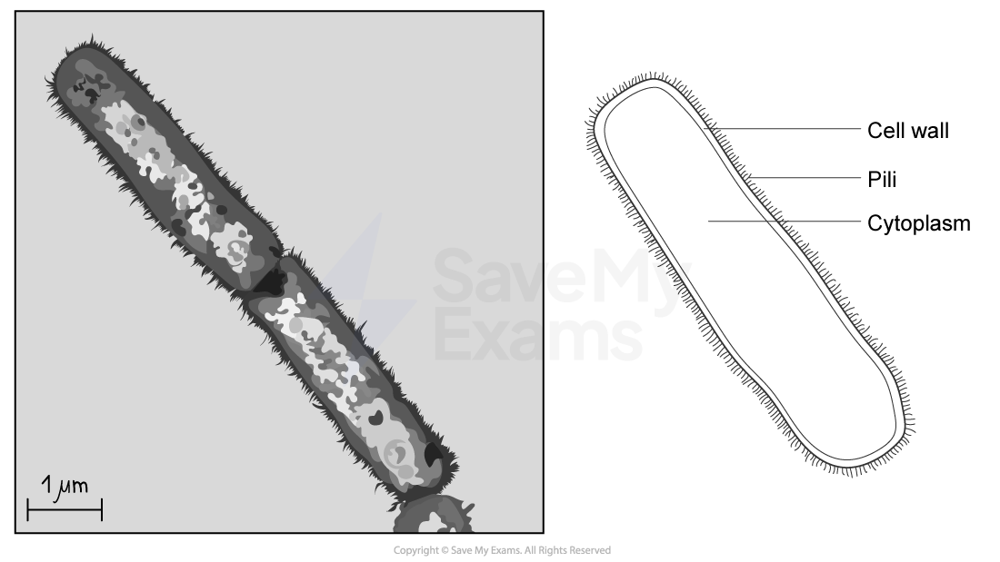
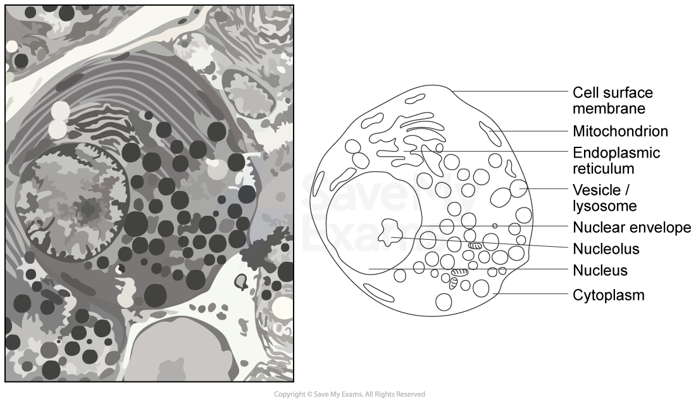

# The Microscope in Cell Studies

## Microscope Slide Preparation

> **Spec point** — `spcpt_69425kc4Jnk66TTd` · make temporary preparations of cellular material suitable for viewing with a light microscope

## Microscope slide preparation

### Preparing a microscope slide

- **Specimens** can be viewed under a light microscope; this allows some details of cellular material to be observed
- Pre-prepared **permanent slides** can be viewed

  - Such slides are produced by cutting **very thin layers of tissue** which are stained and permanently mounted on a glass slide for repeated use
- Different methods will be used to view different types of specimen, e.g. **temporary slide preparations** can be produced in the school laboratory as described below

#### Preparing a slide using a liquid specimen

1. Add a few drops containing the liquid sample to a clean slide using a pipette
2. Lower a** *****coverslip*** over the specimen and gently press down to **remove air bubbles**

  - Coverslips protect the microscope lens from liquids and help to prevent drying out

#### Preparing a microscope slide using a solid specimen

1. Use scissors or a scalpel to cut a small sample of tissue, and peel away or cut a** very thin layer** **of cells** from the tissue sample

  - The preparation method always needs to ensure that **samples are thin** enough to allow **light to pass through**
2. Place the sample onto a slide

  - A drop of water may be added at this point
3. Apply** iodine** **stain**
4. Gently lower a coverslip over the specimen and press down to remove any air bubbles

*Tissue from an onion is a solid specimen, and can be prepared here using iodine stain*

#### Preparing a slide using human cells

1. Brush teeth thoroughly with normal toothbrush and toothpaste

  - This removes bacteria from teeth so they don't obscure the view of the cheek cells
2. Take a ***sterile***** cotton swab** and gently scrape the inside cheek surface of the mouth for 5-10 seconds
3. Smear the cotton swab on the centre of the microscope slide for 2-3 seconds
4. Add a drop of **methylene blue solution**

  - Methylene blue stains negatively charged molecules in the cell, including DNA and RNA
  - This causes the nucleus and mitochondria to appear darker than their surroundings
5. Place a coverslip on top

  - Lay the coverslip down at one edge and then **gently lower **the other edge until it is flat
  - This reduces bubble formation under the coverslip
6. Absorb any excess solution by allowing a paper towel to touch one side of the coverslip

*Cheek cells can be stained using methylene blue*

## Drawing Cells

> **Spec point** — `spcpt_85JDFpYjn4JdKxTP` · draw cells from microscope slides and photomicrographs

## Drawing cells

- To record the observations seen under a microscope, a labelled **biological drawing** is often made
- Biological drawings are **line drawings** which show specific features that have been observed when the specimen was viewed
- There are a number of rules/conventions that are followed when making a biological drawing

  - The drawing must have a **title**
  - The **magnification** under which the observations shown by the drawing are made should be recorded if possible
  
    - A scale bar may be used
  - A **sharp pencil** should be used
  - Drawings should be on plain white paper
  - Lines should be **clear**, **single** **lines **without sketching
  - **No shading **should be used
  - The drawing should take up as much of the space on the page as possible
  - Well-defined structures should be drawn
  - **Only visible structures **should be drawn, and the drawing should **look like the specimen**
  - The drawing should be made with **proper proportions**
  - Structures should be** clearly labelled **with label lines that:
  
    - Do not cross
    - Do not have arrowheads
    - **Connect directly **to the part of the drawing being labelled
    - Are on one side of the drawing
    - Are drawn with a** ruler**
- Drawings of cells are typically made when visualizing cells at a higher magnification power, whereas plan drawings are typically made of tissues viewed under lower magnifications (individual cells are never drawn in a plan diagram)

*Plant cell biological drawing*

*Bacterial cell biological drawing*

*Bacterial cell biological drawing*

*Animal cell biological drawing*

> **Exam Hint**
> When producing a biological drawing, it is vital that you only ever draw **what you see** and not what you think you should see!
