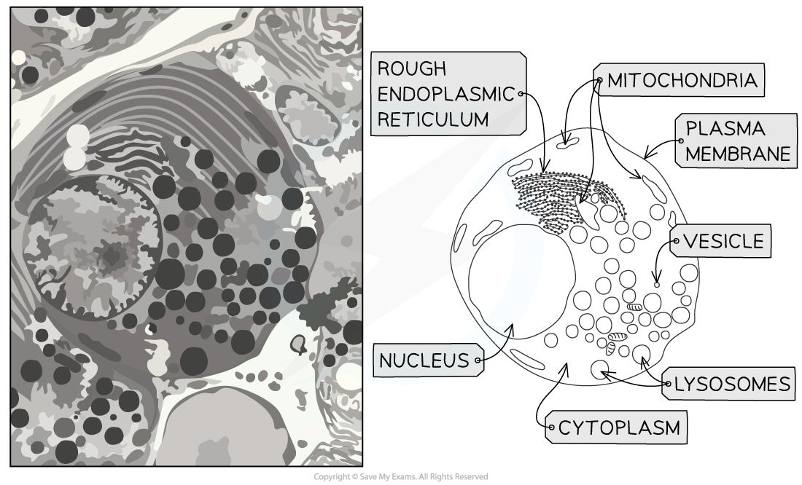
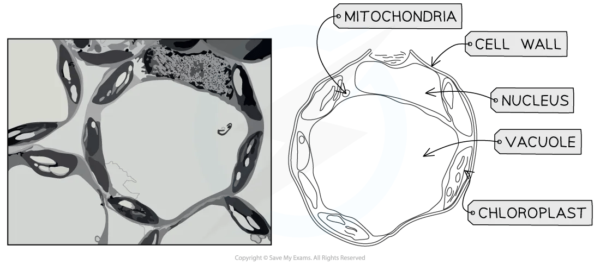
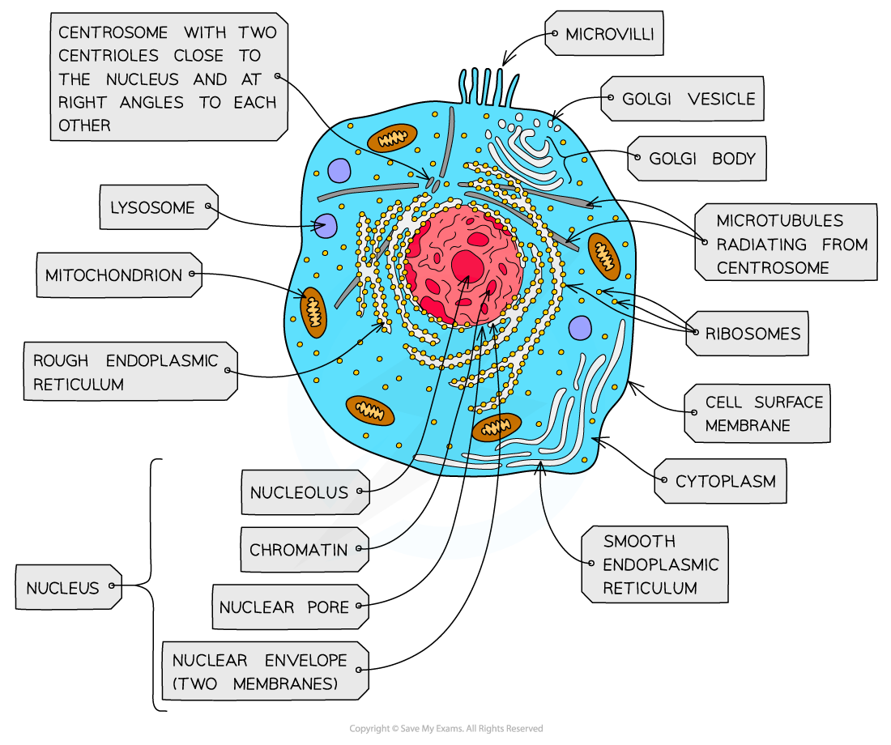
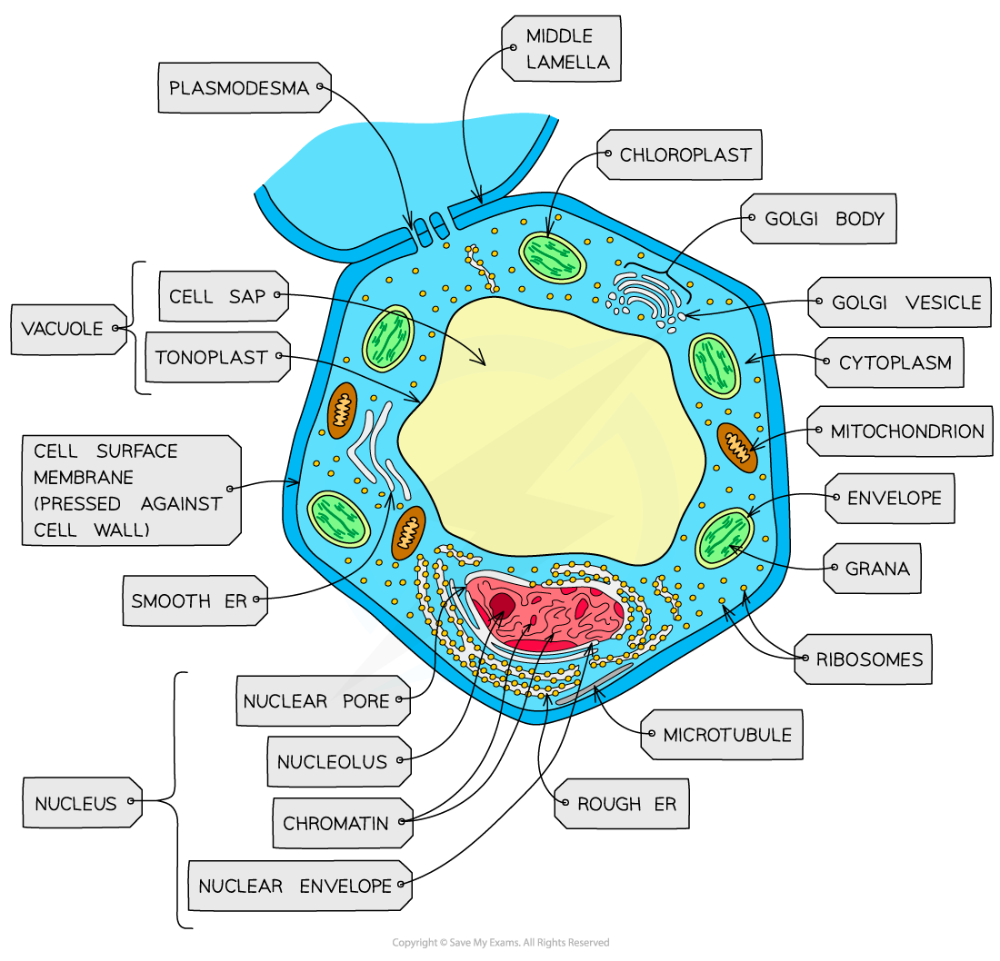

# Animal & Plant Cells

## Electron Micrographs: Animal Cells

> **Spec point** — `spcpt_42yQrcrBMrKSYgNG` · describe and interpret photomicrographs, electron micrographs and drawings of typical plant and animal cells

## Electron micrographs: animal cells

- Exam questions will not always contain neat diagrams of cellular structures, but may instead present images taken using microscopes

  - Such images are known as **micrographs**
- It is possible to identify organelles in micrographs of animal cells on the basis of their** shape**, **location**, and **size relative to other organelles**, e.g.

  - The nucleus will always be the largest organelle
  - Mitochondria are the next largest, and are often cylindrical with a folded inner membrane
  
    - Note that mitochondria are not always cylindrical, but can also be circular; their shape will depend on their age, and on the angle at which they were sliced during specimen preparation
  - RER will be near the nucleus, and ribosomes can sometime be seen
  - Lysosomes and vesicles will be smaller than mitochondria

*Exam questions may present micrograph images of cells*

> **Exam Hint**
> You should be able to describe and interpret photomicrographs, electron micrographs and drawings of typical animal cells.

## Electron Micrographs: Plant Cells

> **Spec point** — `spcpt_yS7zffBcBkz5KmnW` · describe and interpret photomicrographs, electron micrographs and drawings of typical plant and animal cells

## Electron micrographs: plant cells

- Plant cell micrographs can be interpreted using the same techniques as animal cells

  - Large, seemingly empty spaces inside cells will be vacuoles
  - The nucleus will be the largest dark region in the cell
  - Chloroplasts are the next-largest organelles, and *grana* are often visible

*Vacuoles and chloroplasts can be easily recognised inside plant cells*

> **Exam Hint**
> You should be able to describe and interpret photomicrographs, electron micrographs and drawings of typical plant cells.

## Structure of Animal & Plant Cells

> **Spec point** — `spcpt_vDh4MZNsy8CVCdWd` · compare the structure of typical plant and animal cells

## Structure of animal & plant cells

- Animal and plant cells have many common structures:

  - Cell surface membrane
  - Cytoplasm
  - Nucleus
  - Mitochondria
  - Rough and smooth endoplasmic reticulum
  - Golgi bodies
  - Vesicles and lysosomes
  - Ribosomes
  - Microtubules
- Plant cells are larger and more regular in shape than animal cells, and have the following additional structures

  - Cellulose **cell wall**
  - Large permanent **vacuoles**
  - **Chloroplasts**
  - **Plasmodesmata**
- Structures found in animal cells but not in typical plant cells include **centrioles**, **cilia** and **microvilli**

*Plant cells have a larger, more regular structure in comparison to animal cells*
