# Eukaryotic Cell Structures & Functions

## Eukaryotic Cell Structures & Functions

> **Spec point** — `spcpt_Gg733RwrgfF7vSJV` · recognise organelles and other cell structures found in eukaryotic cells and outline their structures and functions, limited to:
• cell surface membrane
• nucleus, nuclear envelope and nucleolus
• rough endoplasmic reticulum
• smooth endoplasmic reticulum
• Golgi body (Golgi apparatus or Golgi complex)
• mitochondria (including the presence of small circular DNA)
• ribosomes (S in the cytoplasm and S in chloroplasts and mitochondria)
• lysosomes
• centrioles and microtubules
• cilia
• microvilli
• chloroplasts (including the presence of small circular DNA)
• cell wall
• plasmodesmata
• large permanent vacuole and tonoplast of plant cells

## Eukaryotic cell structures & functions

- Cells can be divided into two broad types; **eukaryotic **and **prokaryotic cells**
- Eukaryotic cells have a more complex ultrastructure than prokaryotic cells

  - The term ultrastructure refers to the internal structure of cells
- The cytoplasm of eukaryotic cells is divided up into membrane-bound compartments called **organelles**

### Cell organelles

#### Cell surface membrane

- All cells are surrounded by a cell surface membrane which separates the inside of cells from their surroundings
- Cell surface membranes** controls the exchange of materials** between the internal cell environment and the external environment

  - The membrane is described as being partially permeable as it allows the passage of some substances and not others
- The cell membrane is formed from a **phospholipid bilayer **and spans a diameter of around 10 nm

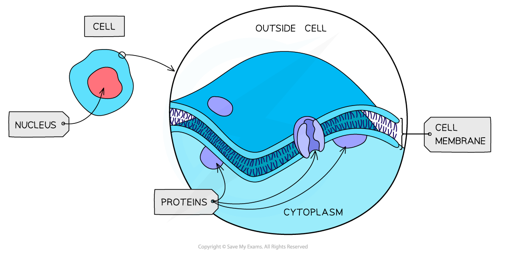

*Cell surface membranes separate cell contents from the surrounding environment and control the passage of substances into and out of cells*

#### Nucleus

- Present in all eukaryotic cells, the nucleus is a large organelle that is separated from the cytoplasm by a double membrane
- The nucleus contains the **DNA**, which is arranged into chromosomes

  - Chromosomes contain DNA and proteins, which are collectively referred to as chromatin
- The nuclear membrane is known as the **nuclear envelope**, and contains many **pores**
- **Nuclear pores** are important channels for allowing mRNA and ribosomes to travel out of the nucleus, as well as allowing enzymes and signalling molecules to move in
- The nucleus contains a region known as the **nucleolus**, which is the site of ribosome production

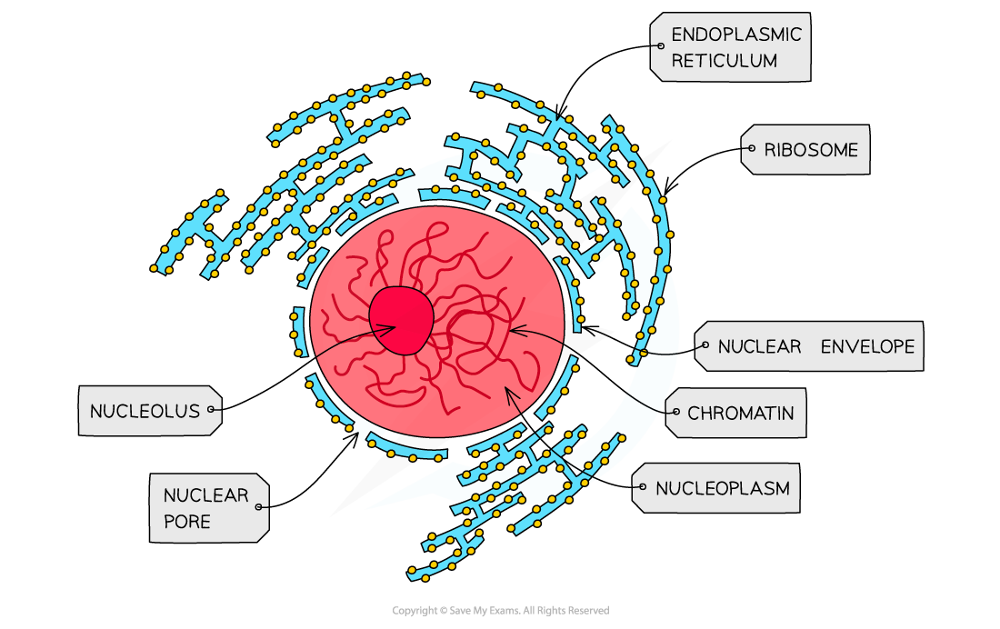

*The nucleus of a cell contains the genetic material*

#### Rough and smooth endoplasmic reticulum

- The endoplasmic reticulum (ER) is made up of a **series of membranes** that form flattened sacs within the cell cytoplasm
- The ER is linked with the nuclear envelope
- There are two distinct types of ER, with different roles within the cell

  - The** rough endoplasmic reticulum (RER)**
  
    - Continuous folds of membrane that are linked with the **nuclear envelope**
    - The surface of the RER is covered in **ribosomes**
    - The role of the RER is to **process proteins** that are produced on the ribosomes
  - The** smooth endoplasmic reticulum (SER)**
  
    - The SER does **not** have ribosomes on the surface
    - It is involved in the **production of lipids**, and of **steroid hormones** such as oestrogen and testosterone

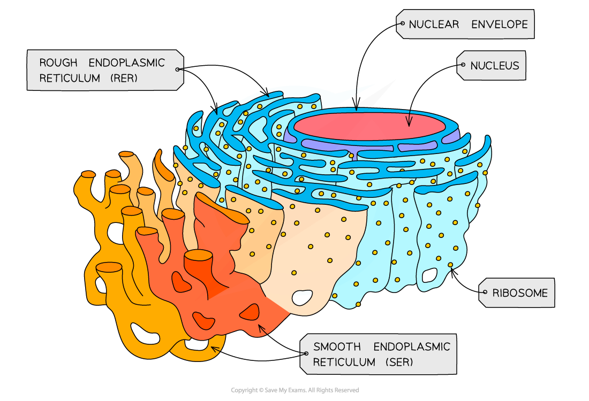

*The RER has ribosomes on its outer surface and is continuous with the nuclear envelope, while the SER lacks ribosomes*

> **Exam Hint**
> Be sure to always use the full name of the **rough **and **smooth endoplasmic reticulum **when you first refer these structures in an exam; marks are often not awarded for the abbreviations RER and SER in the absence of the full key terms.

#### Golgi body

- The Golgi body is often referred to as the Golgi apparatus or the Golgi complex
- It consists of a **series of flattened sacs** of membrane
- It can be clearly distinguished from the ER, as it is not connected to other membrane-bound compartments, and it has a distinctive 'wifi symbol' appearance
- Its role is to** modify proteins** and **package** them into vesicles

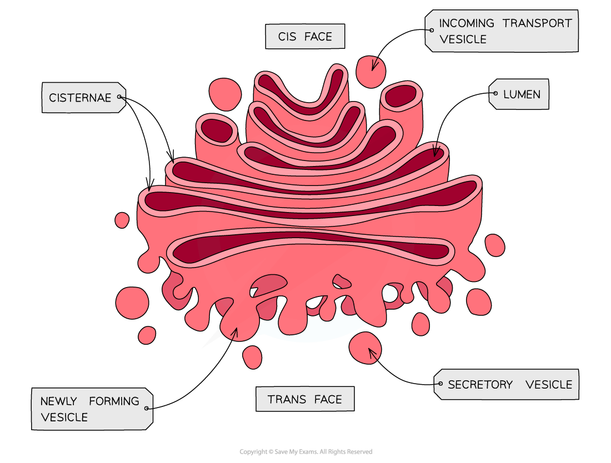

*The Golgi body processes proteins and packages them into vesicles*

#### Mitochondria

- Mitochondria (singular mitochondrion) are relatively large organelles surrounded by a double-membrane

  - They are smaller than the nucleus and chloroplasts, but can be seen with a light microscope
- The **inner membrane** is folded to form **cristae**
- Mitochondria are the** site of aerobic respiration** within eukaryotic cells
- The mitochondrial matrix contains **enzymes **needed for aerobic respiration
- Small, circular pieces of DNA, known as **mitochondrial DNA**, and ribosomes are also found in the matrix

  - This allows the production of proteins required for respiration

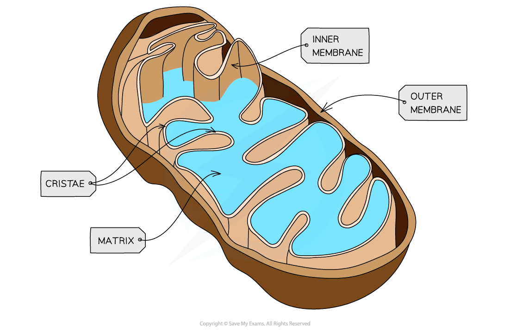

*Mitochondria have a highly folded inner membrane; this provides a large surface area for embedded proteins that are involved with aerobic respiration*

#### Ribosomes

- Ribosomes are found in the cytoplasm of all cells or as part of the **rough endoplasmic reticulum **in eukaryotic cells
- Each ribosome is a complex of **ribosomal RNA (rRNA)** and proteins
- *80S* ribosomes (composed of 60S and 40S subunits) are found in eukaryotic cells

  - Smaller, 70S ribosomes (composed of 50S and 30S subunits) are found in prokaryotes, mitochondria and chloroplasts
- Ribosomes are the site of translation during **protein synthesis**

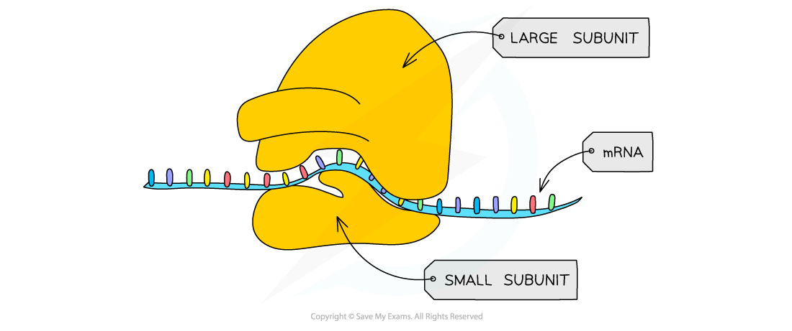

*Ribosomes are formed in the nucleolus and are composed of almost equal amounts of RNA and protein*

#### Vesicles

- Vesicles are small, membrane-bound sacs used by cells for **transport** and **storage**
- They can be pinched off the ends of the Golgi body; these are known as **Golgi vesicles**
- They can fuse with the cell surface membrane to allow *exocytosis*, or bud from the membrane during *endocytosis*

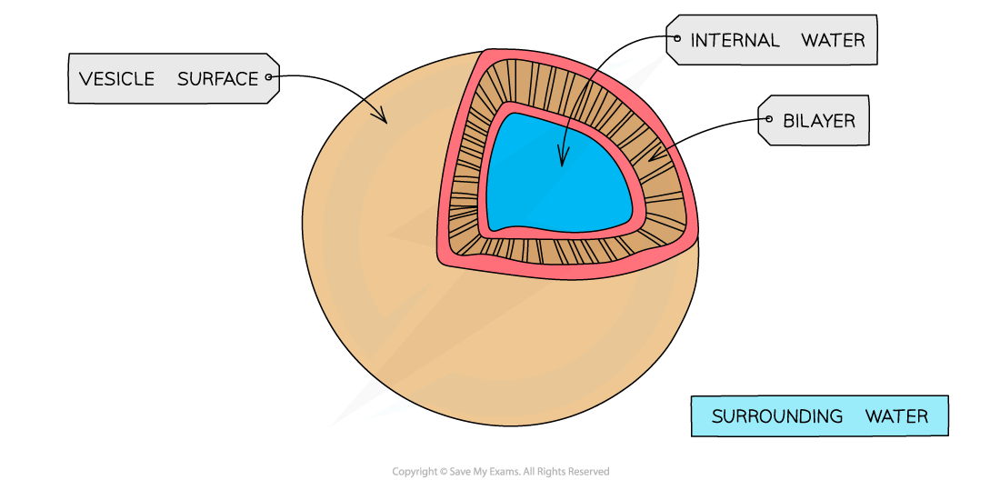

*Vesicles carry out transport and storage of substances within cells*

#### Lysosomes

- Lysosomes are specialised vesicles which contain **hydrolytic enzymes**
- Hydrolytic enzymes break down biological molecules, e.g.

  - Waste materials, such as worn-out organelles
  - Engulfed pathogens during *phagocytosis*
  - Cell debris during apoptosis** **(programmed cell death)

#### Lysosome diagram

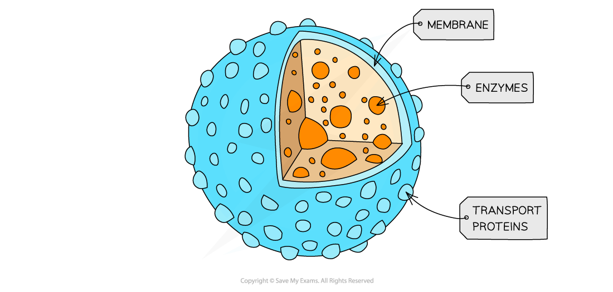

*Lysosomes contain hydrolytic enzymes for the breakdown of biological molecules*

#### Centrioles

- Centrioles are hollow fibres made of **microtubules**
- Two centrioles at right angles to each other form a **centrosome**, which organises the **spindle fibres** during cell division
- Note that centrioles are not found in flowering plants and fungi

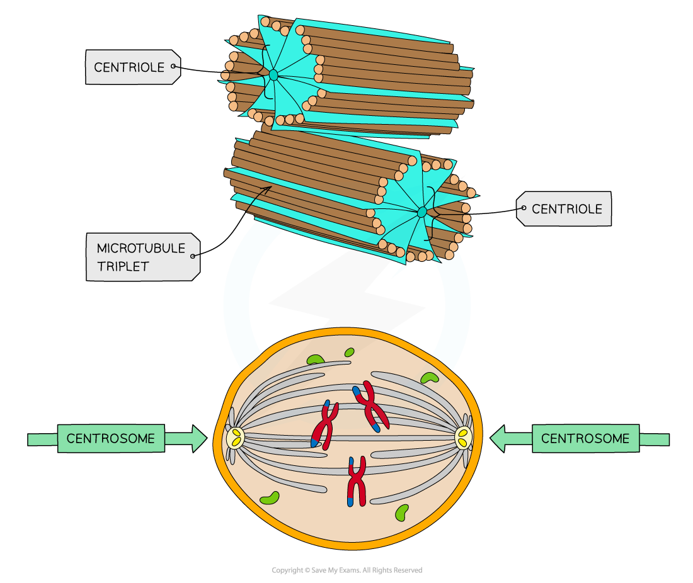

*Centrioles are involved with the movement of chromosomes during cell division*

#### Microtubules

- Microtubules are hollow tubes made of tubulin protein

  - α and β tubulin proteins combine to form dimers, which are then joined into protofilaments
  - Thirteen protofilaments in a cylinder make a microtubule
- Microtubules make up the cytoskeleton of the cell

  - The cytoskeleton is used to provide support and movement of the cell

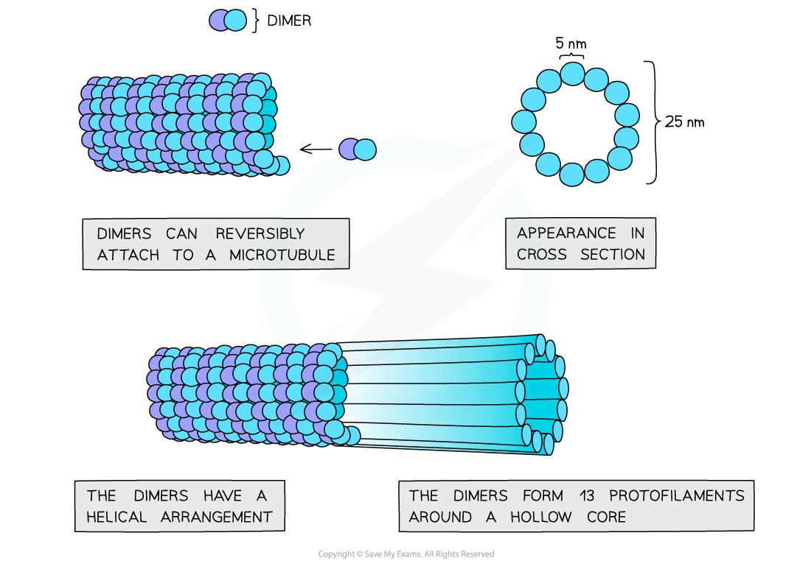

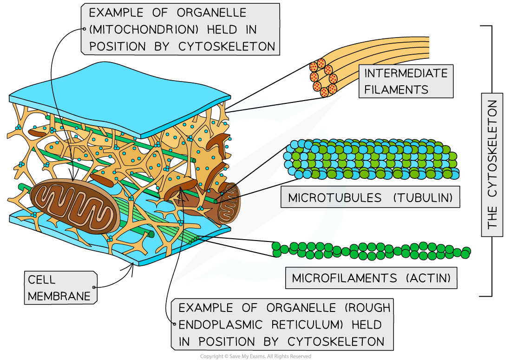

*Microtubules are tubes of protein that are involved with the structure of cell cytoskeletons*

#### Cilia

- Cilia are hair-like projections made from **microtubules**
- They can be found of the surface of some cells where they Allow the movement of substances over the cell surface

  - E.g. ciliated epithelial cells in the airways waft mucus away from the lungs

*Ciliated cells form ciliated epithelium in the airways*

#### Microvilli

- Microvilli are cell membrane projections that increase the **surface area** for absorption
- Microvilli are found in parts of the body that carry out absorption, e.g.

  - The lining of the small intestine
  - The kidney tubules

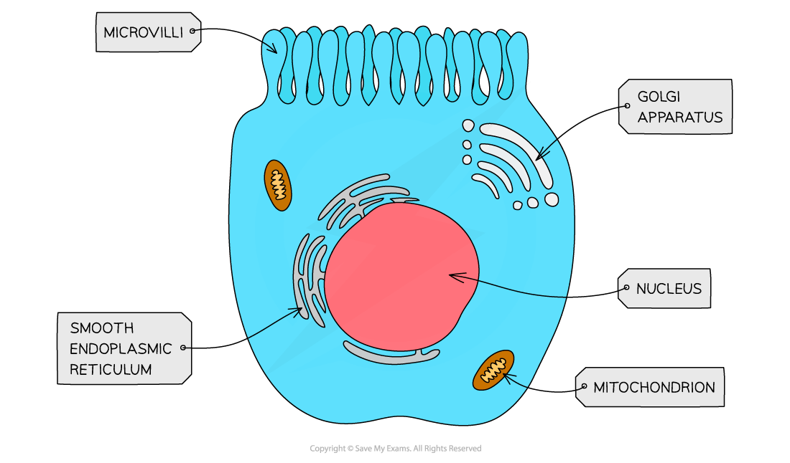

*Microvilli increase the surface area of the cell surface membrane*

> **Exam Hint**
> Be careful not to confuse microvilli with *villi*. Villi are much larger structures made up of several layers of cells, while microvilli are found on the surfaces of individual cells. Microvilli will be present on the outermost layer of cells that make up the villi!

#### Cell wall

- Cell walls are outside cell surface membranes and offer **structural support **to some types of cell

  - Structural support is provided by the polysaccharide cellulose in plants, and by chitin in fungi
- Cell walls are freely permeable and do not play a role in controlling the movement of substances into and out of cells

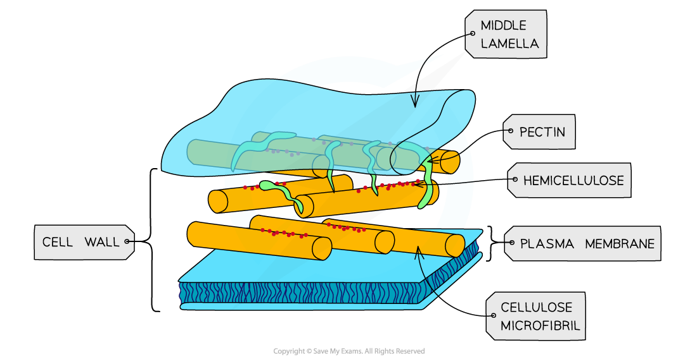

*Plant cell walls contain cellulose*

#### Chloroplasts

- Chloroplasts are larger than mitochondria, and are also surrounded by a **double-membrane**
- Membrane-bound compartments called **thylakoids** stack together to form structures called **grana**
- Grana are joined together by **lamellae**
- Photosynthetic pigments such as **chlorophyll **are found in the membranes of the thylakoids, where their role is to** absorb light energy** for **photosynthesis**
- Chloroplasts contain small circular pieces of DNA and ribosomes used to synthesise proteins needed in chloroplast replication and photosynthesis

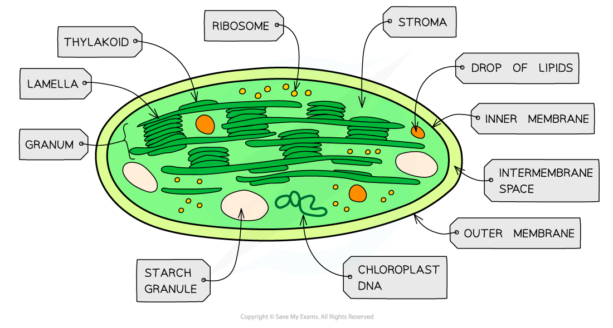

*Chloroplasts are found in the green parts of a plant*

#### Plasmodesmata

- Plasmodesmata are **bridges of cytoplasm** between neighbouring plant cells
- They allow the transfer of substances between plant cells

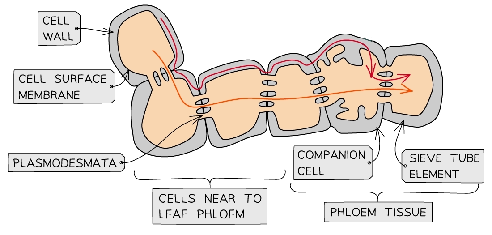

*Plasmodesmata mean that the cytoplasm of neighbouring plant cells is continuous; this allows substances to move easily between cells, e.g. sucrose can move easily from the surrounding cells into the phloem*

#### Large permanent vacuole

- Large permanent vacuoles are found in plant cells, where they store **cell sap** and provide **additional structural support** to cells

  - Vacuoles are sometimes found in animal cells, but these will be small and temporary
- Vacuoles are surrounded by the **tonoplast**, which is a partially permeable membrane

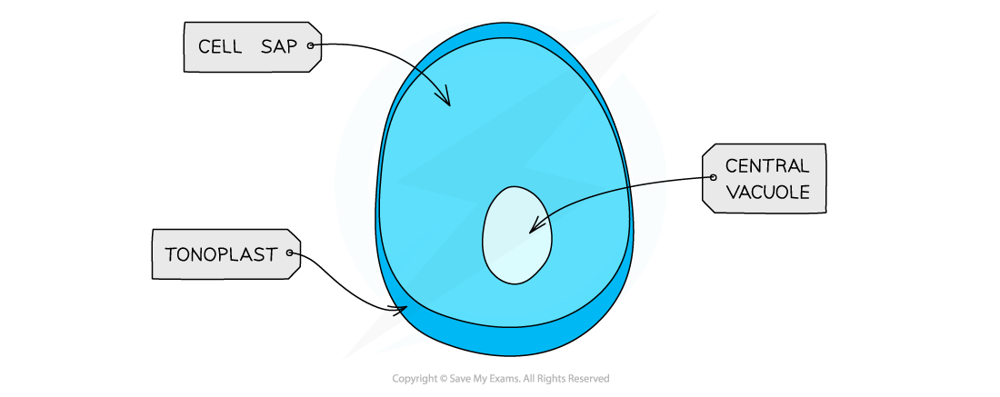

*Large permanent vacuoles store cell sap inside plant cells*
