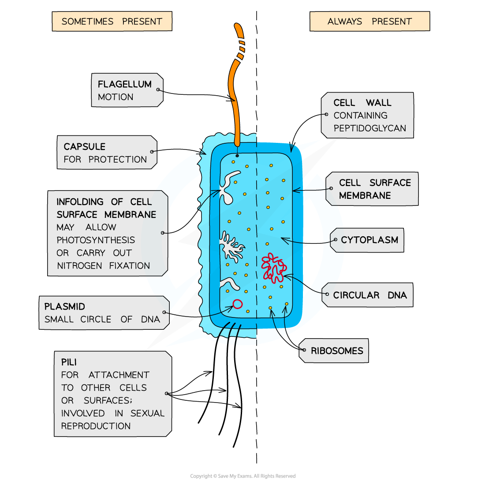

# Prokaryotic v Eukaryotic Cells

## Structural Features of Typical Prokaryotic Cells

> **Spec point** — `spcpt_YkDCzDhmKPFHzH6n` · "outline key structural features of a prokaryotic cell as found in a typical bacterium, including:
• unicellular
• generally – μm diameter
• peptidoglycan cell walls
• circular DNA
• S ribosomes
• absence of organelles surrounded by double membranes"

## Structural features of typical prokaryotic cells

- Animal and plant cells are **eukaryotic** cells, whereas bacterial cells are **prokaryotic**
- Prokaryotes have a cellular structure that is distinct from eukaryotes:

  - Their **genetic material** is free in the cytoplasm and is **circular**
  
    - Eukaryotic genetic material is packaged as linear chromosomes in the nucleus
  - Prokaryotes **lack membrane-bound** **organelles**
  
    - This means that they do not have any internal structures surrounded by membrane, e.g. a nucleus or mitochondria
  - They are many times smaller than eukaryotic cells
  
    - Prokaryotic cells are usually **1-5 μm in diameter**, while eukaryotic plant cells can be 10-100 μm across
  - Their **ribosomes** are structurally smaller (70 S) in comparison to those found in eukaryotic cells (80 S)
  - Their cell walls are made of **peptidoglycan** rather than cellulose or chitin
- Prokaryotes are always **unicellular**, while eukaryotic animal and plant cells can function together in multicellular organisms

*Prokaryotic cells have no internal membrane-bound structures, and are smaller than eukaryotic cells*

## Prokaryotic v Eukaryotic Cell Structures

> **Spec point** — `spcpt_6jpZccrGps9VzypC` · compare the structure of a prokaryotic cell as found in a typical bacterium with the structures of typical eukaryotic cells in plants and animals

## Prokaryotic v eukaryotic cell structures

| **Feature** | **Prokaryotes** | **Eukaryotes** |
|---|---|---|
| **Size** | 1–5 μm | Up to 100 μm |
| **Genetic material** | Circular chromosome in the cytoplasm  Not associated with proteins | Linear chromosomes in the nucleus  Associated with histone proteins |
| **Cell division** | *Binary fission*  No spindle fibres involved | Mitosis or meiosis  Chromosomes are separated by spindle fibres |
| **Ribosomes** | 70S | 80S |
| **Organelles** | No membrane-bound organelles | Multiple membrane-bound organelles, e.g. a nucleus, mitochondria, chloroplasts |
| **Cell wall** | Made of peptidoglycan | Made of cellulose in plants, or chitin in fungi |
