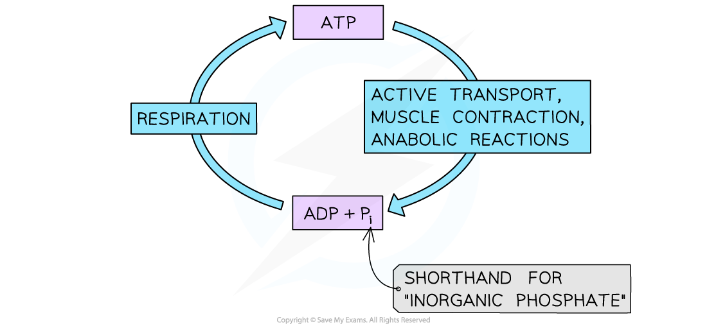

# The Vital Role of ATP

## The Vital Role of ATP

> **Spec point** — `spcpt_fTcFsYGPztqBGPpk` · state that cells use ATP from respiration for energy-requiring processes

## The vital role of ATP

- All organisms require a **constant supply of energy** to maintain their cells and stay alive
- This energy is required

  - In **anabolic** reactions to build larger molecules from smaller molecules
  - To **move substances** across the cell membrane in active transport, or to move substances within the cell
  - In animals, energy is required
  
    - For **muscle contraction**
    - In the **conduction of nerve impulses**
- In all known forms of life, ATP from respiration is used to transfer energy in **all energy-requiring processes** in cells; this is why ATP is known as the **universal energy currency**

  - Energy is released from ATP when it is broken down to ADP and inorganic phosphate
  - This process is reversed during **respiration** to make ATP and maintain a supply of energy
- **Adenosine Triphosphate (ATP)** is a *nucleotide*

  - The monomers of DNA and RNA are also nucleotides

*ATP is the energy currency of cells*

> **Exam Hint**
> Always state that ATP is the immediate source of energy for cellular processes — not glucose.
> 
> In exam questions, students often say that cells “use glucose for energy”, but this is inaccurate. Glucose is first broken down in respiration to produce ATP, and ATP (not glucose) is the molecule that directly releases energy for processes like active transport, muscle contraction, and nerve impulse transmission.
