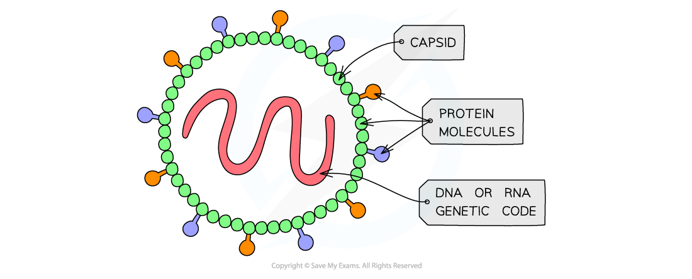

# Viruses

## Key Features of Viruses

> **Spec point** — `spcpt_VyYHf7Fg9GXGv9S2` · state that all viruses are non-cellular structures with a nucleic acid core (either DNA or RNA) and a capsid made of protein, and that some viruses have an outer envelope made of phospholipids

## Key features of viruses

- **Viruses** are **non-cellular particles** that infect living cells

  - Note that viruses are not cells, and they are not considered to be living organisms, so are referred to as 'particles'
- They are much smaller than prokaryotic cells, with a diameter of 20-300 nm
- Structurally they have

  - A** nucleic acid core** made of either DNA or RNA
  - A **protein **coat called a **capsid**
- Some viruses have an outer layer called an envelope; this forms from the **membrane phospholipids** of the host cell in which they were produced
- Viruses can only reproduce by **infecting living cells** and using their protein-building machinery to produce new viral particles

  - Viruses use attachment proteins on their surface to bind to and infect their host cells

*Basic virus structure includes a protein capsid and a nucleic acid core*

> **Exam Hint**
> Never describe viruses as cells or living organisms in exam answers.
> 
> Examiners often include this as a trap — viruses are non-cellular particles that rely on host cells to reproduce. Make sure to refer to them as “virus particles”, not “cells”, and state that they cannot carry out life processes independently.
