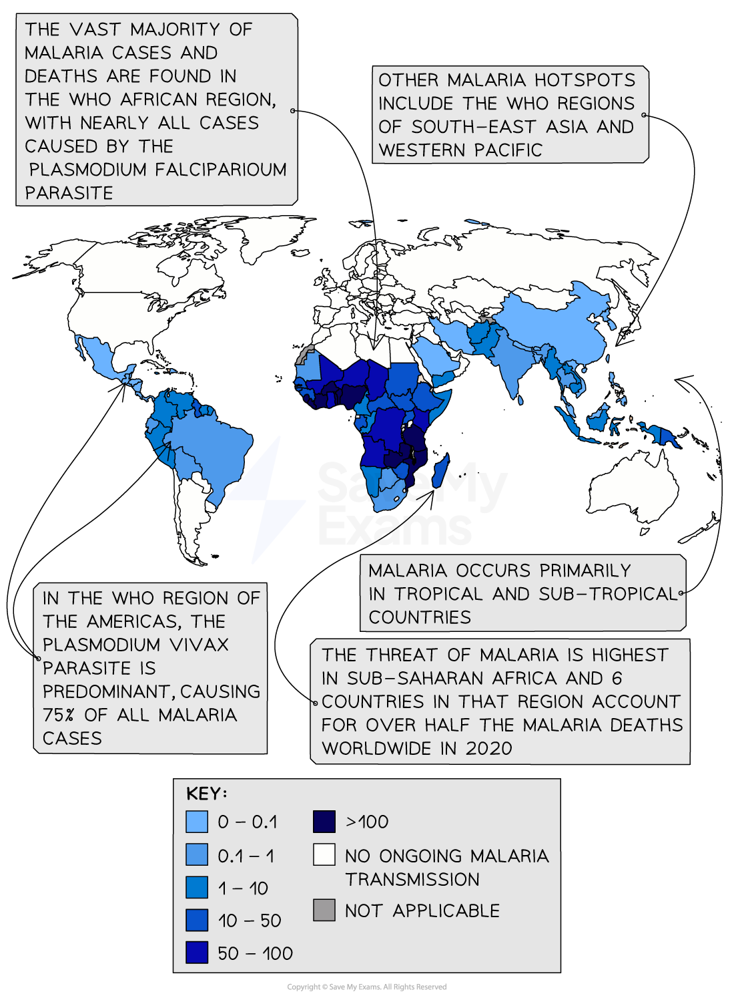

# Prevention & Control of Disease

## Factors for Prevention & Control of Common Diseases

> **Spec point** — `spcpt_cwRJcDMMwqVqvftS` · discuss the biological, social and economic factors that need to be considered in the prevention and control of cholera, malaria, TB and HIV

## Factors for prevention & control of common diseases

### Prevention and control of cholera

- Cholera occurs when people do not have access to effective **sanitation** **facilities** and** access to clean water**
- It is difficult to prevent and control cholera in developing countries

  - The fast-growing cities in **developing countries **may **not have the appropriate infrastructure**, and may have limited funds for large-scale projects such as the provision of drainage systems, sewage treatment facilities and clean water supplies
  - Humanitarian crises, e.g. displacement of people due to wars or natural disasters, can cause the **destruction of sanitation infrastructure** and/or the provision of poor sanitation facilities in **overcrowded temporary housing**
  - In some developing countries the use of raw human sewage to irrigate crops is common
- **Prevention** of cholera can occur through:

  - Providing adequate sewage treatment infrastructure
  - The provision of clean, piped water that has been **chlorinated** to kill bacteria
  
    - This strategy means that cholera is very rare in developed countries
  - Vaccination programmes in areas where cholera is common
- **Cholera** can be controlled by:

  - Ready access to treatments such as **oral rehydration therapy**; a solution containing glucose, salts and water
  - **Monitoring programmes** by the World Health Organisation (WHO)
  - Using antibiotics in severe cases

### Prevention and control of malaria

- Malaria spreads in regions where ***Anopheles***** mosquitos can breed**; this is dependent on a warm climate, and the availability of standing water
- The 3 main methods for reducing malaria are:

  - **Reducing the number of *****Anopheles *****mosquitoes** in an area
  
    - Spraying living areas with **insecticides**
    - **Spreading oil** over the surface of water bodies in which mosquitoes breed
    - **Draining marshes** and other unnecessary bodies of water
    - Ensuring ponds and irrigation or drainage ditches are stocked with **fish that feed on mosquito larvae**
    - Unfortunately, mosquitoes lay eggs in even very small puddles and pools of water and therefore it is **practically impossible to control all breeding sites** using the methods listed above
  - **Reducing the chance of being bitten** by these mosquitoes
  
    - People in malarial zones should sleep under **bed nets**, which can also be soaked periodically in insecticide to increase effectiveness,
    - People should avoid exposing their skin at dusk when mosquitoes are most active
  - **Using** **drugs** to prevent *Plasmodium* infecting humans
  
    - Drugs, such as chloroquine and mefloquine, are taken before, during and after a visit to a location where malaria is prevalent.
    - The use of these drugs has resulted in drug-resistant strains of *Plasmodium*
    - The drugs are expensive and can have disagreeable side-effects
- In the 1950s, the World Health Organisation (WHO) coordinated a worldwide eradication programme; whilst malaria was eradicated from some countries, the programme was mainly **unsuccessful** because:

  - *Plasmodium* became **resistant** to the drugs being used to try and control it
  - *Anopheles* mosquitoes became **resistant** to DDT and other insecticides being used against them
- To **control** malaria, governments, the WHO and other institutions are focusing on:

  - Working within health systems to improve diagnosis
  - Improving the supply of effective drugs
  - Using drugs in combination to reduce drug resistance
  - Promoting appropriate methods to prevent transmission, e.g. the use of biological controls to target the larvae and insecticide-treated bednets
- Recent scientific advances regarding the control of malaria are:

  - Simple dipstick tests for diagnosing malaria – this means a diagnosis can be made much faster and does not require a laboratory
  - The entire *Plasmodium* genome has been sequenced
  - The approval of **two effective malaria vaccines** which have been decades in development; these can now be rolled out in affected areas

*Malaria occurs in regions where the climate is suitable for the Anopheles mosquito*

### Prevention and control of tuberculosis (TB)

- TB is spread from person to person when **droplets** released by the **coughing** or **sneezing** of an infected person are **inhaled** by an uninfected person

  - The droplets contain the TB-causing bacterium *Mycobacterium tuberculosis*
- The spread of TB increases in **overcrowded living conditions**, so is prevalent among poorer people with inadequate housing conditions
- **Contact tracing**, and the subsequent testing of those contacts for the bacterium, is an important part of controlling the spread of TB
- Prevention of TB occurs through the use of the **BCG vaccine**

  - The vaccine protects up to 70-80% of those who receive it, although its effectiveness decreases with age
- The form of TB that can be transmitted between cattle and humans (caused by *Mycobacterium bovis*) can be prevented by:

  - **Routinely testing cattle for TB** and destroying those that test positive
  - **Pasteurising milk**; this kills any TB-causing bacteria present in the milk
  - Ensuring that **meat is cooked properly**

### Prevention and control of HIV/AIDS

- HIV is spread when body fluids are exchanged between an infected and an uninfected individual
- Preventing the spread of HIV is **very difficult** as the virus has a **long latent stage**, which results in it being transmitted by people who have the virus but show no symptoms, and so may not know they are infected

  - The virus can also change its surface proteins (antigens), making it **difficult for the human immune system to recognise it **and for a **vaccine** **to be developed**
- To **prevent** the transmission of HIV the following measures can be implemented:

  - **Blood donations** can be screened for HIV and heat-treated to kill any viruses
  - **HIV-positive mothers and their babies can be treated with drugs**
  - Condoms, femidoms and dental dams can be used to decrease the infection risk during sexual intercourse and oral sex by forming a **physical barrier between body and fluids**
  - **Education programmes about how the virus is transmitted **can be released into the community to encourage people to have** HIV tests **and to **avoid unprotected sex**
  - Intravenous drug users encouraged not to **share needles**
- **Controlling** HIV can occur by:

  - **Contact tracing** (and the subsequent testing of those contacts for the virus)
  - Screening blood donations
  - **Public health measures**, such as widespread HIV testing of the population and education programmes
  - Needle-exchange schemes have been set up in some places to exchange used needles for new, sterile ones
  - Encouraging individuals to be tested for HIV
  - Using anti-retroviral drugs
- The socio-economic status of a person or country with HIV can determine how it is controlled

  - For example, HIV-positive mothers are advised not to breastfeed in high-income countries, however, in low- and middle-income countries breastfeeding is more affordable, and offers protection against other diseases, e.g. cholera
