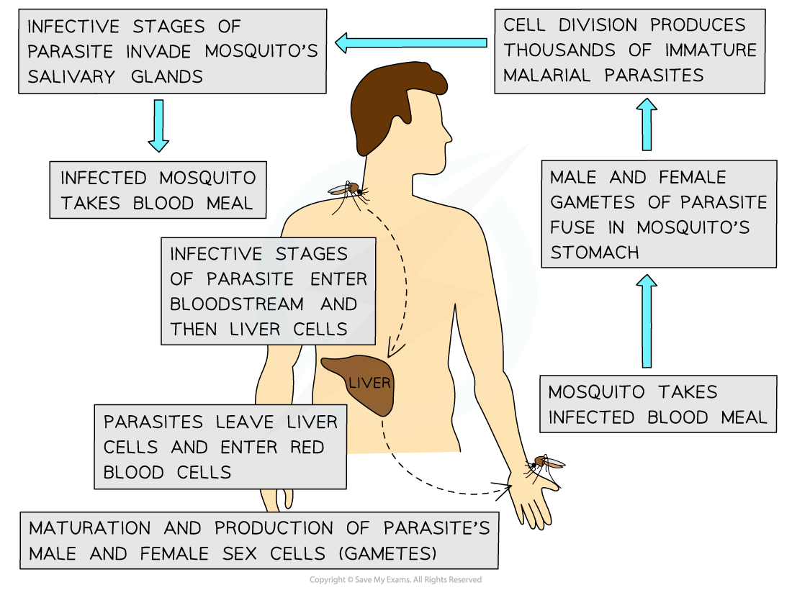

# Transmission of Disease

## Transmission of Common Diseases

> **Spec point** — `spcpt_qZDZtjvbXr38Q26y` · explain how cholera, malaria, TB and HIV are transmitted

## Transmission of common diseases

### Transmission of cholera

- Cholera is caused by the bacterium** *****Vibrio cholerae***
- The disease is **water-borne** and **food-borne**
- Infected people egest large numbers of the pathogenic bacteria in their **faeces **and **water becomes contaminated**
- Cholera can then be** transmitted **when individuals:

  - Wash in contaminated water
  - Drink contaminated water
  - Eat food exposed to contaminated water
- This means the disease occurs where people do not have access to **proper sanitation** and uncontaminated food

### Transmission of malaria

- Malaria is caused by one of four species of the protoctist** *****Plasmodium***
- These protoctists are transmitted to humans by an **insect ***vector* as follows:

  - **Female *****Anopheles***** mosquitoes** feed on human blood to obtain the protein they need to develop their eggs
  - If the person they bite is infected with *Plasmodium*, the mosquito will take up some of the pathogen with the blood meal
  - When feeding on the next human, *Plasmodium* pass from the mosquito to the new human’s blood
- Malaria may also be transmitted:

  - During **blood transfusion**
  - When **unsterile needles** are re-used
- *Plasmodium* can also pass **from mother to child across the placenta**

*Plasmodium spends part of its life cycle inside humans and part inside mosquitoes*

### Transmission of tuberculosis (TB)

- TB is cause by the bacterial pathogens ***Mycobacterium tuberculosis**** and ****Mycobacterium bovis***
- Human to human transmission occurs by **droplet infection** as follows:

  - When infected people with the active form of the disease **cough** or **sneeze**,  *M. tuberculosis* bacteria enter the air in tiny **droplets** of liquid
  - TB is transmitted when uninfected people **inhale** these droplets
  - TB therefore spreads more quickly among people living in **overcrowded conditions**
- The form of TB caused by *M. bovis* occurs in **cattle** but can spread to humans through:

  - **Contaminated** **meat**
  - **Unpasteurised** **milk**
- Very few people in developed countries now acquire TB in this way, although meat and milk can still be a source of infection in some **developing countries**

### Transmission of HIV/AIDS

- Human Immunodeficiency Virus (HIV) can infect human cells and eventually lead to AIDS
- The virus is spread by intimate human contact and can only be **transmitted by direct exchange of body fluids**
- This means HIV can be transmitted in the following ways:

  - Sexual intercourse
  - Receiving a transfusion of infected blood or blood products
  - Sharing of needles used by intravenous drug users
  - From mother to child across the placenta
  - Mixing of blood between mother and child during birth
  - From mother to child through breast milk

| **Disease** | **Pathogen** | **Transmission** | **Symptoms** |
|---|---|---|---|
| Cholera | *Vibrio cholerae* | Contaminated water or food | Diarrhoea and dehydration |
| Malaria | *Plasmodium falciparum*,* P. malariae*,* P. ovale*,* P. vivax* | Female* Anopheles* mosquito | Fever, headaches and muscle pain |
| TB | *Mycobacterium tuberculosis*,* M. bovis* | Airborne droplets | Cough, chest pain, fever and weight loss |
| HIV/AIDS | Human Immunodeficiency Virus | Exchange of body fluids | Initial flu-like symptoms, and eventually a loss of immune function (AIDS) |
