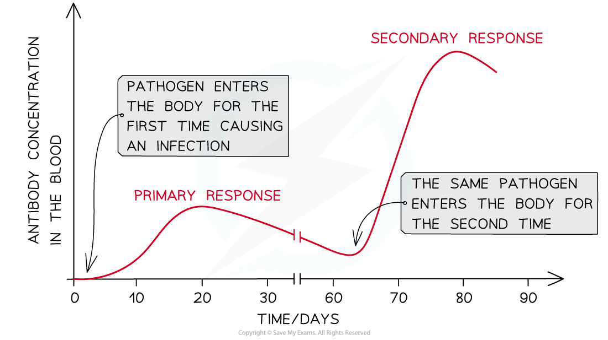

# Memory Cells & Immunity

## Memory Cells & Long-Term Immunity

> **Spec point** — `spcpt_yzJTSbxbghwpDfBB` · explain the role of memory cells in the secondary immune response and in long-term immunity

## Memory cells & long-term immunity

### Developing immunity

- The immune system is **activated** when a **new antigen is encountered**
- This launches a **primary immune response** consisting of:

  - A **non-specific immune response**
  - Followed by a **specific immune response**
- The primary response occurs the **first time** an antigen is encountered by the immune system

  - Since it is the first time the immune system has encountered the antigen, the numbers of **T and B cells with the correct membrane receptors** present in the blood will be **low**
- It will **take time** for the correct lymphocytes to be activated and to divide and for different cell types to develop

  - It can take several days before **plasma cells **develop and are able to start producing **antibodies** against an antigen
  - This is the reason why an infected person will **experience symptoms** of the disease the first time they contract it
- The primary response produces ***memory cells*** which remain in the blood after an infection is over

  - The presence of memory cells means that a person is said to be **immune** to the pathogen
  - Memory cells can remain in the blood for many years, so the immunity gained from a primary response can be **long-term**
- Should the immune system encounter the same antigen again in the future it will launch a **secondary immune response** which will be much **faster** and **stronger **than the primary response

  - Memory cells are present in larger quantities than the mature lymphocytes at the start of the primary response
  
    - This means the correct memory cells are able to detect an antigen, activate and divide by mitosis much more quickly
  - Antibodies are produced **more quickly** and in **larger concentrations** in a secondary response
- This will often eliminate the pathogen **before the infected person can show symptoms**

*The secondary response is much larger and faster than the primary response due to the presence of memory cells in the blood*
