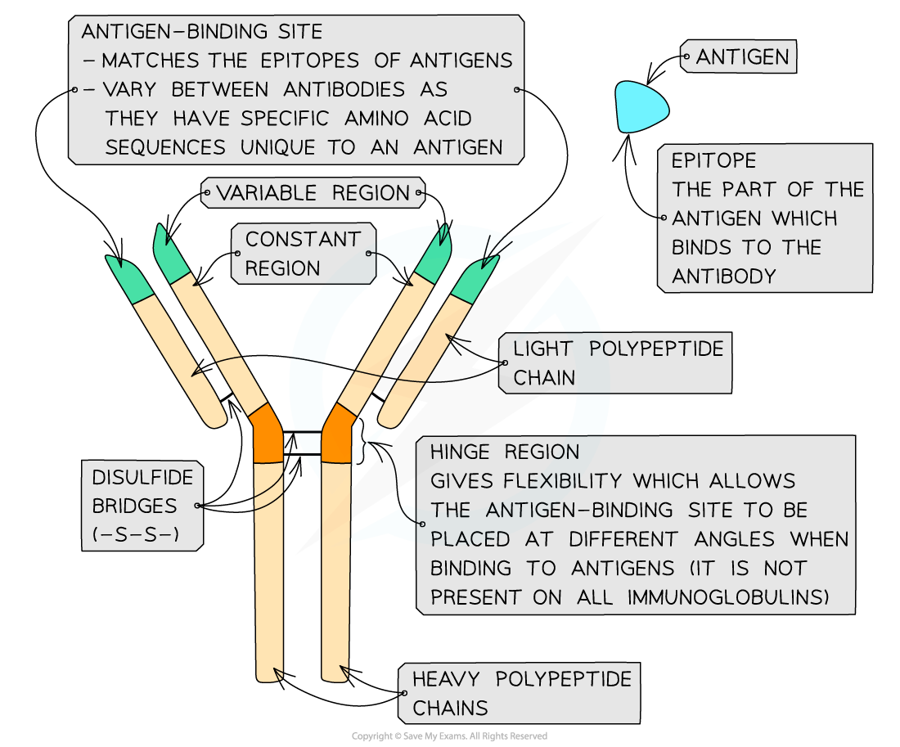
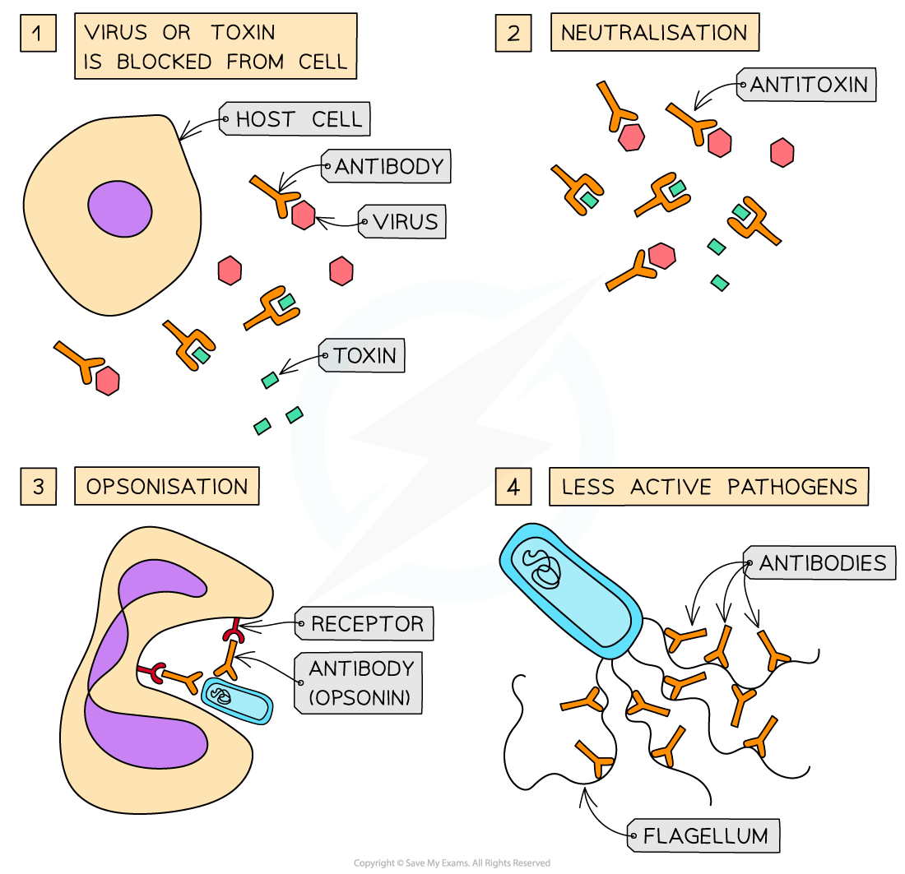
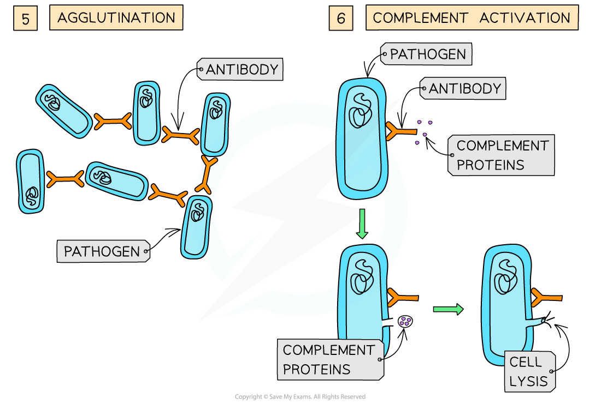

# Antibodies

## Antibodies: Structure & Functions

> **Spec point** — `spcpt_vFDrVRSPKc8gZcXh` · relate the molecular structure of antibodies to their functions

## Antibodies: structure & functions

### Antibody structure

- Antibodies are **globular glycoproteins** called immunoglobulins
- Antibodies have a Y-shaped **quaternary** structure with **two ‘heavy’** polypeptide chains bonded by **disulfide bonds** to **two ‘light’** polypeptide chains
- Antibodies have a **constant region** and a **variable region**

  - The **constant regions** **do not vary** within a class of antibodies but do vary between the classes.
  
    - The constant region determines the mechanism used to destroy antigens
  - The **variable region** is where the antibody attaches to the antigen to form an **antigen-antibody complex**
  
    - At the end of the variable region is the **antigen-binding site**.
    - Each antigen-binding site is generally composed of 110 to 130 amino acids and includes the ends of the light and heavy chains
    - Antigen-binding sites **vary** greatly, giving the antibody its **specificity** for binding to **antigens**
    
      - Antibodies bind to a region of the antigen called the epitope
- Antibodies also have a **hinge region** which gives **flexibility** to the antibody molecule

  - This allows the antigen-binding site to be placed at different angles when binding to antigens

*Antibodies are Y-shaped molecules with specific antigen binding sites*

### Antibody function

- Antibodies are produced by B lymphocytes
- Their role is to **bind to specific antigens**

  - Antigens include parts of pathogens and their toxins, pollen, blood cell surface molecules and the surface proteins found on transplanted tissues
- Antibodies can function in several different ways

  - Antibodies can attach to viruses and to the toxins produced by pathogens to block them from entering or damaging cells
  - Antibodies can act as **anti-toxins** by binding to and neutralising toxins
  - Antibodies can attach to bacteria, making them readily identifiable to phagocytes; this is called **opsonisation**.
  
    - Once identified, the phagocyte has receptor proteins for the heavy polypeptide chains of the antibodies, which enables phagocytosis to occur
  - Antibodies can attach to the flagella of bacteria, making them less active; this makes it easier for phagocytes to do phagocytosis
  - Antibodies act as **agglutinins**, causing pathogens to clump together in **agglutination**
  
    - This reduces the chance that the pathogens will spread through the body and makes it possible for phagocytes to engulf a number of pathogens at one time
  - Antibodies bound to pathogens can activate complement proteins in the blood, which make holes in the cell surface membranes of the pathogens so that they burst (lyse)

*Antibodies can act on pathogens in different ways*
