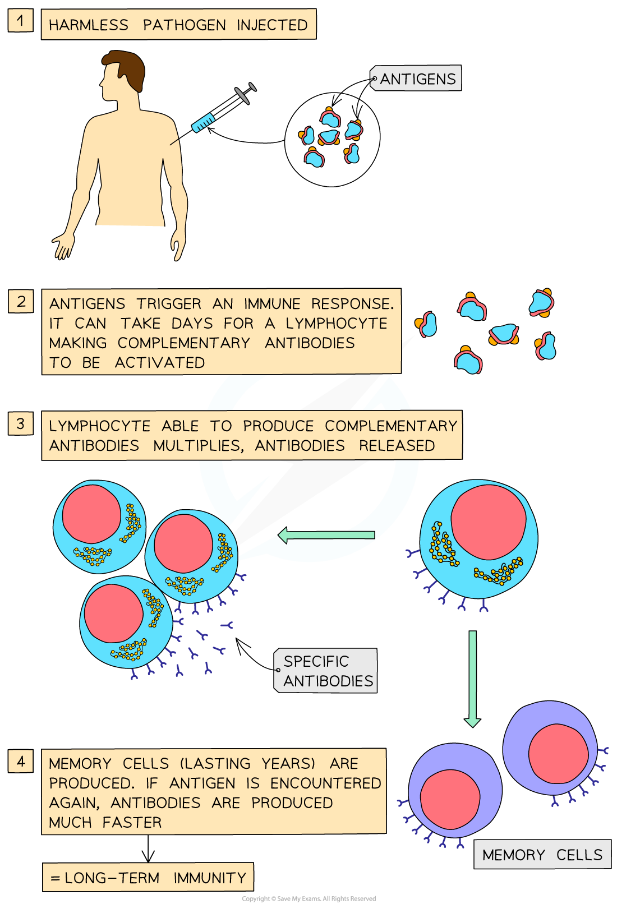

# How Vaccines Work

## How Vaccines Work

> **Spec point** — `spcpt_2KVCGr3vV2BVQHsz` · explain that vaccines contain antigens that stimulate immune responses to provide long-term immunity

## How vaccines work

- A **vaccine** is a suspension of **antigens** that are intentionally put into the body to induce **artificial active immunity**

  - A specific immune response where **antibodies** are released by **plasma cells**
- There are two main types of vaccines:

  - **Live ***attenuated*
  - **Inactivated**
- Vaccines are administered either by injection or orally (by mouth)

  - When a person is given a vaccine they have been given a **vaccination **(they are said to have been vaccinated)
- Vaccinations given by injection are usually into a muscle or under the skin
- **Vaccinations** produce long-term immunity as they cause **memory cells **to be created

  - The immune system remembers the antigen when reencountered and produces antibodies to it, in what is a faster, stronger **secondary response**

*The process of vaccination and development of long term immunity*

### Live attenuated vaccines

- Live attenuated vaccines contain **whole pathogens **(e.g. bacteria and viruses) that have been ‘**weakened**’

  - These weakened pathogens multiply slowly allowing for the body to **recognise the antigens**
  - They trigger the **primary immune response** (plasma cells to produce antibodies)
  - These vaccines tend to produce a **stronger **and longer-lasting immune response

### Inactivated vaccines

- Inactivated vaccines contain **whole pathogens that have been killed** (‘whole killed’) or small parts (‘subunit’) of the pathogens (e.g. proteins or sugars or harmless forms of the toxins – toxoids)

  - As inactivated vaccines do not contain living pathogens they **cannot cause disease**, even for those with weak immune systems
  - However these vaccines **do not trigger a strong or long-lasting immune response** like the live attenuated vaccines
  
    - Repeated doses and / or booster doses are often required

> **Exam Hint**
> Remember vaccines trigger the **primary **immune response (T-helper cells trigger plasma cells to secrete specific antibodies), which leads to the production of memory cells. This will give a faster and greater response (a higher concentration of antibodies in a shorter period of time) during the secondary response.
