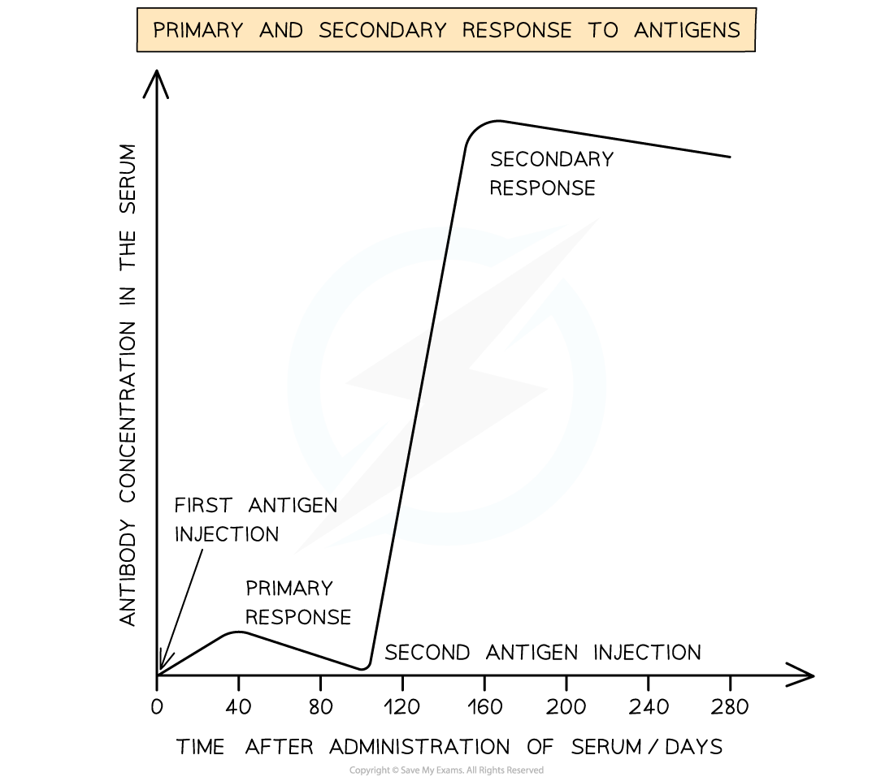

# Types of Immunity

## Types of Immunity

> **Spec point** — `spcpt_YGc7K9c8r6Z86xmJ` · describe the differences between active immunity and passive immunity and between natural immunity and artificial immunity

## Types of immunity

### Active immunity

- **Active immunity** is acquired when an antigen enters the body triggering a specific immune response (**antibodies are produced**)
- Active immunity can be:

  - **Naturally acquired** through exposure to microbes
  - **Artificially acquired **through vaccinations
- The body **produces memory cells**, along with plasma cells, in both types of active immunity

  - This gives the person **long-term immunity**
- In active immunity, during the **primary** response to a pathogen (natural) or to a vaccination (artificial), the antibody concentration in the blood takes **one to two weeks to increase**.
- If the body is invaded by the same pathogen again or by the pathogen that the person was vaccinated against then, during the **secondary response**, the antibody concentration in the blood:

  - Takes a **much shorter period of time** to increase
  - Is **higher** than after the vaccination or first infection

*The primary and secondary response to the same antigen*

### Passive immunity

- Passive immunity is acquired **without an immune response**

  - **Antibodies are not produced **by the infected person
- As the person’s immune system has not been activated, there are **no memory cells **that can produce antibodies in a secondary response

  - If a person is reinfected they would need another infusion of antibodies
- Depending on the disease a person is infected with (e.g., tetanus) they may not have time to actively acquire the immunity (there is no time for active immunity to occur)
- Passive immunity occurs either artificially or naturally

  - **Artificial passive immunity** occurs when:
  
    - People are given an **injection / transfusion** of the antibodies—in the case of tetanus this is an **antitoxin**
    - The antibodies were collected from people whose immune system had been triggered by a vaccination to produce tetanus antibodies
  - **Natural passive immunity** occurs when:
  
    - Foetuses receive antibodies across the **placenta** from their mothers
    - Babies receive the initial breast milk from mothers (the **colostrum**) which delivers a certain type of antibody (IgA)

| **Feature** | **Active** | **Passive** |
|---|---|---|
| Production of antibodies | Produced by the body | Not produced by the body |
| Time before antibodies appear in the blood | 1-2 weeks | Immediate |
| Presence of memory cells | Yes | No |
| Induced naturally by: | Exposure to pathogen | Antibodies received from another organism (e.g. via the placenta during pregnancy) |
| Induced artificially by: | Vaccination | Antibodies are manufactured and injected / infused into the body (e.g. monoclonal antibodies given by injection or infusion) |

> **Exam Hint**
> Active immunity is when the body **produces **the antibodies, whereas in passive immunity the body is **given **the antibodies.
