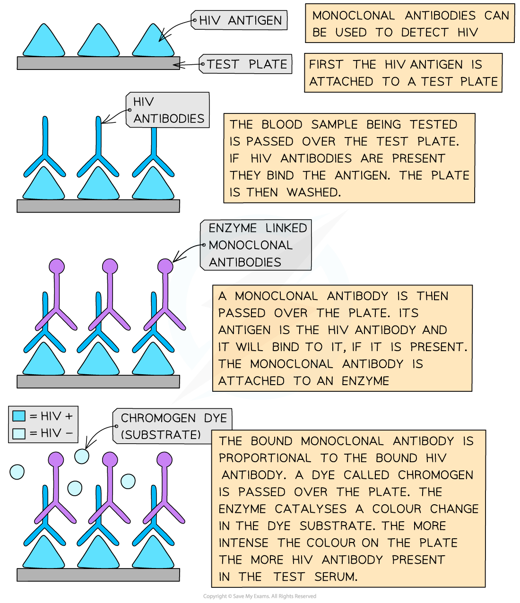

# Uses of Monoclonal Antibodies

## Use of Monoclonal Antibodies

> **Spec point** — `spcpt_NdgGb8HBfY2psGJf` · outline the principles of using monoclonal antibodies in the diagnosis of disease and in the treatment of disease

## Use of monoclonal antibodies

### Diagnostic uses of monoclonal antibodies

- Monoclonal antibodies can be used **diagnostically** for:

  - Diagnosing HIV
  - Detecting the presence of pathogens such as *Streptococcus* bacteria
  - Distinguishing between Herpes I and Herpes II virus
  - Detecting cancer cells
- Monoclonal antibodies can also be used to **locate the position of blood clots** for patients thought to have **deep vein thrombosis**
- This occurs by:

  - Injecting a mouse with human fibrin (the main protein found in blood clots)
  - This activates the plasma cells to produce antibodies against fibrin
  - These cells are collected from the mouse spleen
  - The plasma cells are then fused with tumour cells forming hybridomas that produce antifibrin antibodies
  - To detect where the antibodies are binding to fibrin molecules, a radioactive chemical (producing gamma radiation) is attached to the antibodies making them radioactively labelled
  - A gamma-ray camera is used to detect where these radioactively labelled antibodies have attached to a fibrin molecule, hence indicating where blood clots can be found
- Generally monoclonal antibodies are used only **once**

*Another example of the diagnostic use of monoclonal antibodies—test for HIV*

### Therapeutic uses of monoclonal antibodies

- Therapeutically, monoclonal antibodies have multiple applications to include:

  - Treatment for the **rabies** virus, which can be potentially fatal
  
    - This is done by injecting purified antibodies
  - The **prevention of transplanted organ rejection**
  
    - This is done by intervening with the *T-cells* involved in the rejection process
  - Treatment of **inflammatory conditions** such as allergic asthma (an allergy) and rheumatoid arthritis (an autoimmune disease)
  
    - Monoclonal antibodies are able to bind and deactivate factors involved in the inflammatory response
  - **Treatment for diseases** caused by the overproduction or inappropriate production of *B-cells* (e.g. leukaemia, multiple sclerosis and myasthenia gravis)
  
    - The antibody (rituximab) binds to cell surface receptor proteins on B-cells (not plasma cells) and causes the death of the cells
  - **Prevention of blood clotting** following angioplasty procedures
  
    - Monoclonal antibodies bind to receptors on the platelet surface thereby inhibiting fibrinogen from binding and subsequent clotting from ensuing
  - Targeted treatment of **breast cancer**
  
    - Herceptin is a monoclonal antibody used to treat breast cancer
    - It recognises receptor proteins on the surface of cancer cells and binds to them allowing the immune system to identify and destroy them
  - Treatment of **melanoma** (a type of skin cancer)
  
    - The antibody (ipilimumab) binds to a protein produced by T-cells (whose role is to reduce the immune response)
    - This results in the immune system remaining active against the cancer cells

> **Exam Hint**
> You do not need to know all the details for each example given on this page but you need to know **specific examples** of how monoclonal antibodies can be used as a diagnostic tool and for treatment. You can use a well-annotated diagram to explain how monoclonal antibodies can be used as a diagnostic tool.
