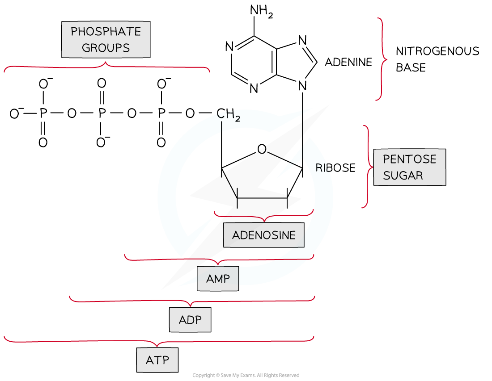
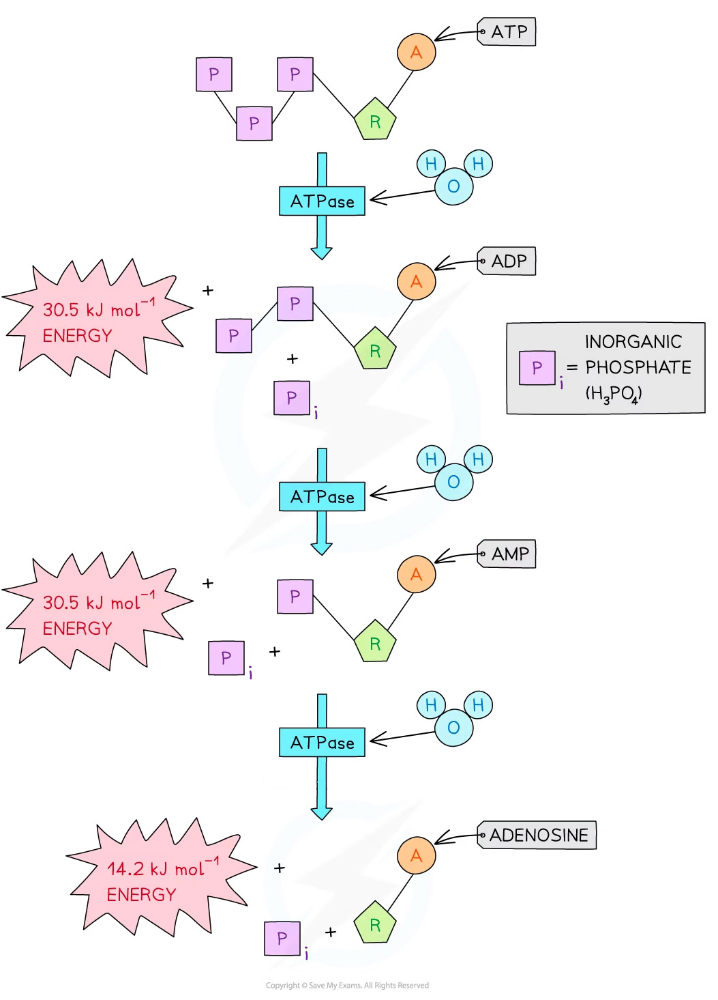
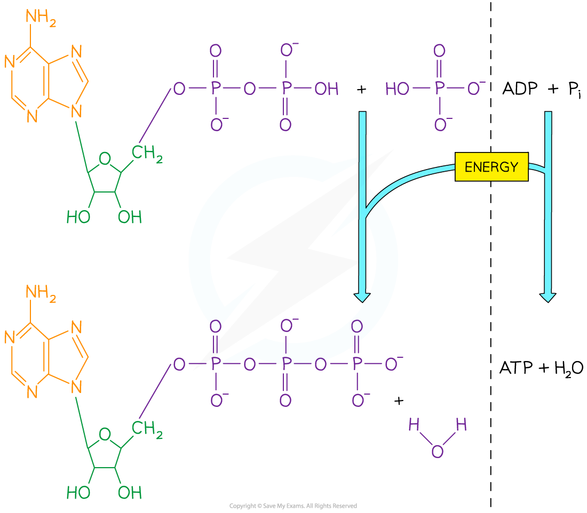

# ATP

## ATP: Universal Energy Currency

> **Spec point** — `spcpt_QtKvS29HtyH9ZM8r` · describe the features of ATP that make it suitable as the universal energy currency

## ATP: universal energy currency

- The energy released during the reactions of respiration is transferred to the molecule **adenosine triphosphate** (ATP)
- ATP is a **small**, **soluble** molecule that provides a **short-term store **of chemical energy that cells can use to do work
- It is vital in linking energy-requiring and energy-yielding reactions
- ATP is described as a **universal energy currency**

  - Universal: it is used in all organisms
  - Currency: like money, it can be used for different purposes (reactions) and is reused countless times
- The use of ATP as an ‘energy-currency’ is beneficial for many reasons:

  - The **hydrolysis** of ATP can be carried out quickly and easily wherever energy is required within the cell by the action of just one enzyme, ATPase
  - A useful (not too small, not too large) quantity of energy is released from the hydrolysis of one ATP molecule—this is beneficial as it reduces waste but also gives the cell control over what processes occur
  - ATP is relatively stable at cellular pH levels

### Structure of ATP

- ATP is a phosphorylated ***nucleotide***
- It is made up of:

  - **Ribose** sugar
  - **Adenine** base
  - Three **phosphate** groups

*ATP contains ribose, adenine and three phosphate groups*

### Hydrolysis of ATP

- When ATP is hydrolysed (broken down), **ADP** and **phosphate** are produced
- As ADP is formed, **free energy** is released that can be used for processes within a cell e.g. DNA synthesis

  - Removal of one phosphate group from ATP releases approximately 30.5 kJ mol -1 of energy, forming ADP
  - Removal of a second phosphate group from ADP also releases approximately 30.5 kJ mol-1 of energy, forming AMP
  - Removal of the third and final phosphate group from AMP releases 14.2 kJ mol-1 of energy, forming adenosine

*The hydrolysis of ATP*

| **Feature** | **Benefit** |
|---|---|
| Releases a small but sufficient amount of energy (30.5 kJ mol-1 when one phosphate is removed to form ADP) | This is enough energy to drive important metabolic reactions while keeping energy wastage low |
| Exists as a stable molecule | It does not break down unless a catalyst (ATPase) is present, so energy will not be wasted |
| Can be recycled | The breakdown of ATP is a reversible reaction; ATP can be reformed from ADP and Pi. This means that the same molecule can be used elsewhere in the cell for different reactions |
| Hydrolysis is quick and easy | Allows cells to respond to a sudden increase in energy demand |
| Soluble and moves easily within a cell | Can transport energy to different areas of the cell |
| Forms phosphorylated intermediates | This can make metabolites more reactive and lower the activation energy required for a reaction |

> **Exam Hint**
> Be careful not to use the terms energy and ATP interchangeably. Energy is the capacity or power to do work. ATP is a molecule which stores (chemical potential) energy and carries it to places in the cell that need energy to do work. For example, it is correct to say that respiration 'produces ATP', but you should *never* say that it 'produces energy'.

## ATP Synthesis

> **Spec point** — `spcpt_MFd3bywP5QPzpFPD` · state that ATP is synthesised by:
• transfer of phosphate in substrate-linked reactions
• chemiosmosis in membranes of mitochondria and chloroplasts

## ATP synthesis

- Organisms **cannot build up large stores of ATP**

  - This means the cells must make ATP as and when they need it
- ATP is formed when ADP is combined with an inorganic phosphate (Pi) group

  - This is an **energy-requiring reaction**
  - **Water is released** as a waste product (therefore ATP synthesis is a condensation reaction)

*ATP is synthesised from ADP and phosphate*

### Types of ATP synthesis

- ATP is made during the reactions of **respiration** and **photosynthesis**

  - All of an animal's ATP comes from respiration
- ATP can be made in two different ways:

  - **Substrate-linked phosphorylation**
  - **Chemiosmosis**

### Substrate-linked phosphorylation

- ATP is formed by **transferring a phosphate directly from a substrate molecule to ADP**

**ADP + P****i**** → ATP**

- The energy required for the reaction is **provided directly by another chemical reaction**
- This type of ATP synthesis occurs in the cell cytoplasm and in the matrix of the mitochondria
- It only accounts for a small amount of the ATP synthesised during [aerobic respiration](https://www.savemyexams.com/a-level/biology/cie/22/revision-notes/12-energy--respiration/12-2-respiration/12-2-2-the-four-stages-in-aerobic-respiration/)

  - ~ 4 / 6 ATP per glucose molecule
- This type of ATP synthesis takes place in [glycolysis](https://www.savemyexams.com/a-level/biology/cie/25/revision-notes/12-energy-and-respiration/12-2-respiration/aerobic-respiration-glycolysis/?_ai=internal-linking) and the Krebs cycle

### Chemiosmosis

- This specific type of ATP synthesis involves a proton (hydrogen ion) gradient across a membrane
- It takes place across the **inner membrane of the mitochondria** and the **[thylakoid membrane of chloroplasts](https://www.savemyexams.com/a-level/biology/cie/25/revision-notes/13-photosynthesis/13-1-photosynthesis-as-an-energy-transfer-process/photophosphorylation/?_ai=internal-linking)**
- An electron transport chain helps to establish the **proton concentration gradient**

  - High-energy electrons move from carrier to carrier releasing energy that is used to pump protons (up a concentration gradient) across the inner membrane into the intermembrane space
  - Protons are pumped from a low concentration in the mitochondrial matrix to a high concentration in the intermembrane space
- The protons then move down the concentration gradient into the matrix which **releases energy**
- The protons move through the **ATP synthase complex** which uses the released energy to **drive the phosphorylation of ATP**
- Oxygen acts as the **final electron and proton acceptor** to form **water**
- Most of the ATP made during respiration is [synthesised via chemiosmosis](https://www.savemyexams.com/a-level/biology/cie/25/revision-notes/12-energy-and-respiration/12-2-respiration/aerobic-respiration-oxidative-phosphorylation/?_ai=internal-linking)

  - ~ 32 / 34 ATP per glucose molecule

|   | Substrate-linked phosphorylation | Chemiosmosis |
|---|---|---|
| Process | The phosphate of a substrate molecule is **transferred directly** to ADP to form ATP.  It uses the energy provided directly by another chemical reaction. | The energy released by the **movement of hydrogen ions** down a concentration gradient is used to synthesise ATP via the enzyme **ATP synthase**. In mitochondria, **oxygen** acts as the final hydrogen/electron acceptor (in chloroplasts, NADP is the final electron acceptor) |
| Location | The cytoplasm of cells / the matrix of mitochondria | Inner mitochondrial membrane / thylakoid membrane of chloroplasts |
| Quantity of ATP produced during respiration | Small (4/6 per glucose molecule respired) | Large (32/34 per glucose molecule respired) |

> **Exam Hint**
> You may be asked to identify which type of ATP synthesis is occurring at different stages of respiration and photosynthesis. Remember that chemiosmosis involves a **proton gradient** that has been created by an **electron transport chain **and it takes place across an **inner membrane**.
