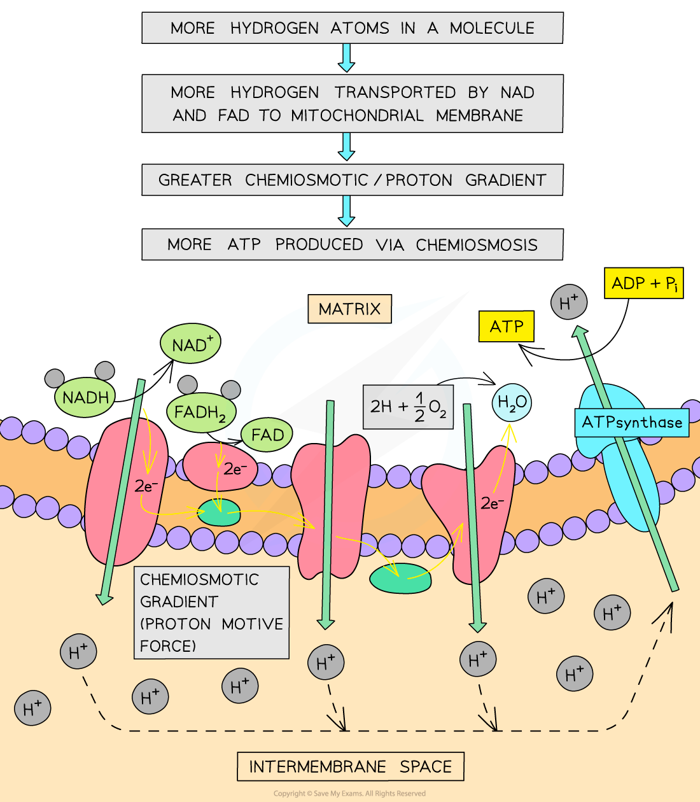
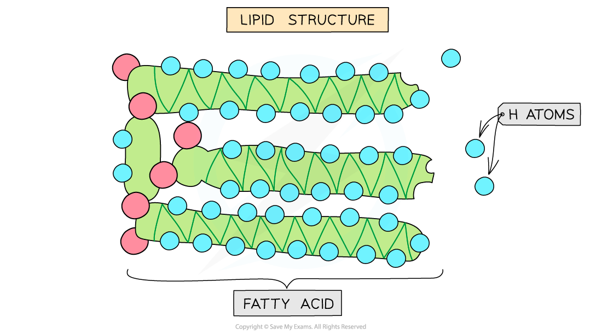

# Energy Values of Respiratory Substrates

## Energy Values of Respiratory Substrates

> **Spec point** — `spcpt_9TMsGzkxfMFbstMd` · explain the relative energy values of carbohydrates, lipids and proteins as respiratory substrates

## Energy values of respiratory substrates

- **Glucose** is the principal respiratory substrate for [aerobic respiration](https://www.savemyexams.com/a-level/biology/cie/22/revision-notes/12-energy--respiration/12-2-respiration/12-2-2-the-four-stages-in-aerobic-respiration/) in most cells
- When the supply of glucose in a cell has been used up, that cell may continue respiration using other substrates
- These may be:

  - Other carbohydrates
  - Lipids
  - Proteins
- Amino acids from proteins are only respired aerobically when all other substrates have been exhausted

  - This is because they often have **essential functions elsewhere** in the cell
  - Amino acids are required to make proteins which have structural (e.g. in the cytoskeleton) and functional (e.g. enzymatic) roles
- When these different substrates are broken down in respiration, they **release different amounts of energy**

| **Respiratory substrate** | **Energy value / kJ g****-1** |
|---|---|
| **Carbohydrate** | 15.8 |
| **Lipid** | 39.4 |
| **Protein** | 17.0 |

### Explaining the differences in energy values

- Lipids have the highest energy value (39.4 kJ g-1) followed by proteins (17.0 kJ g-1) and then carbohydrates (15.8 kJ g-1)
- The differences in the energy values of substrates can be explained by their **molecular composition**

  - Specifically how many **hydrogen atoms** become available when the substrate molecules are broken down
- During respiration, hydrogen atoms play a vital role:

  - The substrate molecules are broken down and the hydrogen atoms become available
  - **Hydrogen carrier molecules** called **[NAD and FAD](https://www.savemyexams.com/a-level/biology/cie/25/revision-notes/12-energy-and-respiration/12-2-respiration/aerobic-respiration-role-of-nad-and-fad/?_ai=internal-linking)** pick them up (become reduced) and transfer them to the inner mitochondrial membrane
  - Reduced NAD and FAD release the hydrogen atoms which split into protons and electrons
  - The protons are pumped across the inner mitochondrial membrane into the intermembrane space - forming a **proton / chemiosmotic gradient**
  - This proton gradient is used in ***chemiosmosis*** to **produce ATP**
  - After the protons have flowed back into the matrix of the mitochondria via ATP synthase, they **combine with electrons and oxygen to form water** (oxygen is the final electron acceptor)
- This means that a molecule with a **higher hydrogen content** will result in a **greater proton gradient** across the mitochondrial membrane which allows for the formation of **more ATP **via chemiosmosis
- Fatty acids in lipids are made up of **long hydrocarbon chains** with a high proportion of hydrogen atoms
- These hydrogen atoms are released when the lipid is broken down

*Substrate molecules with a greater hydrogen content result in a greater energy release through respiration*

*Structure of a lipid (triglyceride)*

> **Exam Hint**
> You may be expected to explain why different respiratory substrates have different energy values. Here’s an example question: *Explain why carbohydrates, lipids and proteins have different relative energy values as substrates in respiration in aerobic conditions. [6 marks]*
> 
> Your answer will need to relate to the differing hydrogen concentrations held within those substrates, and the consequent effect on chemiosmosis and energy release.
