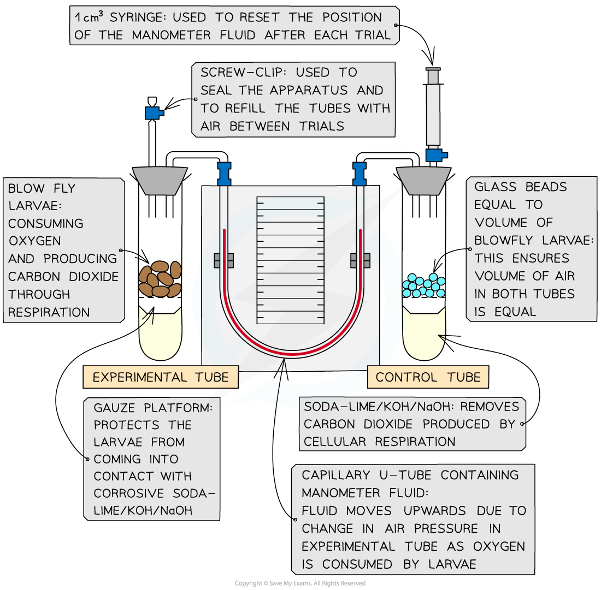
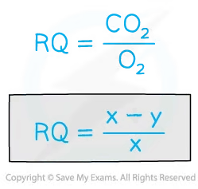

# Investigating RQs

## Investigating RQs

> **Spec point** — `spcpt_qShskGsjbkRgc55F` · describe and carry out investigations, using simple respirometers, to determine the RQ of germinating seeds or small invertebrates (e.g. blowfly larvae)

## Investigating RQs

- **Respirometers** are used to measure and investigate the **rate of oxygen consumption **during respiration in organisms
- They can also be used to calculate respiratory quotients
- The experiments usually involve organisms such as germinating seeds or invertebrates

*The typical set-up of a respirometer*

### The equation for calculating a change in gas volume

- The volume of oxygen consumed (cm3 min-1) can be worked out using:

  - The radius of the capillary tube* r* (cm)
  - And the distance moved by the manometer fluid *h* (cm) in a minute
- Using the formula:

**πr****2****h**

### Using a respirometer to determine the respiratory quotient

#### Method

- Measure oxygen consumption: set up the respirometer and run the experiment with soda-lime present in both tubes. Use the manometer reading to calculate the change in gas volume within a given time, *x *cm3 min-1

  - Always read from the side of the U-tube manometer **closest to the respiring organisms** (the left side as depicted in this diagram)
- Reset the apparatus: allow air to re-enter the tubes via the screw cap and reset the manometer fluid using the syringe
- Run the experiment again: **remove the soda-lime** from both tubes and use the manometer reading to calculate the change in gas volume in a given time, *y* cm3 min-1

#### Calculations

- *x* tells us the volume of oxygen consumed by respiration within a given time
- *y* tells us the volume of oxygen consumed by respiration within a given time **minus** the volume of carbon dioxide produced within a given time

  - *(x - y)* is therefore the volume of CO2 given off by the organisms
  - remembering to read the scale on the side of the U-tube manometer closest to the respiring organisms
- The two measurements *x* and *y* can be used to calculate the RQ

*RQ Equation for Respirometer experiment*

> **Worked Example**
> #### Calculating RQ from a respirometer experiment
> 
> *x* = 2.9 cm3 min-1
> 
> *y* = 0.8 cm3 min-1
> 
> $\frac{x-y}{x}=\mathrm{RQ}$
> 
> $\frac{2.9-0.8}{2.9}=0.724$
> 
> When equal volumes of oxygen are consumed and carbon dioxide produced (as seen with glucose) the manometer fluid will not move and *y* will be 0, making the RQ=1.

#### Analysis

- Respirometers can be used in experiments to investigate how different factors affect the RQ of organisms over time

  - e.g. temperature – using a series of water baths
- When an **RQ value changes** it means **the substrate being respired has changed**
- Some cells may also be **using a mixture of substrates **in respiration e.g. An RQ value of 0.85 suggests **both** carbohydrates and lipids are being used at the same time

  - This is because the RQ of glucose is 1 and the RQ of lipids is 0.7
- Under normal cellular conditions, the order which substrates are used in respiration is: carbohydrates, lipids and proteins
- The RQ can also give an indication of under or overfeeding:

  - An RQ value of more than 1 suggests excessive carbohydrate/calorie intake
  - An RQ value of less than 0.7 suggests underfeeding

> **Exam Hint**
> There are several ways you can manage variables and increase the reliability of results in respirometer experiments:
> 
> - Use a controlled water bath to keep the **temperature** constant
> - Have a control tube with an equal volume of inert material to the volume of the organisms to compensate for changes in atmospheric **pressure**
> - Repeat the experiment multiple times and calculate a **mean**
