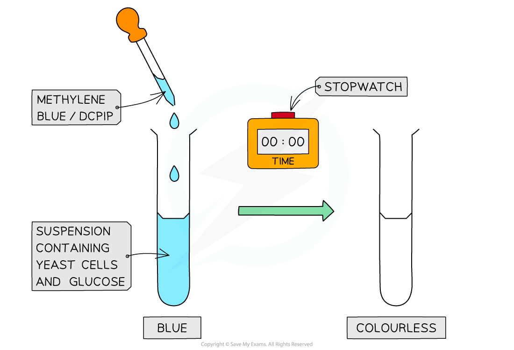
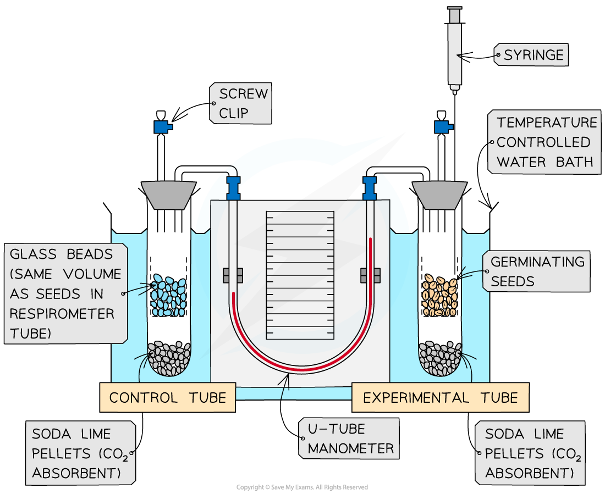

# Aerobic Respiration: Effect of Temperature & Substrate Concentration

## Anaerobic Respiration: Effect of Temperature & Substrate Concentration

> **Spec point** — `spcpt_QJF9zZNFW4V42qyq` · describe and carry out investigations using redox indicators, including DCPIP and methylene blue, to determine the effects of temperature and substrate concentration on the rate of respiration of yeast

## Effect of temperature & substrate concentration

- A **redox indicator** is a substance that changes colour when it is reduced or oxidised
- **DCPIP** and **methylene** blue are redox indicators

  - They are used to investigate the effects of **temperature **and **substrate concentration** on the **rate of respiration **in yeast
- These dyes can be added to a suspension of living **yeast cells** as they don’t damage cells
- Yeast can respire both aerobically and anaerobically, in this experiment it is their rate of anaerobic respiration that is being investigated

### Mechanism

- **Dehydrogenation** happens regularly throughout the different stages of [aerobic respiration](https://www.savemyexams.com/a-level/biology/cie/22/revision-notes/12-energy--respiration/12-2-respiration/12-2-2-the-four-stages-in-aerobic-respiration/)
- The hydrogens that are removed from substrate molecules are transferred to the final stage of aerobic respiration, oxidative phosphorylation, via the hydrogen carriers NAD and FAD
- When DCPIP and methylene blue are present they can also take up hydrogens and get reduced
- Both redox indicators undergo the same colour change when they are reduced

  - **Blue → colourless**
- The faster the rate of respiration, the faster the rate of hydrogen release and the faster the dyes get reduced and become discoloured

  - This means that the **rate of colour change** can correspond to the **rate of respiration** in yeast
- The rate of respiration is inversely proportional to the time taken

*Colour change of DCPIP and Methylene blue*

### Investigating the effect of temperature and substrate concentration on the rate of respiration in yeast

- The effect of temperature can be investigated by adding the test tubes containing the yeast suspension to a** temperature-controlled water bath** and recording the time taken for a colour change to occur once the dye is added

  - Repeat across a range of temperatures. For example, 30oC, 35oC, 40oC, 45oC
- The effect of substrate concentration can be investigated by adding **different concentrations of a substrate** to the suspension of yeast cells and recording the time taken for a colour change to occur once the dye is added

  - For example, 0.1% glucose, 0.5% glucose, 1.0% glucose

### Controlling other variables

- It is important when investigating one variable, to ensure that the other variables in the experiment are being controlled

  - **The volume of dye added**: if there are more dye molecules present then the time taken for the colour change to occur will be longer
  - **Volume of yeast suspension**: when more yeast cells are present, the rate of respiration will be inflated
  - **Type of substrate**: yeast cells will respire different substrates at different rates
  - **Concentration of substrate**: if there is limited substrate in one tube then the respiration of those yeast cells will be limited
  - **Temperature**: an increase or decrease in temperature can affect the rate of respiration due to energy demands and kinetic energy changes
  - The temperature of the dye being added also needs to be considered

> **Exam Hint**
> Although the DCPIP and methylene blue undergo a colour change from blue to colourless, it is important to remember that the **yeast suspension in the test tube may have a slight colour** of its own (usually yellow).
> 
> That means when the dye changes to colourless there may still be an overall yellow colour in the test tube.
> 
> If this is the case it can be useful to have a control tube containing the same yeast suspension but with no dye added, then you can tell when the dye has completely changed colour.

## Effect of Temperature: Respirometer

> **Spec point** — `spcpt_MHG3MGtxbD755jN8` · describe and carry out investigations using simple respirometers to determine the effect of temperature on the rate of respiration

## Effect of temperature: respirometer

- Respirometers are used to measure and investigate the **rate of oxygen consumption **during aerobic respiration in organisms
- By adding the apparatus to a thermostatically controlled **water bath** the **effect of temperature on the rate of respiration** can be investigated
- The experiments usually involve organisms such as germinating seeds or invertebrates

*Respirometer set up with a temperature-controlled water bath*

### Method

- **Measure oxygen consumption**: set up the respirometer and run the experiment with both tubes in a controlled temperature water bath. Use the manometer reading to calculate the change in gas volume within a given time, *x* cm3 min-1
- **Reset the apparatus**: Allow air to reenter the tubes via the screw cap and reset the manometer fluid using the syringe. **Change the temperature of the water bath** and allow the tubes to acclimate, then close the screw clip to begin the experiment
- **Run the experiment again**: use the manometer reading to calculate the change in gas volume in a given time, *y* cm3 min-1
- **Repeat** the experiment several times at different temperatures

### Calculations

- The volume of oxygen consumed (cm3 min-1) can be worked out using the radius of the capillary tube *r* (cm) and the distance moved by the manometer fluid *h* (cm) in a minute using the formula:

**πr****2****h**

### Analysis

- The **rate of oxygen consumption** (cm3 min-1) is often taken as the rate of respiration for organisms
- The different volumes of oxygen consumed obtained for the different temperatures can be presented in table or graph form to show the effects of temperature

*Graph showing the effect of temperature on the rate of respiration*

> **Exam Hint**
> If you think back to learning about proteins and enzymes you will remember that at extremely high temperatures, proteins become **denatured **and are unable to carry out their function. At low temperatures, molecules and enzymes don’t collide very frequently as they don’t have a lot of energy.  This same trend can often be seen in the rate of respiration as the reactions rely on enzymes.
> 
> The respirometer set up above is for measuring the rate of **aerobic** respiration. It cannot be used to measure the rate of anaerobic respiration as no oxygen is consumed during anaerobic respiration, as shown by the different equations for aerobic and anaerobic respiration. Aerobic respiration:
> 
> **Glucose + Oxygen →  Water + Carbon Dioxide (+ energy)**
> 
> Anaerobic respiration (in mammals)
> 
> **Glucose → Lactic acid (+ energy)**
