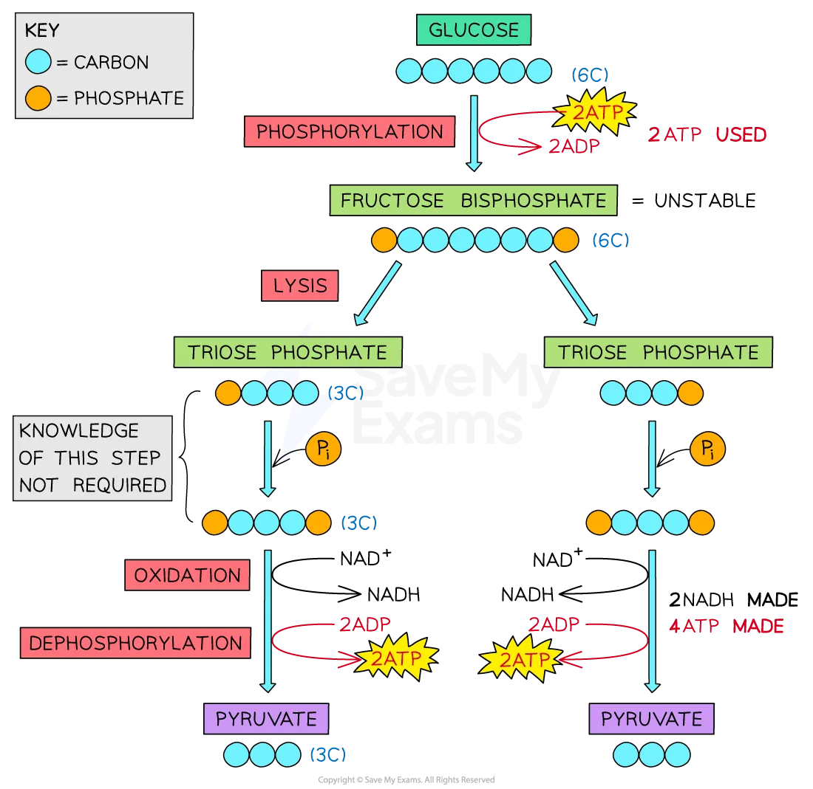

# Aerobic Respiration: Glycolysis

## Aerobic Respiration: Glycolysis

> **Spec point** — `spcpt_SDsdBSFtnztJ8gbX` · explain that, when oxygen is available, pyruvate enters mitochondria to take part in the link reaction

## Aerobic respiration: glycolysis

- Glycolysis is the first stage of respiration
- It takes place in the cytoplasm of the cell and involves:

  - **Trapping glucose** in the cell by phosphorylating the molecule
  - **Splitting the glucose molecule into two**
- It results in the production of

  - 2 **pyruvate** (3C) molecules
  - Net gain 2 **ATP**
  - 2 **reduced** *NAD*

### Steps of glycolysis

- **Phosphorylation**: glucose (6C) is **phosphorylated** by 2 ATP to form fructose bisphosphate (6C)

**Glucose + 2ATP → Fructose bisphosphate**

- **Lysis**: fructose bisphosphate (6C) **splits** into two molecules of triose phosphate (3C)

**Fructose bisphosphate → 2 Triose phosphate**

- **Oxidation**: hydrogen is removed from each molecule of triose phosphate and transferred to coenzyme NAD to form 2 reduced NAD (sometimes called NADH)

**4H + 2NAD → 2NADH + 2H****+**

- **Dephosphorylation: **phosphates are transferred from the intermediate substrate molecules to form 4 ATP through **substrate-linked phosphorylation**

**4P****i ****+ 4ADP → 4ATP**

- **Pyruvate is produced**: the end product of glycolysis which can be used in the next stage of respiration

**2 triose phosphate → 2 pyruvate**

*The process of glycolysis*

> **Exam Hint**
> It may seem strange that ATP is **used** and also **produced** during glycolysis. At the start ATP is used to **make glucose more reactive** (it is usually very stable) and to lower the activation energy of the reaction. Since 2 ATP are used and 4 are produced during the process, there is a **net gain of 2 ATP per glucose molecule.**
