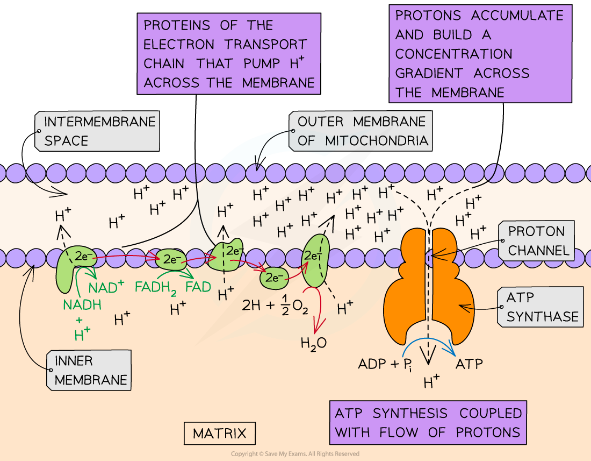

# Aerobic Respiration: Oxidative Phosphorylation

## Aerobic Respiration: Oxidative Phosphorylation

> **Spec point** — `spcpt_jfF8SCYQnnNqzhYK` · explain that during oxidative phosphorylation:
• hydrogen atoms split into protons and energetic electrons
• energetic electrons release energy as they pass through the electron transport chain 
• the released energy is used to transfer protons across the inner mitochondrial membrane
• protons return to the mitochondrial matrix by facilitated diffusion through ATP synthase, providing energy for ATP synthesis
• oxygen acts as the final electron acceptor to form water
 describe the relationship between the structure and function of mitochondria using diagrams and electron micrographs

## Oxidative phosphorylation

- **Oxidative phosphorylation** is the last stage of aerobic respiration
- It takes place at the inner membrane of the mitochondria
- Several steps occur:

  - Hydrogen atoms are donated by [reduced NAD and FAD](https://www.savemyexams.com/a-level/biology/cie/25/revision-notes/12-energy-and-respiration/12-2-respiration/aerobic-respiration-role-of-nad-and-fad/?_ai=internal-linking)
  - Hydrogen atoms **split into protons and electrons**
  - The high-energy electrons release energy as they move through the **electron transport chain**
  - The released energy is used to **transport protons** across the inner mitochondrial membrane from the matrix **into the intermembrane space**
  - A **concentration gradient** of protons is established between the intermembrane space and the matrix
  - The protons return to the matrix via [facilitated diffusion](https://www.savemyexams.com/a-level/biology/cie/25/revision-notes/4-cell-membranes-and-transport/4-2-movement-into-and-out-of-cells/diffusion/) through the channel protein ATP synthase
  - The movement of protons down their concentration gradient provides energy for **ATP synthesis**
  - **Oxygen** combines with protons and electrons at the end of the electron transport chain to form water

### Electron transport chain

- The electron transport chain is made up of a series of membrane proteins/electron carriers
- They are positioned close together which allows the electrons to pass from carrier to carrier
- The inner membrane of the mitochondria is impermeable to hydrogen ions so these electron carriers are required to **pump the protons across the membrane** to establish the concentration gradient

*Oxidative phosphorylation at the inner membrane of the mitochondrion*

> **Exam Hint**
> Examiners often ask why oxygen is so important for aerobic respiration. Oxygen acts as the **final electron acceptor. **Without oxygen the electron transport chain cannot continue as the electrons have nowhere to go. Without oxygen accepting the electrons (and hydrogens) the reduced coenzymes NADH and FADH2 cannot be oxidised to regenerate NAD and FAD, so they can’t be used in further hydrogen transport.
