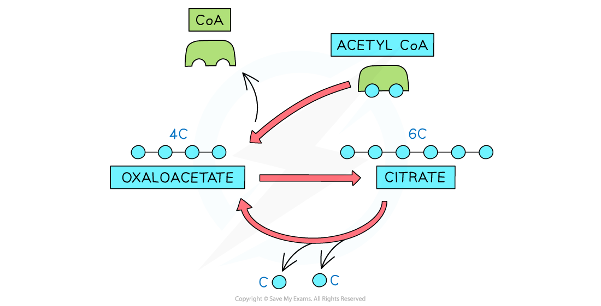
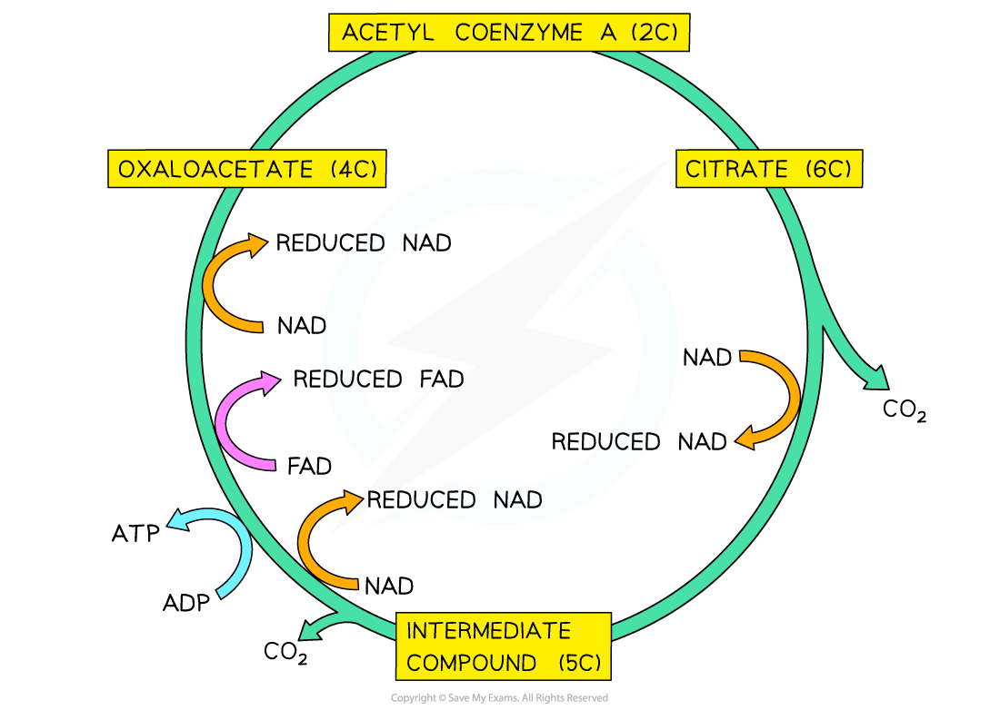

# Aerobic Respiration: The Krebs Cycle

## Aerobic Respiration: Outline of the Krebs Cycle

> **Spec point** — `spcpt_ZFt7jdK42WTmxv24` · outline the Krebs cycle, explaining that oxaloacetate (C) acts as an acceptor of the C fragment from acetyl coenzyme A to form citrate (C), which is converted back to oxaloacetate in a series of small steps
 explain that reactions in the Krebs cycle involve decarboxylation and dehydrogenation and the reduction of the coenzymes NAD and FAD

## Aerobic respiration: outline of the Krebs cycle

- The Krebs cycle (sometimes called the citric acid cycle) consists of a **series of enzyme-controlled reactions**
- **Acetyl CoA (2C) enters** the circular pathway via the **link reaction**
- 4 carbon (4C) oxaloacetate accepts the 2C acetyl fragment from acetyl CoA to form citrate (6C)
- **Citrate is then converted back to oxaloacetate** through a series of small reactions

*The regeneration of oxaloacetate*

## Aerobic Respiration: The Krebs Cycle

> **Spec point** — `spcpt_j2PcXqHpzmnrV2bN`

## Aerobic respiration: the Krebs cycle

### Steps in the Krebs cycle

- **Oxaloacetate is regenerated** in the Krebs cycle through a series of reactions
- Decarboxylation of citrate

  - Releasing **2 CO****2** as waste gas
- Dehydrogenation of citrate

  - Releasing H atoms that [reduce coenzymes NAD and FAD](https://www.savemyexams.com/a-level/biology/cie/25/revision-notes/12-energy-and-respiration/12-2-respiration/aerobic-respiration-role-of-nad-and-fad/?_ai=internal-linking)
  - 8H + 3NAD + FAD → **3NADH + 3H****+**** + FADH****2**
- Substrate-level phosphorylation

  - A phosphate group is transferred from one of the intermediates to ADP, forming **1 ATP**

*The Krebs cycle*

> **Exam Hint**
> It is a good idea to learn the Krebs cycle in detail. You may be asked to name the important molecules in the Krebs cycle like oxaloacetate. It is also worth noting how the **number of carbon atoms** in the substrate molecule changes as the cycle progresses.
