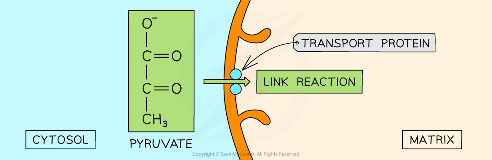
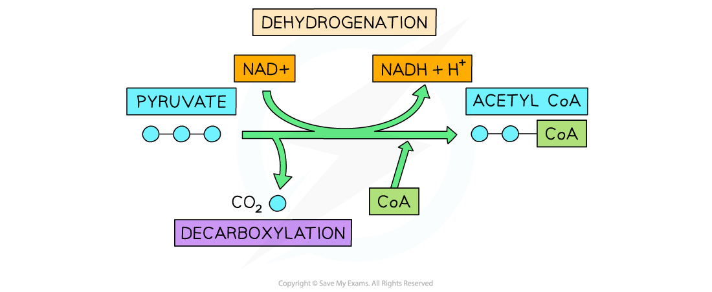

# Aerobic Respiration: The Link Reaction

## Aerobic Respiration: Entering the Link Reaction

> **Spec point** — `spcpt_GY2xYD4s2tpXQnHs` · describe the link reaction, including the role of coenzyme A in the transfer of acetyl (C) groups

## Aerobic respiration: entering the link reaction

- The [end product of glycolysis](https://www.savemyexams.com/a-level/biology/cie/25/revision-notes/12-energy-and-respiration/12-2-respiration/aerobic-respiration-glycolysis/?_ai=internal-linking) is **pyruvate**
- Pyruvate contains a substantial amount of chemical energy that can be further utilised in respiration to produce more ATP
- When **oxygen is available** pyruvate will **enter the mitochondrial *****matrix*** and [aerobic respiration](https://www.savemyexams.com/a-level/biology/cie/22/revision-notes/12-energy--respiration/12-2-respiration/12-2-2-the-four-stages-in-aerobic-respiration/) will continue
- It moves across the double membrane of the mitochondria via **active transport**

  - It requires a transport protein and a small amount of ATP
- Once in the mitochondrial matrix **pyruvate** takes part in the **link reaction**

*Pyruvate moving across the mitochondrial double membrane*

## Aerobic Respiration: Link Reaction

> **Spec point** — `spcpt_Sp5mpCqtRHXWgnPr`

## Aerobic respiration: link reaction

- The link reaction is so-called because it **links** **glycolysis** to the **Krebs cycle**
- The steps are:

1. *Decarboxylation* and *dehydrogenation* of pyruvate by enzymes to produce an **acetyl group, CH****3****C(O)-**

2. **Combination with coenzyme A **to form **acetyl CoA**

- It produces:

  - Acetyl CoA
  - Carbon dioxide (CO2)
  - Reduced NAD (NADH)

pyruvate + NAD + CoA → acetyl CoA + carbon dioxide + reduced NAD

*The link reaction*

### Role of coenzyme A

- A coenzyme is a molecule that **helps an enzyme carry out its function** but is **not used in the reaction itself**
- Coenzyme A consists of a **nucleoside** (ribose and adenine) and a **vitamin**
- In the link reaction, CoA binds to the remainder of the pyruvate molecule (acetyl group 2C) to form **acetyl CoA**
- It then **supplies the acetyl group to the Krebs cycle** where it is used to continue aerobic respiration
- This is the stage that brings part of the carbohydrate (or lipid/amino acid) into the further stages of respiration and **links** the initial stage of respiration in the cytoplasm to the later stages in the mitochondria

> **Exam Hint**
> Remember that there are two pyruvate molecules produced per glucose molecule so you need to **multiply everything by 2** when thinking about what happens to a single glucose molecule in aerobic respiration.
