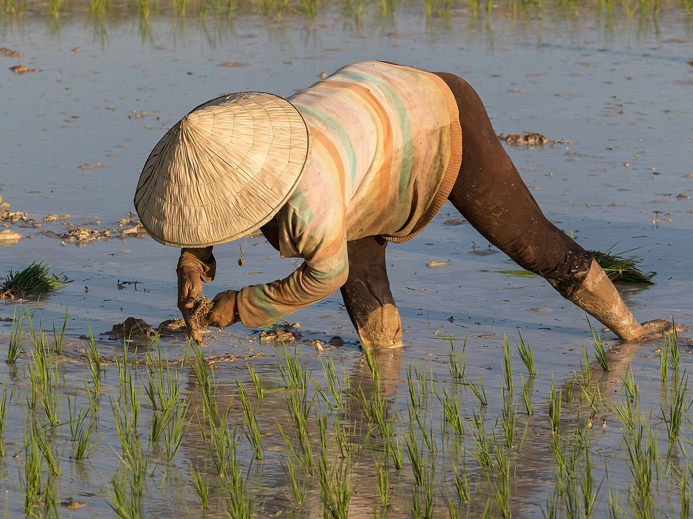
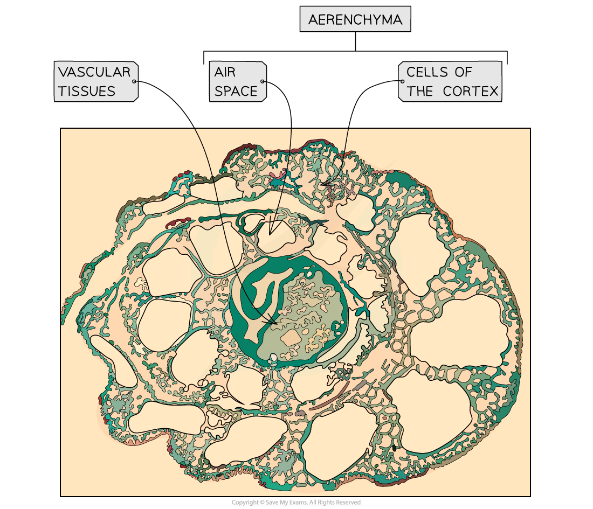

# Anaerobic Adaptation of Rice

## Anaerobic Adaptations of Rice

> **Spec point** — `spcpt_HFtBTHbD2vkBW4Kv` · explain how rice is adapted to grow with its roots submerged in water, limited to the development of aerenchyma in roots, ethanol fermentation in roots and faster growth of stems

## Anaerobic adaptations of rice

- Flooding is a major problem when growing crops
- As the water rises and covers the different parts of a plant it can create problems:

  - Plant roots don’t get the **oxygen** they need for [aerobic respiration](https://www.savemyexams.com/a-level/biology/cie/22/revision-notes/12-energy--respiration/12-2-respiration/12-2-2-the-four-stages-in-aerobic-respiration/)
  - Plant leaves don’t get the **carbon dioxide** they need for photosynthesis
- These gases are **less readily available in water** as they diffuse more slowly in liquid compared to air
- Rice plants possess **several adaptations** that enable them to survive and grow in waterlogged conditions

*Rice being planted in a waterlogged paddy field in Laos (Basile Morin, CC BY-SA 4.0, via Wikimedia Commons)*

### Adaptations for aerobic respiration

- Some types of rice show an** increased rate of upward growth** away from the waterline

  - The leaves always remain above water so there is **access to oxygen and carbon dioxide through the stomata**
- Rice plants possess **aerenchyma** tissue in the stems and roots

  - This specialised plant tissue contains useful air spaces that allow **gases that enter the stomata to diffuse** to other parts of the plant that are above and under the water
  - Oxygen and carbon dioxide can therefore be held in this tissue even when underwater and can be transferred from parts of the plant that have access to air

### Adaptations for anaerobic respiration

- When there isn’t enough energy being supplied to the cells by aerobic respiration, plants resort to anaerobic respiration as a source of ATP
- Plants use **ethanol fermentation** during anaerobic respiration

  - Toxic ethanol is produced which can build up in the plant tissue causing damage
- Rice plants can **tolerate higher levels of toxic ethanol **compared to other plants
- They also **produce more ethanol dehydrogenase**

  - This is the enzyme that breaks down ethanol
- The resilience that rice plants have towards ethanol allows them to carry out anaerobic respiration for **longer** so enough ATP is produced for the plant to survive and actively grow

*Aerenchyma tissue in rice plants*

> **Exam Hint**
> You might be wondering why farmers would grow rice in paddies (intentionally flooded fields). Growing rice in these conditions actually increases the yield. The plants or weeds that would usually be competitors for nutrients and light are unable to survive in these conditions and so the rice has more resources for its growth. Farmers are effectively removing selection pressures from the growing areas by flooding them.
